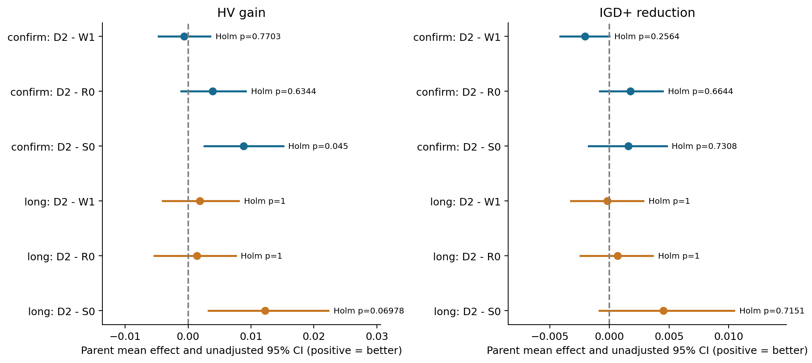
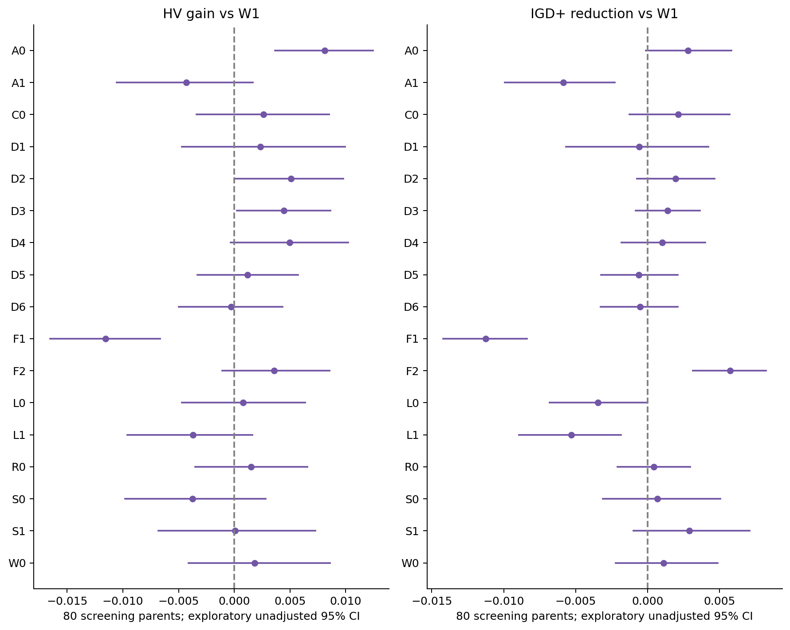
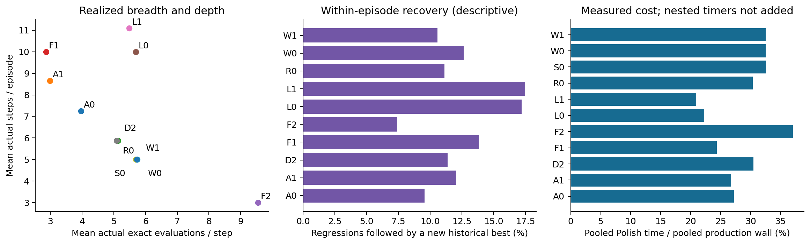

# 辅助轨迹、距离预算与宽深分配：三阶段完整结果

## Material Passport

- Origin Skill: academic-research-suite / experiment-agent
- Origin Mode: validate
- Origin Date: 2026-10-19
- Verification Status: VERIFIED（完整性、指标与统计复算；没有重新运行9600次优化）
- Version Label: aux-walk-results-v1

## 结论

**本批尚不支持将距离控制器替换固定 WALK_BEST。** 预注册筛选选出的 D2，在160个全新父实例和另80个长预算父实例上，均未确认优于固定 W1 或匹配随机 R0。常规确认中 D2 对严格 S0 的 HV 有小幅优势，但 IGD+ 未通过；长预算中对 S0 的 HV 也没有通过六项联合校正。因此，不能把相对严格规则的局部收益解释成距离信息有效，也不能宣布距离方法与对照等价。

更明确的筛选证据是宽深分配：窄深 F1（3×10）的 HV、IGD+ 都较 W1 退步，宽浅 F2（10×3）的 IGD+ 改善。纯提前停止 A0 的 HV 有正向筛选信号。这两者尚未经过本批独立确认，不能事后替换 D2 并称为留出验证成功。增加轨迹额度 C60 没有表现出整体优势。

## 计算与验收范围

正式 T0 为北京时间2026-10-16 06:07:18；两节点最后退出时间为10月18日11:13:28，约53.103小时，早于72小时截止。筛选5760/5760、常规确认2560/2560、长预算1280/1280，合计9600次；独立父实例分别80、160、80，总320，派生输入640。20/50/100/200任务、五拓扑、四成对压力、两版本与两seed均完整。每父全部版本、seed、方法在同一实际host；9600次不是9600个独立样本。

当前两容器实际身份20005/61cdebbc4dba、20007/bad114e22e60；本批 worker/supervisor 均已退出，exit均为complete，无failure/stop，oom/oom_kill均为0。到期仍为10月22日21:31:57/27。本次没有连接旧身份、删除原始文件、启动下一批或修改正在运行的其他服务器实验。

完整48000结果文件、5150807401字节，经服务器与本地逐size/SHA256重新核对。冻结source、plan、640输入、9600实际spec/config、初始化指纹、host、Q42×8及选择/访问/更新计数均通过。原worker对5903619个最终种群/Archive成员独立exact复验的证据，由完整产物SHA绑定；本轮另按事前固定的词典序首个S0、三阶段×四规模×两host抽查24run的48成员，fresh exact通过、目标最大绝对差0。这个抽查不替代全部成员重评。

原源码为 `867c95e866b13fa3459451eb54713292b112ee03`，canonical为 `9a56d536978a9f6b5b62fa31f4b9b49c084725ac7030c36596b6a47b545317ba`；plan SHA为 `0e243e3dd4e22641e4fea2f76c7db19d8df711d5272247b6a83bded517a9fc05`。原运行源与默认算法保持不变。本批共同背景使用研究源的A3电价排序、原混合P100和在线Q42/原reward；S0是这一共同背景下的严格规则对照，不能直接当作其他源码或初始化配置的复现。

本地回收器曾有4次连接/超时中断记录，最终全部恢复，没有因此重跑算法；旧回收器退出及早期传输历史保留。早期control快照存在空的未到达文件占位，本轮以完整新捕获的control为准，未将占位selection/stop当作真实状态。

## 本次实际试了什么

| 组别 | 机制 |
| --- | --- |
| S0/S1/W0/W1 | 严格/允许退步 × 返回最后/历史最好；6次×5步、C30 |
| F1/F2 | 固定3次×10步 / 10次×3步，均C30 |
| D1/D2/D4 | 分配、顺序、时序距离的均值 / 最大分量 / 按上一步动作选距离 |
| D3/D5/D6 | 净位移/路径长度效率 / 一步窗口 / 反向预算映射 |
| R0 | 与选中控制器匹配3/6/10请求边际频率及AID属性的随机预算 |
| C0 | D2最多5步，C30 |
| L0/L1 | 固定6最多10步 / D2最多20步，均C60 |
| A0/A1 | 固定10+AID / D2+AID，均C30、最多10步 |

除S0/S1/W0外均返回历史最好。固定6/5只用于相应对照，深度、广度和额度在本批均已实际变化。每个候选调用同源、无调用内候选链；可行候选全部尝试归档，最终历史集合按统一更新后的ideal重评分，随后一次Polish。Q状态来自实际探索位置，正常在线学习、末步terminal。

这些是两篇论文启发下、针对本项目表示与在线Q的适配对照，不是原论文算法复现。本批采用冻结的合成实例与profile，不据此声称在实测LLM集群功率或生产负载上验证有效。

## D2怎么算距离、怎么分预算

分配距离是2N个operation的MS变化比例；顺序距离将OS还原为唯一P/D operation序列，计算归一化Kendall逆序数，分母排除同job固定P→D的N对；时序距离为每个开始时间差除以该operation固定时长、截断到1后取均值。A7/A8的纯时序变化因此不会被判为零移动。

D2读取本轨迹最近最多两步的端点，取三个分量的最大值：$d_t=\max\{d_{MS},d_{OS},d_S\}$。首步请求6；后续距离不大于0.025时请求3，在0.025到0.0595间请求6，大于0.0595时请求10。每次请求再截断到剩余C30实际exact额度，最多10步。距离来自已完成位置，没有读取本步未来候选。

阈值来自独立32次W1校准，在正式T0前冻结。D6复用D2阈值，仅反转3/10映射。筛选仅允许D1–D6/A1七个C30距离候选，按80父实例HV/IGD+序位和选择；D2总序位405，D3为429，其余更高。独立重算与原选择完全一致，选择依据摘要SHA也一致。D2是这七组中的预注册筛选选择，**不是18组全局最优的证明**。

R0首步同样6，随后3/6/10概率分别0.4112732543、0.3085358931、0.2801908526，来自D2筛选期非首步、剩余额度至少10时的请求频数210838/158170/143639。匹配边际频率不保证每条轨迹成本和序列相同；它检验的是使用距离安排预算，是否优于不看距离的同类随机分配。

## 统计口径

每个输入将本阶段所有方法和seed的最终Archive组成共同经验非支配前沿，共同min/range归一化，HV参考(1.1,1.1)，IGD+使用同一经验前沿。这不是已知真实Pareto前沿；不同阶段的HV绝对值不可据此比较“多跑时间提高多少”。

父内平均两压力版本和两seed，再四规模等权聚合。采用20000次按规模分层cluster bootstrap、100000次双侧配对sign-flip，seed2026101603。符号统一：HV为处理减对照，IGD+为对照减处理，正数代表改善。95%CI未经多重校正，与双侧sign-flip检验并非同一种构造，不应据CI单独判胜。

预注册家族为筛选34项探索检验、常规确认6项、长预算确认6项，分别Holm校正。46项统计、三个家族已用另一个计算路径完整复算；9600个HV与640个IGD+有独立实现交叉验证。补充的38项机制锚点比较使用另一个整体Holm家族及seed2026101901，明确标记为事后处理的探索分析，不提升为新的预注册确认。

## 两个独立确认集

| 阶段 | 比较 | HV增量 | HV Holm p | IGD+改善 | IGD+ Holm p |
| --- | --- | ---: | ---: | ---: | ---: |
| 常规，160父 | D2−W1 | −0.000623 | 0.770292 | −0.002065 | 0.256397 |
| 常规，160父 | D2−R0 | +0.003896 | 0.634434 | +0.001766 | 0.664403 |
| 常规，160父 | D2−S0 | +0.008844 | 0.045000 | +0.001572 | 0.730833 |
| 长预算，80父 | D2−W1 | +0.001867 | 1.000000 | −0.000199 | 1.000000 |
| 长预算，80父 | D2−R0 | +0.001406 | 1.000000 | +0.000667 | 1.000000 |
| 长预算，80父 | D2−S0 | +0.012216 | 0.069779 | +0.004516 | 0.715093 |

常规D2−S0的HV未校正95%CI为[0.002584,0.015101]，99/160父正；配对相对HV平均+1.175%，仅为描述性尺度，不能把normalized HV增量0.008844写成0.8844%的相对增益。长预算对应CI[0.003245,0.022301]，但六项Holm p=0.069779，不称已确认优势。D2−W1常规HV为75胜/85负，长预算45胜/35负；对R0分别80/80、44/36，缺乏稳定的距离信息优势。

四规模、五拓扑、四压力和host分层结果全部导出，属于描述性异质性分析；没有看哪一层显著后重定义主样本。例如常规D2−W1的HV，在20/50/100/200任务的均值为+0.000986/−0.000923/−0.003861/+0.001307，无法概括为规模越大越有效。`size_heterogeneity`图给出两阶段全部规模结果。

## 接受与返回机制：没有证据支持原先对WALK_BEST的强偏好

筛选W0−S0的HV/IGD+改善为+0.005592/+0.000456，W1−S1为−0.000083/−0.002900，W1−W0为−0.001830/−0.001125，S1−S0为+0.003846/+0.002230；补充38项家族均未确认这些差异。不能说允许退步或保留历史最好已独立验证有效，也不能因W0均值略好就宣布应删除保优。

固定W1−S0的HV在筛选/常规/长预算分别+0.003762/+0.009467/+0.010348，但IGD+与校正结果没有共同支持整体优势。常规与长预算的W1−S0是补充探索比较，不冒充D2的六项主确认之一。历史保优仍有同一比较上下文下的输出保护语义；这种局部保证不等于整程Pareto质量保证，因为后续Q、算子、Polish、替换与随机流路径都会变化。

## 宽深、额度与AID：本轮更有信息的结果

| 筛选比较 | HV增量 / Holm p | IGD+改善 / Holm p | 含义 |
| --- | --- | --- | --- |
| F1−W1 | −0.011555 / 0.002880 | −0.011241 / 0.000340 | 窄深在本批筛选中较差 |
| F2−W1 | +0.003559 / 1.000000 | +0.005752 / 0.001320 | 宽浅改善IGD+，HV未确认 |
| A0−W1 | +0.008098 / 0.043400 | +0.002818 / 1.000000 | 纯AID有HV筛选信号，不能称全面改善 |
| L0−W1 | +0.000792 / 1.000000 | −0.003459 / 1.000000 | C60固定深度增加未见整体优势 |
| L1−W1 | −0.003693 / 1.000000 | −0.005285 / 0.239248 | C60距离方案未见整体优势 |

以上均为原34项探索家族；完整17个对W1比较保存在analysis.json，没有只保留正结果。A1−W1的IGD+为−0.005865，Holm p=0.054599，也不改写为已确认退步。补充探索家族中，L1−D2的IGD+退步−0.007231（p=0.028380），A1−D2退步−0.007810（p=0.001110），A1−A0的HV与IGD+均较差（p=0.039360/0.005440）。这些说明“距离、更多深度、提前停止可以直接叠加收益”没有得到本批支持，仍须独立确认。

实际平均深度：W1为5，F1为10，F2为3；D2筛选/常规/长预算为5.88/5.96/5.97，L1筛选为11.09，A0/A1为7.25/8.66。筛选每步实际评价量W1/F1/F2/D2约5.73/2.86/9.55/5.13。深广确实变了，不是只换组名。

筛选W1平均完成2119.6个offspring，F1仅1427.9，F2为2504.7；L0仅1320.9，L1相对D2由1898.3降到1245.6。更多步数会减少等总时间中的其他探索机会，不能把一条轨迹回收率升高当成整程收益。此处属于成本关联描述，不证明某单个计时项造成全部质量差异。

## 退步回收、回访与成本

按每条轨迹最终统一标量上下文回看，筛选W1约10.59%、D2约11.38%的退步事件，能在轨迹结束前发现新的历史最好；L0/L1约17.22%/17.49%。长预算D2约7.43%。分母是退步事件，一条轨迹可能贡献多次，不是独立父样本；未回收包含轨迹结束造成的右删失。回到退步前的位置水平，与刷新历史最好，是两个不同口径，原始计数和按步回收分布均保留。严格组在最终上下文回看可能有极少回溯退步，它不表示线上严格接受规则实际接受了退步。

W1/D2筛选的移动后物理回访约占总步数10.30%/10.79%；计数基于MS+完整开始时间，原地停留另列。更长轨迹带来更多回收，也带来更多回访和更少offspring，不能单看某一个机制数字判断质量。

Polish在W1/D2常规确认中按逐run比例平均占生产wall约22.75%/21.19%；筛选把全部运行wall汇总加权后，W1/D2约32.6%/30.7%。两种权重不同，不能混用。exact/Archive/Polish计时有嵌套，**没有把这些计时直接相加当总耗时**。距离预算本身平均每run仅约0.49/0.53秒，历史处理约1.78/1.57秒；当前没有证据支持优先用复杂状态或控制器优化这部分小开销。

相同的是名义端到端wall预算；停止检查发生在offspring边界，实际会超时。D2平均超时筛选/常规/长预算为4.09/4.70/4.99秒，最大单次全批186.009秒；并非严格相同实际秒数。常规D2与W1平均生产wall为1129.70/1128.94秒。初始化、生成、SSGS、exact、Archive/Q、历史、距离和Polish均计入生产时间，最终独立审计/导出另报且计入三天运维窗口。

`last_best_gap`保留原始局部标量口径；某些run因局部归一化分母接近下限产生很大的数值，跨run平均不稳健。本报告不据该均值比较算法，也不把它当Flow或Bill差距。实际质量比较始终采用共同输入级目标归一化，与该轨迹诊断分开。

另发现资源计时限制：`ru_maxrss`原记录最大0.542GiB，但它可保留子进程exec前的历史峰，不能作为设置256MiB地址空间上限后的独占RSS。单独小探针中，64MiB地址空间上限下记录ru_maxrss109940KiB，而当前VmHWM仅11168KiB，复现了该差异。本批无OOM、实际地址空间限制代码与配置保持；未来若研究内存峰值，应新增exec后VmHWM采样，不能直接沿用此字段当独占峰值。本探针没有运行solver或启动科学实验。

## Anytime与解释边界

全部实测snapshot已经导出。记录的是初始化以及首次跨过预算比例阈值后的完整offspring边界，保存实际elapsed；不是恰好在10%/25%等时刻的精确状态，也没有作可行解插值。早期Archive点可能超出最终前沿的归一化范围，因此anytime采用覆盖全部中间及最终点的独立共同范围，不能与终点HV数值直接拼接。

`anytime_fixed_cases`预先按case ID词典序各取一例、展示S0/W1/D2/R0，包含实际时间坐标，仅用于说明轨迹，不是挑选成功案例或全体anytime优势的检验。固定case列表随图保存；全体snapshot CSV供完整再分析。本报告不据单例曲线声称整体anytime优势。

## 本轮后的研究取舍

1. 保持当前默认算法；D2、WALK_BEST均没有达到全面、稳定的独立质量优势证据。
2. 后续若继续，应优先用新父实例少量确认F2宽浅与A0纯AID，并保留W1和S0；它们有筛选信号，不能只研究筛选中的距离胜者。
3. 距离方案下一步先检验“距离是否能在留出数据上预测追加评价的边际收益”。运动幅度不是收益，当前D2对匹配随机未胜；仅换距离公式、继续增加C60或加深缺乏本批支持。
4. 先做同源候选质量与真实成本、Polish投入的拆分，再决定是否改奖励或状态。原reward对探索位置改善计分，与最终历史最好目标可能错位，但本批没有测试新奖励，不能拿负结果归因于奖励。

这些是待研究建议，本轮没有启动新实验或自动延长窗口，也没有把筛选候选晋级默认。

## 11项统计误用检查

全部11/11已检查：分层异质性已完整导出，未作普遍尺度外推；独立单位为父实例，不作生态推断；640输入来自冻结网格，合成实例外推边界保留；没有按预算消耗或成功与否筛选主样本；回收率同时给分母；筛选与两个独立确认严格分开以控制均值回归；9600无缺失，不仅保留成功子集；完整34/6/6与补充38项校正抑制多重搜索；阈值和筛选规则冻结，补充分析明确探索性；距离、回收率与收益的关联没有改写成机制因果；距离只读过去状态，不使用未来目标改善作在线预算输入。未显著不等价，两个组显著性一有一无不证明交互差异。

## 数据与复现

完整结果、输入/spec/心跳/控制日志、服务器manifest和原source通过独立Release交付；本地正式raw和服务器本批原件保留。逐输入参考、全体run/父指标、38探索比较、成本、完整anytime、48成员fresh exact及统计验真回执见分析包。复现命令和恢复布局见 [REPRODUCTION.md](REPRODUCTION.md)。工程/CI/发布验收在交付回执中单独记录，不能替代上述科学证据。
