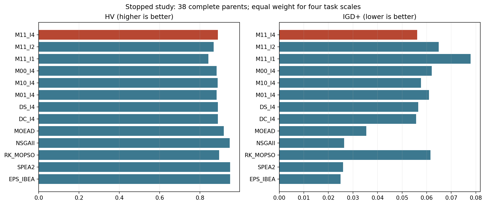
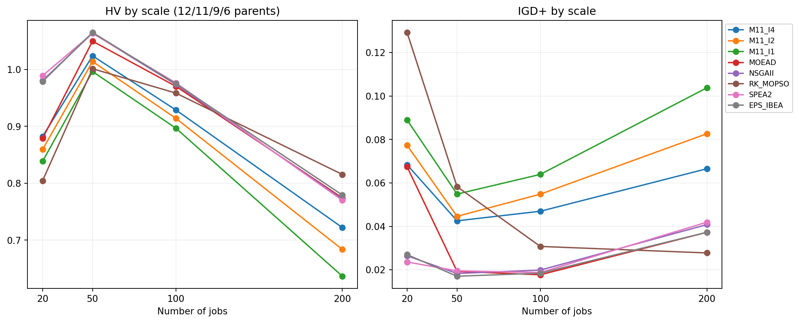
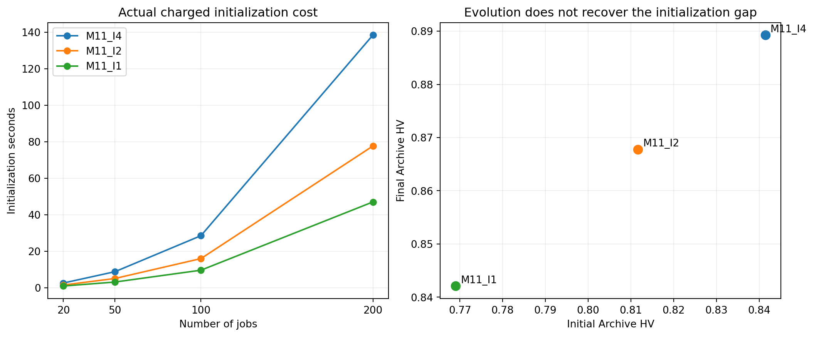
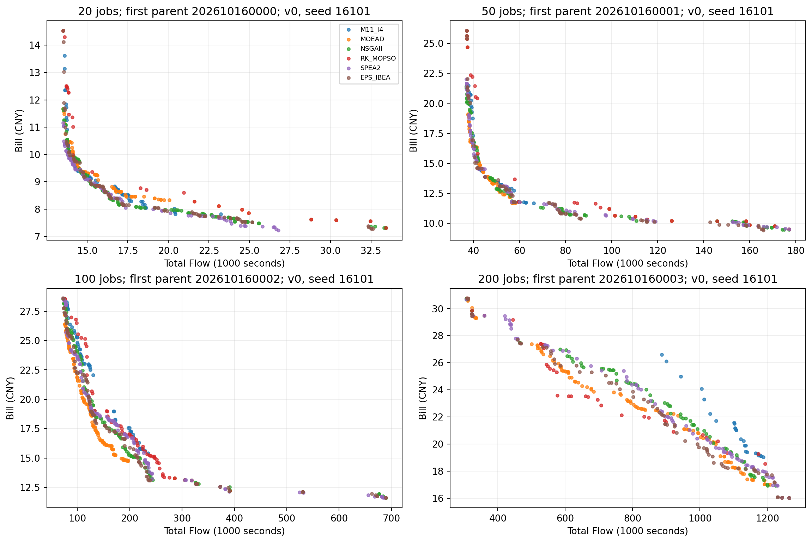

# 综合 13 组实验：中断原因、已完成结果及下一步建议

日期：2026-10-19。**本批没有跑完。有效结果已完整回收，下面是 38 个完整配对父实例的探索性分析，不是原 160 父实例主实验的最终结论。**

## 1. 实际运行状态

- 10 月 16 日 10:00:21 启动；10 月 17 日 00:11:40 首次失败，00:51:15 安全收尾，实际运行约 14 小时 51 分钟。当前 worker/supervisor 均为 0，研究状态 `exit=failed`；操作系统服务包装层退出成功不代表实验完成。
- 原主矩阵 8,320 次，完成并通过原 validator 的 2,360 次，占 28.37%；主矩阵尚差 5,960 次。另 12,480 次为固定储备，不能把 20,800 当已承诺全部跑完的主样本数。
- 四规模完成 run：20/50/100/200 分别 650/626/584/500。13 臂全齐的块 162 个，四块全齐的父实例 38 个；主分析使用 1,976 次，剩余 384 条有效结果保留但不混入配对质量结论。
- 完整父实例按规模 12/11/9/6；按压力 arrival 20、kv 15、cheap_capacity 3、**demand 0**，均属于 r0。拓扑 R3M12/R2M12/R5M12/R3M6/R3M24 分别 10/8/7/7/6。缺失不是随机抽样，不能外推全部压力和原主矩阵。
- 原 source 固定 `bf719d68e882a9cc3058cd5fced3adcaa84757f8`，canonical `85c187874a18c9225c303fe3c45df25ac4668d41a759ab2e8a2add36e39e7540`；没有改算法、放宽预算、重试正式任务、创建定时或干预辅助探索 18。

## 2. 为什么停了：公共初始化的唯一候选不足

失败键 `r0_n20_R5M12_cheap_capacity_v1_s16101`，5 地区/12 机器，原调度顺序首臂 EPS_IBEA。失败发生在共同 BILL I4 初始化，**尚未进入 IBEA 的进化循环**。

离线按相同冻结输入、算法 seed=16101、bank seed=116101、每位置上限 100 次重放，错误完全复现：第 3 个位置（slot=2，Flow 权重 0.25）要求四个全新基因型，100 次仅接受 3 个。前两个位置分别使用 9、25 次生成获得各 4 个候选；第三位置 100 次生成中只有 10 种基因型，97 次与全局 seen 重复，累计 exact 为 111（原父 100＋BILL 11）。

当前 seen 不只含最终保留的种群，还包含每个位置所有已评价但未中选的候选，并跨位置共享。构造顺序只在按 release 排序的三种规则和 5% 受限路径列表内随机，小规模与便宜地区资源集中的组合容易重复。**证据支持“随机构造支持集偏窄、唯一性要求过强时可能耗尽”；100 次观察不证明所有可行构造已经穷尽。**

没有 MemoryError/OOM 堆栈，也没有恢复后完整保留的该已释放 cgroup 内存峰值可供本轮读取；不能把退出后的空 cgroup 或服务默认 MemoryMax 当运行内存证据。有效 worker 峰值 RSS 最大 170.50 MiB，但这不等于全批总内存峰值。历史启动的 200GB aggregate 限制证据仍以启动验收为准。

修复建议是先界定最终 P100 唯一与“每个未中选 trial 永不再出现”的区别，再设计有界、显式 RNG 的多样化/去重缓存策略。不能静默改成不足四个也继续，更不能只给 IBEA 换初始化。任何修复都需要新 source/protocol；本轮仅诊断，未实施。

## 3. 比较口径

M11-I4 是 A3＋随机替换顺序＋固定 MacroSearch 6，90 个原十类来源＋10 个 BILL，每个 BILL 位置四选一。M11-I2/I1 仅改二选一/单次。M00 两项都不加，M10 只加 A3，M01 只加随机替换；DS/DC 是原两种动态预算。外部 MOEA/D、NSGA-II、随机键 MOPSO、SPEA2、epsilon-IBEA 共用 I4 初始化、同一可行表示/SSGS/exact。后 3 个是本仓库适配实现，不能冒充原作者代码复现。

初始化纳入 300/600/1,200/2,400 秒生产 wall，所有原父与 trial 均进入被动测量 Archive，SPEA2/MOPSO 原生选择仓库独立。比较最终观测 Archive；它不等于最终 P100。完成检查包括每 run 八产物、输入/spec/config/source/seed/host/hash、final exact 证据与初始化 hash 同源。

每个输入的 13 臂×两个 seed 共同非支配 union 为经验参考，不是真实 Pareto；按其 ideal/nadir 归一化，HV reference=(1.1,1.1)。落在该框外的点贡献零 HV，坐标不裁剪，IGD/IGD+ 仍保留完整距离。HV 可超过 1，因为参考框面积为 1.21。

先平均一个父实例的两变体×两 seed，再将四规模均权。20,000 次分规模父 cluster bootstrap、100,000 次父效应变号，显式 seed=2026101613；保留原 10/6/4/4 四个 Holm 家族。变号检验依赖对称零假设，CI 是条件于已完成子集的抽样不确定性，不补救停机选择偏差。无效“未显著=等价”、无事后挑子组晋级。

## 4. 13 组整体表现

| 算法 | HV ↑ | IGD+ ↓ | 初始 HV | 迭代增加 HV | 初始化秒 |
| --- | --- | --- | --- | --- | --- |
| M11_I4 | 0.88926 | 0.05611 | 0.84145 | 0.04782 | 44.59 |
| M11_I2 | 0.86775 | 0.06486 | 0.81162 | 0.05613 | 25.05 |
| M11_I1 | 0.84210 | 0.07791 | 0.76904 | 0.07306 | 15.18 |
| M00_I4 | 0.88222 | 0.06205 | 0.84145 | 0.04078 | 44.70 |
| M10_I4 | 0.88738 | 0.05769 | 0.84145 | 0.04594 | 44.73 |
| M01_I4 | 0.88242 | 0.06095 | 0.84145 | 0.04097 | 44.73 |
| DS_I4 | 0.88860 | 0.05660 | 0.84145 | 0.04716 | 44.53 |
| DC_I4 | 0.88935 | 0.05572 | 0.84145 | 0.04791 | 44.68 |
| MOEAD | 0.91828 | 0.03543 | 0.84145 | 0.07683 | 44.60 |
| NSGAII | 0.94752 | 0.02637 | 0.84145 | 0.10607 | 44.58 |
| RK_MOPSO | 0.89492 | 0.06153 | 0.84145 | 0.05347 | 44.61 |
| SPEA2 | 0.94973 | 0.02595 | 0.84145 | 0.10828 | 44.54 |
| EPS_IBEA | 0.94949 | 0.02495 | 0.84145 | 0.10804 | 44.69 |

**主算法目前落后于几个较简单的对照。** 普通 MOEA/D 相对 M11-I4 的 HV 差为 +0.02902、IGD+ 改善 +0.02068；NSGA-II 为 +0.05826/+0.02974；SPEA2 为 +0.06047/+0.03015；IBEA 为 +0.06023/+0.03116。后三者在全部 38 父实例的 HV 与 IGD+ 上都更好，当前子集的探索性 Holm p 均约 0.00010。配对相对 HV 描述性增幅分别约 3.90%、7.34%、7.64%、7.69%，这与“均值 HV 比值”不是同一统计量。

Flow/Bill 单端改善远小于整条前沿指标差距：例如 NSGA-II 的最优 Flow/Bill 相对改善均值约 0.63%/0.75%，SPEA2 约 0.53%/0.84%；覆盖净优势分别约 +0.701/+0.698。这提示差距包括中间折中解的密度和位置，不能只盯最优单点。覆盖是集合指标，不是新独立样本。

RK-MOPSO 的整体 HV 与 IGD+ 方向不一致，探索性差异未确认；其规模反转很明显，不能因为全规模均值就删除它，见下节。

## 5. 规模差异与初始化强度

| 算法 | 20 任务 HV | 50 任务 HV | 100 任务 HV | 200 任务 HV |
| --- | --- | --- | --- | --- |
| M11_I4 | 0.88228 | 1.02388 | 0.92884 | 0.72205 |
| M11_I2 | 0.85934 | 1.01392 | 0.91417 | 0.68358 |
| M11_I1 | 0.83859 | 0.99639 | 0.89679 | 0.63663 |
| MOEAD | 0.87886 | 1.04965 | 0.97041 | 0.77420 |
| NSGAII | 0.98042 | 1.06392 | 0.97363 | 0.77211 |
| RK_MOPSO | 0.80450 | 1.00125 | 0.95851 | 0.81541 |
| SPEA2 | 0.98906 | 1.06347 | 0.97639 | 0.77000 |
| EPS_IBEA | 0.97879 | 1.06497 | 0.97492 | 0.77928 |

- 200 任务只有 6 个完整父实例，M11-I4 HV=0.72205，普通 MOEA/D=0.77420、NSGA-II=0.77211、RK-MOPSO=0.81541。**当前 200 任务最好均值来自随机键 MOPSO**，但本节是小样本描述，不是预注册规模内胜负判定。
- M11-I4 的初始/最终 HV：100 任务 0.91210→0.92884，200 任务 0.71274→0.72205；同初始 Archive 下 NSGA-II 为 0.97363/0.77211。大规模时现有搜索追加收益尤其有限。
- I4 对 I2/I1 最终 HV 优势 0.02151/0.04716、IGD+ 优势 0.00876/0.02180。I2 有 36/38 父实例 HV 更差，I1 为 38/38；当前子集不支持为了加速直接全面换成 I1/I2。
- I4/I2/I1 初始 Archive HV 为 0.84145/0.81162/0.76904，搜索后增加 0.04782/0.05613/0.07306：弱初始化虽有更多后续改善，仍未追回起点差距。不同强度还改变 trial 测量 Archive，不能把这种差别只解释为保留的 100 人质量。

| 规模 | I4 初始化秒 | I2 初始化秒 | I1 初始化秒 | I4 后代数 | 普通 MOEA/D 后代数 | NSGA-II 后代数 |
| --- | --- | --- | --- | --- | --- | --- |
| 20 | 2.58 | 1.49 | 0.95 | 6177 | 36504 | 64486 |
| 50 | 8.80 | 5.08 | 3.13 | 2690 | 47092 | 50521 |
| 100 | 28.52 | 15.98 | 9.62 | 827 | 29951 | 24813 |
| 200 | 138.46 | 77.67 | 47.02 | 296 | 10786 | 8984 |

I4 200 任务初始化约 138.46 秒，占 2,400 秒约 5.77%；I2/I1 约 77.67/47.02 秒。三种初始化都已计时，当前数据说明省下的时间尚未转化为足以抵消质量损失的迭代收益；这组新实例耗时也不能与旧 185.39 秒诊断均值当成同规模完全相同的实验。

## 6. A3、随机替换和动态预算

A3 的跨另一个因子平均主效应 HV +0.006003、IGD+ 改善 +0.004598，探索性 Holm p=0.00045/0.00018，30/31 个父实例方向有利。**A3 是有用的局部修正，但它的效应量小于与外部基线的差距。**

随机替换主效应 HV +0.001038，95% CI 跨零；A3×随机替换交互也跨零。DS 对固定 6 的 HV −0.000659，DC +0.000090，均未确认；不能据此宣布等价，但现阶段不值得继续单纯围绕预算 3/6/10 堆叠大批次。

## 7. 时间花在哪里，下一步优先研究什么

| 规模 | 生产总秒 | 局部搜索调用计时秒 | SSGS 秒 | exact 秒 | Archive 秒 |
| --- | --- | --- | --- | --- | --- |
| 20 | 300.16 | 238.39 | 28.74 | 72.65 | 41.34 |
| 50 | 600.49 | 428.62 | 79.02 | 163.92 | 44.44 |
| 100 | 1203.76 | 688.17 | 169.25 | 406.07 | 94.09 |
| 200 | 2420.40 | 1015.81 | 328.87 | 1069.41 | 152.63 |

局部搜索调用、SSGS、exact、Archive 为嵌套计时，**不能相加**；完整逐动作秒与计数在 diagnostic_summary.json 和原 diagnostics 中。总体 M11-I4 exact 约 42,530、NSGA-II 约 37,341，前者并不是简单地“评价次数太少”；同时普通新后代数量差很多，且一个局部步骤可能做许多 exact，两者后代不能当等工作量。

200 任务 M11-I4 仅约 296 个结构后代，普通 MOEA/D/NSGA-II 约 10,786/8,984；M11-I4 平均 soft wall 超出约 20.40 秒。全 2,360 次最大超时 94.25 秒。原冻结终止发生在后代/最终 Polish 边界，这些差异属于真实实现口径；本轮没有裁掉较慢 run。新增结果不能只延长墙钟掩盖搜索效率问题。

我建议的下一步顺序：

1. **先修公共初始化的可靠性。** 同输入同 RNG 重放、100 成员可行和唯一、代价全部计时、重复 trial 缓存、不可耗尽的有界回退要有清晰语义。先对整个冻结输入库做初始化验收，再另行冻结正式算法；旧批失败日志与所有有效结果保留，不拼接不同初始化版本伪装成原主矩阵完成。
2. **把主干收益和局部搜索成本拆开。** 保持 I4 与同一表示，做普通 MOEA/D、仅 A3 的简洁版本、原完整方法、按实际收益/秒限制的局部搜索四组小机制比较。关注最终/anytime HV、有效结构变化、产生新 Archive 区域的概率与成本，而不是累计 reward 或 exact 数。候选门控应先用可解释少量状态，再考虑 RL。
3. **检查 MacroSearch 与状态/算子的匹配。** 大量全枚举尝试但只少量候选、固定 6 内重复邻域、同源候选是否只在已密集区域抖动，都值得做诊断；初步计数只能提出假设，不能说已证明 Q-learning 或某个算子是根因。先比较边际 HV/覆盖增量每秒，再决定自适应调用，不先扩充 STATE84。
4. **把随机键 MOPSO 留作大规模结构探索参考。** 200 任务的交叉提示大步改变分配/顺序可能有价值，但尚不能证明某个 MOPSO 组件能迁移获益。SPEA2/IBEA/NSGA-II 也提供“种群选择压力和全局探索”对照，先提取机制，不急于换掉用户希望保留的 MOEA/D 主框架。
5. **修好后补齐新正式比较。** 优先覆盖当前缺失 demand 与稀少 cheap_capacity，并维持四规模轮转、父实例独立配对、同源初始化与等总 wall。新增部分应独立标识 source 和阶段；若要与旧结果合并需预先说明可比性，不能自动延长旧 72 小时窗口。

以上为建议，**本轮未实现修复或启动新实验**。现有证据支持先简化并找瓶颈，暂不支持声称整套复杂改进已优于传统多目标算法，也不足以宣布 MOEA/D 框架本身没有研究价值。

## 8. 完整探索性统计表

正数统一表示该对比改善；IGD+ 使用“对照减处理”方向。CI/p 均仅针对当前子集。

### external（探索性）

| 对比 | 指标 | 改善均值 | 95% 配对 cluster CI | Holm p | 正/负父数 |
| --- | --- | --- | --- | --- | --- |
| M11_I4-MOEAD | hv | -0.029017 | [-0.037660, -0.021306] | 0.000100 | 6/32 |
| M11_I4-MOEAD | igd_plus | -0.020676 | [-0.025337, -0.016095] | 0.000100 | 6/32 |
| M11_I4-NSGAII | hv | -0.058258 | [-0.069080, -0.048507] | 0.000100 | 0/38 |
| M11_I4-NSGAII | igd_plus | -0.029735 | [-0.036008, -0.024225] | 0.000100 | 0/38 |
| M11_I4-RK_MOPSO | hv | -0.005654 | [-0.024241, +0.012604] | 0.981550 | 26/12 |
| M11_I4-RK_MOPSO | igd_plus | +0.005422 | [-0.003310, +0.014763] | 0.981550 | 25/13 |
| M11_I4-SPEA2 | hv | -0.060465 | [-0.072303, -0.049806] | 0.000100 | 0/38 |
| M11_I4-SPEA2 | igd_plus | -0.030155 | [-0.036976, -0.024211] | 0.000100 | 0/38 |
| M11_I4-EPS_IBEA | hv | -0.060227 | [-0.071963, -0.049291] | 0.000100 | 0/38 |
| M11_I4-EPS_IBEA | igd_plus | -0.031157 | [-0.037698, -0.025221] | 0.000100 | 0/38 |
### factorial（探索性）

| 对比 | 指标 | 改善均值 | 95% 配对 cluster CI | Holm p | 正/负父数 |
| --- | --- | --- | --- | --- | --- |
| A3 | hv | +0.006003 | [+0.002760, +0.010609] | 0.000450 | 30/8 |
| A3 | igd_plus | +0.004598 | [+0.002130, +0.007983] | 0.000180 | 31/7 |
| RPERM | hv | +0.001038 | [-0.000866, +0.002943] | 1.000000 | 20/18 |
| RPERM | igd_plus | +0.001344 | [-0.000219, +0.003008] | 0.529275 | 22/16 |
| interaction | hv | +0.001682 | [-0.003226, +0.006972] | 1.000000 | 19/19 |
| interaction | igd_plus | +0.000490 | [-0.003725, +0.004629] | 1.000000 | 19/19 |
### budget（探索性）

| 对比 | 指标 | 改善均值 | 95% 配对 cluster CI | Holm p | 正/负父数 |
| --- | --- | --- | --- | --- | --- |
| DS_I4-M11_I4 | hv | -0.000659 | [-0.002920, +0.001478] | 1.000000 | 20/18 |
| DS_I4-M11_I4 | igd_plus | -0.000495 | [-0.002065, +0.000989] | 1.000000 | 22/16 |
| DC_I4-M11_I4 | hv | +0.000090 | [-0.001760, +0.001969] | 1.000000 | 18/20 |
| DC_I4-M11_I4 | igd_plus | +0.000382 | [-0.000950, +0.001768] | 1.000000 | 18/20 |
### initialization（探索性）

| 对比 | 指标 | 改善均值 | 95% 配对 cluster CI | Holm p | 正/负父数 |
| --- | --- | --- | --- | --- | --- |
| M11_I2-M11_I4 | hv | -0.021509 | [-0.027502, -0.016254] | 0.000040 | 2/36 |
| M11_I2-M11_I4 | igd_plus | -0.008760 | [-0.011489, -0.006150] | 0.000040 | 6/32 |
| M11_I1-M11_I4 | hv | -0.047164 | [-0.058483, -0.037364] | 0.000040 | 0/38 |
| M11_I1-M11_I4 | igd_plus | -0.021801 | [-0.028475, -0.016293] | 0.000040 | 0/38 |

## 9. 原始前沿示例

各规模取最小父编号、固定变体 0/seed16101，不按胜负挑图。只画实际点，未连接成暗示可行插值的线。

## 10. 完整性、复现和限制

- 30,733 个 formal 常规文件，735,751,798 原始字节，完整 tar 393,610,777 字节；服务器、tar、解压本地逐成员 size/SHA 一致。tar SHA `3e7f44b83b54fd4ef632a0ef48a0f5e33067e7bd0ea8140846a5b4a8ac8ef006`；完整 manifest SHA `e7ceb2545df46b2857fa7e6e3afb46e00cb4bd3dc6e09a2d9f4b9e9d733d21b2`。
- 原冻结 validator 在服务器和本地只读产物均通过 2,360 条；1,976 次质量 HV 双实现、52 次 IGD+ 双实现、24 个效应均值和四 Holm 家族独立复算通过。原 worker 最终独立 exact 由完整产物 hash 绑定，本轮未重新运行所有最终解 exact。
- 本地完整门禁固定本 checkout 的源码导入后，628 项通过、1 项 Linux 平台相关跳过，417.33 秒；overall 85.83%、core 96.93%。新增 7 项分析/失败重放测试通过；首轮完整门禁的两项旧 mini 集成检查未在原观察窗口内完成，626 项通过/2 项失败日志保留，同限制两项复验 2 通过/42.27 秒；未延长测试窗口、降低覆盖率门槛或改运行算法。六个分析输出完整重跑后逐 SHA 一致。
- 首轮后处理修正了序列化 Bill 字段读取（tou＋sum demand）、HV 输入需元组及参考框外零面积处理，失败日志保留；它们是分析程序问题，未改变原运行数据。单元反例包括框外 HV 不裁剪距离、规模均权/非 run 权重、交互方向、完整 Holm 家族和真实失败初始化冻结重放。
- 停机选择偏差、38 父样本与 demand 缺失是主要科研限制；不能把重复 seed/run 当额外独立证据，不混旧 T/H、其他批次或辅助 18；不从局部显著推导整体创新性。
- 结果报告与分析代码走独立 PR/CI，原运行 source/PR64 和默认算法保持。完整 raw、manifest、checksum、原运行与分析 bundle、分析 ZIP 和复现说明走独立 Release，最终交付状态以下载验真回执为准。

材料护照：来源为冻结真实运行；执行不完整、有效产物已验真；统计为固定完整配对子集的探索性证据；无外部论文新断言；不可用作完整确认研究或真实 Pareto 最优证明。
