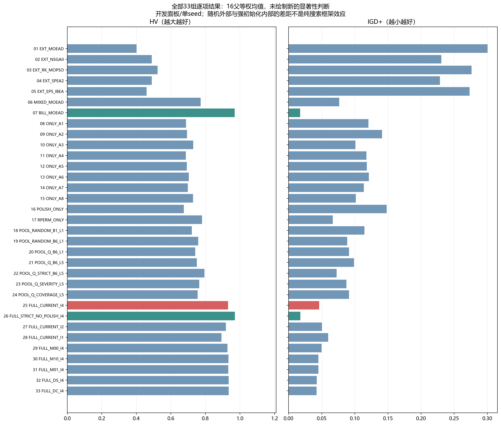
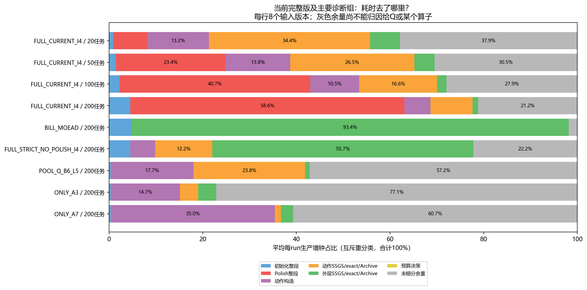

# 33组实验逐项复盘：有效方向、耗时瓶颈与下一步

2026-10-20。本文件面向研究决策，逐组解释已完成的33组/1056次结果；在既有冻结分析上新增互斥耗时重分类，没有重跑算法、增加显著性检验或修改默认算法。

## 先看结论

**当前最可靠的收益来自初始化；最需要收缩的是高频、深轨迹、带昂贵Polish的搜索政策。建议把BILL4＋普通MOEA/D当作研究比较底座，要求任何新增机制在同初始化、等总墙钟下提供额外收益。**

1. 原混合、BILL4在相同普通MOEA/D下都取得校正后的整程正收益，且两个指标均16/16父正向。
2. 当前完整包显著优于五随机初始化外部；这证明整个包有效，不能证明Q、五步轨迹或Polish分别有效。
3. 严格触发＋无Polish显著优于当前完整包，但尚未确认优于BILL4普通MOEA/D；不能把未显著解释成等价。
4. 200任务当前完整包的Polish占58.57%、初始化约4.50%；降低BILL构造强度没有解决外层约4代的问题。
5. 新的成本拆分显示，200任务强制Q五步仍有57.15%时间未被现有细项计时覆盖，ONLY_A3约77.13%、ONLY_A7约60.70%。不能把它们直接叫作“Q表耗时”；应先细分诊断、状态/标量计算、集合构造、刷新和observer开销。
6. 下一步先分析已经跑完的独立五组320次，再决定是否保留局部搜索；不要立即再开33组或重复五组实验。

## 1. 数据口径与证据边界

### Material Passport

| 项目 | 本次口径 |
| --- | --- |
| 验证状态 | ANALYZED；本批复算165项均值、2112个summary/diagnostics SHA绑定及1056项耗时恒等式；不是重新运行1056次算法。 |
| 正式样本 | 16已有开发父；每规模4父；每父两压力版本、一个seed16101。33组各32次，共1056次。 |
| 任务/拓扑 | 20/50/100/200任务；2/3/5地区、6/12/24机器；arrival12父、kv4父，无cheap-capacity/demand。 |
| 运行源 | b148c4addd207fe30a6b2a43d953a04afc35d3a1 |
| 运行canonical | 37f3153178bb7d3238750ec1ac85ebe7871c18a317eb5f2dc8025a25497dfaba |
| 原验收 | 1056/1056原validator；HV/IGD+各1056双实现；四家族70项冻结统计独立复算；最终874110成员exact证据绑定，非本轮fresh全量exact。 |
| 运算预算 | 300/600/1200/2400秒，包含初始化；最终审计/导出单列。48单线程solver，正式7小时22分43秒。 |
| 指标 | 每输入共同经验union归一化，HV参考点(1.1,1.1)，非真实Pareto。HV可大于1，不能跨批直接比较。 |
| 统计单位 | 两个版本先父内平均，再四规模等权。20k分层bootstrap/100k配对sign-flip；70项按主10/组件24/层级22/整包14分别Holm。 |

下文HV、IGD+为16父等权均值；“200任务代数”为每100个外层子代一代的代理，可含未完成一代，不等于不同算法执行了相同内部工作。每组200任务计时为8个输入版本均值。未出现新的留出集、多个随机种子稳定性或框架创新确认。

## 2. 全部33组的结果总表

| 序号 | 组别 | HV↑ | IGD+↓ | 200任务外层代数 | 200任务初始化秒 | 200任务Polish占比 |
| --- | --- | --- | --- | --- | --- | --- |
| 1 | `EXT_MOEAD` | 0.401442 | 0.300329 | 465.33 | 6.03 | 0.00% |
| 2 | `EXT_NSGAII` | 0.489631 | 0.230666 | 455.72 | 6.36 | 0.00% |
| 3 | `EXT_RK_MOPSO` | 0.523342 | 0.276122 | 338.57 | 6.03 | 0.00% |
| 4 | `EXT_SPEA2` | 0.489617 | 0.228563 | 461.28 | 6.15 | 0.00% |
| 5 | `EXT_EPS_IBEA` | 0.459243 | 0.273361 | 466.34 | 6.04 | 0.00% |
| 6 | `MIXED_MOEAD` | 0.772069 | 0.076496 | 342.08 | 8.39 | 0.00% |
| 7 | `BILL_MOEAD` | 0.969888 | 0.017476 | 284.66 | 113.34 | 0.00% |
| 8 | `ONLY_A1` | 0.688182 | 0.120675 | 15.06 | 8.29 | 0.00% |
| 9 | `ONLY_A2` | 0.694052 | 0.141045 | 13.52 | 8.42 | 0.00% |
| 10 | `ONLY_A3` | 0.730165 | 0.101031 | 13.57 | 8.37 | 0.00% |
| 11 | `ONLY_A4` | 0.687273 | 0.117389 | 18.41 | 8.41 | 0.00% |
| 12 | `ONLY_A5` | 0.692181 | 0.118020 | 18.11 | 8.40 | 0.00% |
| 13 | `ONLY_A6` | 0.703774 | 0.121015 | 21.17 | 8.34 | 0.00% |
| 14 | `ONLY_A7` | 0.698516 | 0.113709 | 10.22 | 8.41 | 0.00% |
| 15 | `ONLY_A8` | 0.728297 | 0.101573 | 19.96 | 8.91 | 0.00% |
| 16 | `POLISH_ONLY` | 0.675475 | 0.148150 | 2.24 | 8.40 | 99.03% |
| 17 | `RPERM_ONLY` | 0.781182 | 0.066660 | 332.43 | 9.47 | 0.00% |
| 18 | `POOL_RANDOM_B1_L1` | 0.721395 | 0.114562 | 14.92 | 8.38 | 0.00% |
| 19 | `POOL_RANDOM_B6_L1` | 0.758122 | 0.088388 | 11.36 | 8.38 | 0.00% |
| 20 | `POOL_Q_B6_L1` | 0.741522 | 0.091129 | 11.13 | 8.86 | 0.00% |
| 21 | `POOL_Q_B6_L5` | 0.750628 | 0.098681 | 3.84 | 8.31 | 0.00% |
| 22 | `POOL_Q_STRICT_B6_L5` | 0.794713 | 0.072451 | 195.77 | 8.40 | 0.00% |
| 23 | `POOL_Q_SEVERITY_L5` | 0.763890 | 0.087282 | 3.79 | 8.40 | 0.00% |
| 24 | `POOL_Q_COVERAGE_L5` | 0.755434 | 0.091245 | 3.72 | 8.31 | 0.00% |
| 25 | `FULL_CURRENT_I4` | 0.930966 | 0.046196 | 4.09 | 107.85 | 58.57% |
| 26 | `FULL_STRICT_NO_POLISH_I4` | 0.970745 | 0.017856 | 174.69 | 108.08 | 0.00% |
| 27 | `FULL_CURRENT_I2` | 0.918570 | 0.050281 | 4.11 | 58.73 | 59.47% |
| 28 | `FULL_CURRENT_I1` | 0.893529 | 0.059816 | 4.09 | 32.71 | 59.60% |
| 29 | `FULL_M00_I4` | 0.927403 | 0.049671 | 4.27 | 121.00 | 57.07% |
| 30 | `FULL_M10_I4` | 0.933928 | 0.044877 | 4.12 | 108.78 | 57.15% |
| 31 | `FULL_M01_I4` | 0.932223 | 0.044848 | 4.02 | 108.42 | 57.09% |
| 32 | `FULL_DS_I4` | 0.934563 | 0.042698 | 4.02 | 108.35 | 57.58% |
| 33 | `FULL_DC_I4` | 0.934941 | 0.042406 | 4.09 | 107.34 | 58.34% |

### 四个任务规模的逐组结果

单元格为HV↑ / IGD+↓，各规模4父、两个版本先均值。全部规模一并列出；本表只描述，不新增规模内检验，不因某规模均值好就宣布局部冠军。不同规模的输入和预算不同，跨列差异不是任务数的单独因果效应。

| 组别 | 20任务 | 50任务 | 100任务 | 200任务 |
| --- | --- | --- | --- | --- |
| `EXT_MOEAD` | 0.2946 / 0.4846 | 0.5929 / 0.1916 | 0.4907 / 0.2077 | 0.2275 / 0.3174 |
| `EXT_NSGAII` | 0.5700 / 0.2550 | 0.6360 / 0.1627 | 0.5246 / 0.1868 | 0.2279 / 0.3182 |
| `EXT_RK_MOPSO` | 0.4700 / 0.4450 | 0.6269 / 0.2521 | 0.6177 / 0.1641 | 0.3789 / 0.2432 |
| `EXT_SPEA2` | 0.5603 / 0.2546 | 0.6246 / 0.1718 | 0.5323 / 0.1805 | 0.2413 / 0.3073 |
| `EXT_EPS_IBEA` | 0.4896 / 0.3989 | 0.6034 / 0.1876 | 0.5031 / 0.2001 | 0.2409 / 0.3069 |
| `MIXED_MOEAD` | 0.7049 / 0.1665 | 0.8848 / 0.0452 | 0.8193 / 0.0454 | 0.6793 / 0.0489 |
| `BILL_MOEAD` | 0.9892 / 0.0214 | 1.0696 / 0.0063 | 0.9960 / 0.0148 | 0.8247 / 0.0274 |
| `ONLY_A1` | 0.6673 / 0.1334 | 0.7632 / 0.1314 | 0.7589 / 0.0942 | 0.5634 / 0.1237 |
| `ONLY_A2` | 0.6358 / 0.2549 | 0.8214 / 0.0902 | 0.7548 / 0.0951 | 0.5643 / 0.1240 |
| `ONLY_A3` | 0.7077 / 0.1211 | 0.8256 / 0.0940 | 0.8029 / 0.0726 | 0.5845 / 0.1165 |
| `ONLY_A4` | 0.6232 / 0.1544 | 0.7952 / 0.1062 | 0.7602 / 0.0869 | 0.5706 / 0.1220 |
| `ONLY_A5` | 0.6537 / 0.1530 | 0.7972 / 0.0997 | 0.7603 / 0.0901 | 0.5576 / 0.1293 |
| `ONLY_A6` | 0.6761 / 0.1721 | 0.7893 / 0.1108 | 0.7777 / 0.0815 | 0.5720 / 0.1197 |
| `ONLY_A7` | 0.6895 / 0.1232 | 0.8118 / 0.0941 | 0.7430 / 0.1012 | 0.5497 / 0.1363 |
| `ONLY_A8` | 0.7206 / 0.1213 | 0.8420 / 0.0855 | 0.7700 / 0.0822 | 0.5806 / 0.1173 |
| `POLISH_ONLY` | 0.6828 / 0.2041 | 0.7898 / 0.1069 | 0.7180 / 0.1229 | 0.5113 / 0.1587 |
| `RPERM_ONLY` | 0.7082 / 0.1414 | 0.8966 / 0.0411 | 0.8393 / 0.0360 | 0.6806 / 0.0482 |
| `POOL_RANDOM_B1_L1` | 0.6737 / 0.1862 | 0.8580 / 0.0710 | 0.7814 / 0.0793 | 0.5725 / 0.1218 |
| `POOL_RANDOM_B6_L1` | 0.7817 / 0.0804 | 0.8902 / 0.0654 | 0.7884 / 0.0806 | 0.5721 / 0.1271 |
| `POOL_Q_B6_L1` | 0.7661 / 0.0818 | 0.8599 / 0.0729 | 0.7731 / 0.0839 | 0.5669 / 0.1260 |
| `POOL_Q_B6_L5` | 0.8719 / 0.0517 | 0.8113 / 0.1115 | 0.7617 / 0.1005 | 0.5575 / 0.1311 |
| `POOL_Q_STRICT_B6_L5` | 0.7501 / 0.1578 | 0.9073 / 0.0394 | 0.8457 / 0.0362 | 0.6758 / 0.0564 |
| `POOL_Q_SEVERITY_L5` | 0.8657 / 0.0482 | 0.8469 / 0.0827 | 0.7755 / 0.0917 | 0.5675 / 0.1265 |
| `POOL_Q_COVERAGE_L5` | 0.8502 / 0.0537 | 0.8467 / 0.0848 | 0.7747 / 0.0917 | 0.5502 / 0.1349 |
| `FULL_CURRENT_I4` | 0.9841 / 0.0297 | 1.0353 / 0.0380 | 0.9422 / 0.0500 | 0.7623 / 0.0672 |
| `FULL_STRICT_NO_POLISH_I4` | 0.9923 / 0.0228 | 1.0636 / 0.0107 | 0.9992 / 0.0149 | 0.8279 / 0.0231 |
| `FULL_CURRENT_I2` | 0.9607 / 0.0321 | 1.0319 / 0.0379 | 0.9273 / 0.0597 | 0.7543 / 0.0715 |
| `FULL_CURRENT_I1` | 0.9099 / 0.0544 | 1.0172 / 0.0413 | 0.9200 / 0.0618 | 0.7270 / 0.0818 |
| `FULL_M00_I4` | 0.9734 / 0.0374 | 1.0315 / 0.0432 | 0.9436 / 0.0494 | 0.7611 / 0.0687 |
| `FULL_M10_I4` | 0.9860 / 0.0297 | 1.0399 / 0.0355 | 0.9471 / 0.0467 | 0.7627 / 0.0675 |
| `FULL_M01_I4` | 0.9890 / 0.0256 | 1.0400 / 0.0345 | 0.9413 / 0.0495 | 0.7585 / 0.0697 |
| `FULL_DS_I4` | 0.9920 / 0.0219 | 1.0385 / 0.0352 | 0.9442 / 0.0484 | 0.7635 / 0.0653 |
| `FULL_DC_I4` | 0.9914 / 0.0224 | 1.0440 / 0.0312 | 0.9424 / 0.0490 | 0.7619 / 0.0671 |

## 3. 逐组解释：这组回答了什么、结果能说明什么

ONLY_A组全部采用混合初始化、逐子代强制调用、B1/L1、无Polish；它们测的是这种调用政策，不是算子在理想状态下的潜力。POOL组件组使用混合初始化，完整包组使用BILL，不能把两种底座直接当纯单变量差异。

### 01. 随机初始化普通MOEA/D｜`EXT_MOEAD`

**设置与问题：** 纯随机合法MS/OS初始化；没有设计型初始化和模因搜索。

**观测结果：** HV=0.401442，IGD+=0.300329；200任务约465.33代，初始化6.03秒。

**统计参照：** FULL_CURRENT_I4 对 EXT_MOEAD（main家族），HV改善+0.529524、p_Holm=0.000140（通过）；IGD+改善+0.254133、p_Holm=0.000100（通过）。改善负号表示左方法更差。

**成本线索：** 200任务初始化整段0.28%、Polish整段0.00%、动作构造0.00%、动作评价三项0.00%、外层评价三项96.95%、未细分余量2.77%；预算决策余项见成本表。这里各项互斥，未细分不是已定位的单模块。

**如何理解：** 它是初始化收益的锚点。与原混合初始化只改变初始化政策，因此可比较设计型初始化的整程净价值。不能用它单独评价MOEA/D框架的上限。

**下一步处理：** 保留随机条件作整体方法包对照，同时以同BILL初始化版本作机制研究底座。

### 02. 随机初始化NSGA-II｜`EXT_NSGAII`

**设置与问题：** rank/crowding及父子代精英选择的离散调度适配，纯随机初始化。

**观测结果：** HV=0.489631，IGD+=0.230666；200任务约455.72代，初始化6.36秒。

**统计参照：** FULL_CURRENT_I4 对 EXT_NSGAII（main家族），HV改善+0.441335、p_Holm=0.000180（通过）；IGD+改善+0.184470、p_Holm=0.000200（通过）。改善负号表示左方法更差。

**成本线索：** 200任务初始化整段0.29%、Polish整段0.00%、动作构造0.00%、动作评价三项0.00%、外层评价三项96.40%、未细分余量3.31%；预算决策余项见成本表。这里各项互斥，未细分不是已定位的单模块。

**如何理解：** 整体HV高于随机MOEA/D，但本轮没有预注册五外部之间的胜负检验。完整版优于它是强初始化加搜索整包的结果，未分离搜索框架。

**下一步处理：** 若要比较主干，下一轮给NSGA-II与MOEA/D相同BILL4输入、种群和端到端预算。

### 03. 随机键MOPSO适配｜`EXT_RK_MOPSO`

**设置与问题：** 随机键表示、原生领导库/网格；纯随机合法初始化。

**观测结果：** HV=0.523342，IGD+=0.276122；200任务约338.57代，初始化6.03秒。

**统计参照：** FULL_CURRENT_I4 对 EXT_RK_MOPSO（main家族），HV改善+0.407624、p_Holm=0.000200（通过）；IGD+改善+0.229925、p_Holm=0.000200（通过）。改善负号表示左方法更差。

**成本线索：** 200任务初始化整段0.28%、Polish整段0.00%、动作构造0.00%、动作评价三项0.00%、外层评价三项96.82%、未细分余量2.90%；预算决策余项见成本表。这里各项互斥，未细分不是已定位的单模块。

**如何理解：** 它在五外部中描述性HV最高，但IGD+不如NSGA-II/SPEA2，提示覆盖体积与到经验前沿距离的排序不同。不是双指标稳定冠军。

**下一步处理：** 保留为风格不同的基线；后续同强初始化时保留原生库与被动测量Archive的边界。

### 04. 随机初始化SPEA2｜`EXT_SPEA2`

**设置与问题：** strength-sum、密度与环境截断；纯随机初始化。

**观测结果：** HV=0.489617，IGD+=0.228563；200任务约461.28代，初始化6.15秒。

**统计参照：** FULL_CURRENT_I4 对 EXT_SPEA2（main家族），HV改善+0.441349、p_Holm=0.000200（通过）；IGD+改善+0.182367、p_Holm=0.000100（通过）。改善负号表示左方法更差。

**成本线索：** 200任务初始化整段0.28%、Polish整段0.00%、动作构造0.00%、动作评价三项0.00%、外层评价三项96.16%、未细分余量3.56%；预算决策余项见成本表。这里各项互斥，未细分不是已定位的单模块。

**如何理解：** 平均HV与NSGA-II非常接近，平均IGD+略低。没有针对这两个外部方法的确认检验，不能把微小数值差异当优势。

**下一步处理：** 继续作有代表性的外部适配；效果讨论明确随机初始化条件。

### 05. 随机初始化epsilon-IBEA｜`EXT_EPS_IBEA`

**设置与问题：** 归一化additive-epsilon指标、kappa=0.05的适配，纯随机初始化。

**观测结果：** HV=0.459243，IGD+=0.273361；200任务约466.34代，初始化6.04秒。

**统计参照：** FULL_CURRENT_I4 对 EXT_EPS_IBEA（main家族），HV改善+0.471723、p_Holm=0.000100（通过）；IGD+改善+0.227164、p_Holm=0.000200（通过）。改善负号表示左方法更差。

**成本线索：** 200任务初始化整段0.28%、Polish整段0.00%、动作构造0.00%、动作评价三项0.00%、外层评价三项96.74%、未细分余量2.98%；预算决策余项见成本表。这里各项互斥，未细分不是已定位的单模块。

**如何理解：** 完整版对它的两个指标通过主家族检验；这不等于指标选择框架无价值。旧13组曾在初始化阶段失败，不是IBEA迭代崩溃；本轮全部运行成功。

**下一步处理：** 保留基线，不因本轮表现而事后改弱参数或把旧初始化故障归给IBEA。

### 06. 原混合初始化＋普通MOEA/D｜`MIXED_MOEAD`

**设置与问题：** 原100成员混合初始化，后续只有普通MOEA/D。

**观测结果：** HV=0.772069，IGD+=0.076496；200任务约342.08代，初始化8.39秒。

**统计参照：** MIXED_MOEAD 对 EXT_MOEAD（component家族），HV改善+0.370627、p_Holm=0.001050（通过）；IGD+改善+0.223834、p_Holm=0.000720（通过）。改善负号表示左方法更差。

**成本线索：** 200任务初始化整段0.38%、Polish整段0.00%、动作构造0.00%、动作评价三项0.00%、外层评价三项97.40%、未细分余量2.22%；预算决策余项见成本表。这里各项互斥，未细分不是已定位的单模块。

**如何理解：** 相对随机MOEA/D两个指标均16/16父正向且通过组件家族检验；收益是在扣除初始化耗时之后的最终收益。它是所有混合底座单组件的正确参照。

**下一步处理：** 保留为必要消融，不用随机初始化外部替代这一同主干对照。

### 07. BILL4初始化＋普通MOEA/D｜`BILL_MOEAD`

**设置与问题：** 原十类各9个＋BILL10，BILL每个位置四选一；无局部搜索。

**观测结果：** HV=0.969888，IGD+=0.017476；200任务约284.66代，初始化113.34秒。

**统计参照：** BILL_MOEAD 对 MIXED_MOEAD（component家族），HV改善+0.197819、p_Holm=0.001330（通过）；IGD+改善+0.059019、p_Holm=0.000920（通过）。改善负号表示左方法更差。

**成本线索：** 200任务初始化整段4.75%、Polish整段0.00%、动作构造0.00%、动作评价三项0.00%、外层评价三项93.42%、未细分余量1.83%；预算决策余项见成本表。这里各项互斥，未细分不是已定位的单模块。

**如何理解：** 相对原混合两个指标均16/16父正向并通过检验。它与完整版有相同的初始P100及Archive；最终平均HV反而更高，是当前最有用的简单研究底座。它不属于已证明的全域最优算法。

**下一步处理：** 优先作为后续简洁基准保留；先要求新模块在同初始化下超过它。

### 08. 仅A1：单阶段重分配｜`ONLY_A1`

**设置与问题：** 混合初始化；逐子代强制调用A1，B1/L1，无Polish。

**观测结果：** HV=0.688182，IGD+=0.120675；200任务约15.06代，初始化8.29秒。

**统计参照：** ONLY_A1 对 MIXED_MOEAD（component家族），HV改善-0.083887、p_Holm=0.015120（通过）；IGD+改善-0.044179、p_Holm=0.311197（未通过）。改善负号表示左方法更差。

**成本线索：** 200任务初始化整段0.37%、Polish整段0.00%、动作构造1.27%、动作评价三项4.03%、外层评价三项4.10%、未细分余量90.24%；预算决策余项见成本表。这里各项互斥，未细分不是已定位的单模块。

**如何理解：** HV下降通过校正，IGD+下降未通过。这里测到的是高频单动作政策连同其支持流程的代价，不是对所有A1调用机会的否定。

**下一步处理：** 停止逐子代强制A1的扩张；若保留，只在阶段资源/分配瓶颈明确时研究稀疏调用。

### 09. 仅A2：P/D路径重分配｜`ONLY_A2`

**设置与问题：** 混合初始化；逐子代A2、B1/L1，无Polish。

**观测结果：** HV=0.694052，IGD+=0.141045；200任务约13.52代，初始化8.42秒。

**统计参照：** ONLY_A2 对 MIXED_MOEAD（component家族），HV改善-0.078017、p_Holm=0.007480（通过）；IGD+改善-0.064549、p_Holm=0.000920（通过）。改善负号表示左方法更差。

**成本线索：** 200任务初始化整段0.38%、Polish整段0.00%、动作构造7.64%、动作评价三项3.72%、外层评价三项3.72%、未细分余量84.54%；预算决策余项见成本表。这里各项互斥，未细分不是已定位的单模块。

**如何理解：** HV与IGD+均显著变差。路径评分、结构重建和调用支持开销挤压外层探索；现有数据不能分离哪一项是唯一原因。

**下一步处理：** 不作为默认高频动作；先诊断同P/同路径重复评分与合法候选质量，再考虑精确等价缓存或稀疏触发。

### 10. 仅A3：任务区域迁移｜`ONLY_A3`

**设置与问题：** 混合初始化；使用tariff改进版A3，逐子代B1/L1。

**观测结果：** HV=0.730165，IGD+=0.101031；200任务约13.57代，初始化8.37秒。

**统计参照：** ONLY_A3 对 MIXED_MOEAD（component家族），HV改善-0.041904、p_Holm=0.171428（未通过）；IGD+改善-0.024536、p_Holm=0.515595（未通过）。改善负号表示左方法更差。

**成本线索：** 200任务初始化整段0.38%、Polish整段0.00%、动作构造14.74%、动作评价三项3.88%、外层评价三项3.87%、未细分余量77.13%；预算决策余项见成本表。这里各项互斥，未细分不是已定位的单模块。

**如何理解：** 在单动作组中均值较好，但相对混合普通MOEA/D两指标仍下降，校正后未确认差异。A3曾在D8有信号，不代表本轮强制调用政策合算，也不构成跨批矛盾。

**下一步处理：** 保留问题特定候选价值，先限制调用频率；不能凭它是较好的单动作就断言应高频使用。

### 11. 仅A4：拥塞前插｜`ONLY_A4`

**设置与问题：** 混合初始化；逐子代A4、B1/L1，无Polish。

**观测结果：** HV=0.687273，IGD+=0.117389；200任务约18.41代，初始化8.41秒。

**统计参照：** ONLY_A4 对 MIXED_MOEAD（component家族），HV改善-0.084797、p_Holm=0.010560（通过）；IGD+改善-0.040894、p_Holm=0.267177（未通过）。改善负号表示左方法更差。

**成本线索：** 200任务初始化整段0.38%、Polish整段0.00%、动作构造0.03%、动作评价三项4.82%、外层评价三项4.81%、未细分余量89.95%；预算决策余项见成本表。这里各项互斥，未细分不是已定位的单模块。

**如何理解：** HV下降通过校正，IGD+未确认。它的显式构造计时很小，却仍使外层推进大降，说明不能只盯算子propose函数。

**下一步处理：** 先看拥塞机会、severity/诊断刷新及支持调用开销；不把低构造秒数当整体廉价。

### 12. 仅A5：P/D耦合前插｜`ONLY_A5`

**设置与问题：** 混合初始化；逐子代A5、B1/L1，无Polish。

**观测结果：** HV=0.692181，IGD+=0.118020；200任务约18.11代，初始化8.40秒。

**统计参照：** ONLY_A5 对 MIXED_MOEAD（component家族），HV改善-0.079888、p_Holm=0.001200（通过）；IGD+改善-0.041525、p_Holm=0.167438（未通过）。改善负号表示左方法更差。

**成本线索：** 200任务初始化整段0.38%、Polish整段0.00%、动作构造0.04%、动作评价三项4.70%、外层评价三项4.72%、未细分余量90.16%；预算决策余项见成本表。这里各项互斥，未细分不是已定位的单模块。

**如何理解：** HV在16父均下降且通过校正；IGD+没有通过家族检验。局部可改善当前标量不保证整程覆盖的净收益。

**下一步处理：** 暂不高频推广；与A4分别按真实等待机会研究，不能把耦合本身当已验证优势。

### 13. 仅A6：随机任务LNS｜`ONLY_A6`

**设置与问题：** 混合初始化；逐子代A6、B1/L1，无Polish。

**观测结果：** HV=0.703774，IGD+=0.121015；200任务约21.17代，初始化8.34秒。

**统计参照：** ONLY_A6 对 MIXED_MOEAD（component家族），HV改善-0.068295、p_Holm=0.015120（通过）；IGD+改善-0.044519、p_Holm=0.015120（通过）。改善负号表示左方法更差。

**成本线索：** 200任务初始化整段0.37%、Polish整段0.00%、动作构造0.21%、动作评价三项5.24%、外层评价三项5.56%、未细分余量88.61%；预算决策余项见成本表。这里各项互斥，未细分不是已定位的单模块。

**如何理解：** 两个指标下降均通过校正。随机破坏/重构没有在本轮端到端时间内补偿其机会成本。

**下一步处理：** 暂缓作为常规高频动作；将来若研究停滞重启，另设低频触发及匹配随机对照。

### 14. 仅A7：Active-Pack｜`ONLY_A7`

**设置与问题：** 混合初始化；逐子代A7、B1/L1，时序动作且不做SSGS重建。

**观测结果：** HV=0.698516，IGD+=0.113709；200任务约10.22代，初始化8.41秒。

**统计参照：** ONLY_A7 对 MIXED_MOEAD（component家族），HV改善-0.073553、p_Holm=0.026290（通过）；IGD+改善-0.037213、p_Holm=0.515595（未通过）。改善负号表示左方法更差。

**成本线索：** 200任务初始化整段0.38%、Polish整段0.00%、动作构造35.03%、动作评价三项1.28%、外层评价三项2.62%、未细分余量60.70%；预算决策余项见成本表。这里各项互斥，未细分不是已定位的单模块。

**如何理解：** HV下降通过校正。即使SSGS为零，候选构造、时间/资源机会分析和未单列的支持逻辑仍可很贵；200任务构造约占35%，剩余未细分约61%。

**下一步处理：** 优先做计时定位和重复临界时刻/资源查询的等价复用；先解决真实开销再谈增加调用。

### 15. 仅A8：Peak-Coalition｜`ONLY_A8`

**设置与问题：** 混合初始化；逐子代A8、B1/L1，无Polish。

**观测结果：** HV=0.728297，IGD+=0.101573；200任务约19.96代，初始化8.91秒。

**统计参照：** ONLY_A8 对 MIXED_MOEAD（component家族），HV改善-0.043772、p_Holm=0.133829（未通过）；IGD+改善-0.025077、p_Holm=0.515595（未通过）。改善负号表示左方法更差。

**成本线索：** 200任务初始化整段0.40%、Polish整段0.00%、动作构造3.33%、动作评价三项0.85%、外层评价三项5.40%、未细分余量90.01%；预算决策余项见成本表。这里各项互斥，未细分不是已定位的单模块。

**如何理解：** 单动作均值相对较好，但两指标均低于混合普通MOEA/D，校正后未确认差异。该政策没有证明净收益，未显著也不代表无效或等价。

**下一步处理：** 保留为有真实需量峰机会时的候选，后续应补demand压力留出和低频调用；本轮未覆盖该压力。

### 16. 仅Polish：逐子代右移精修｜`POLISH_ONLY`

**设置与问题：** 混合初始化；每个子代做一次Polish，不选择RL动作或更新Q。

**观测结果：** HV=0.675475，IGD+=0.148150；200任务约2.24代，初始化8.40秒。

**统计参照：** POLISH_ONLY 对 MIXED_MOEAD（component家族），HV改善-0.096594、p_Holm=0.013500（通过）；IGD+改善-0.071654、p_Holm=0.002160（通过）。改善负号表示左方法更差。

**成本线索：** 200任务初始化整段0.38%、Polish整段99.03%、动作构造0.00%、动作评价三项0.00%、外层评价三项0.58%、未细分余量0.02%；预算决策余项见成本表。这里各项互斥，未细分不是已定位的单模块。

**如何理解：** 两个指标显著变差。200任务约99%的生产时间在Polish内，几乎没有留下结构探索预算。它局部保证Flow不升并不保证等时间整程最优。

**下一步处理：** 明确不宜逐子代执行；优先比较稀疏、停滞或有明确P→D时差机会的调用，而非继续加密精修。

### 17. 仅随机邻域替换顺序｜`RPERM_ONLY`

**设置与问题：** 混合普通MOEA/D只打乱邻域替换遍历顺序，关闭局部搜索。

**观测结果：** HV=0.781182，IGD+=0.066660；200任务约332.43代，初始化9.47秒。

**统计参照：** RPERM_ONLY 对 MIXED_MOEAD（component家族），HV改善+0.009113、p_Holm=0.515595（未通过）；IGD+改善+0.009835、p_Holm=0.073499（未通过）。改善负号表示左方法更差。

**成本线索：** 200任务初始化整段0.42%、Polish整段0.00%、动作构造0.00%、动作评价三项0.00%、外层评价三项97.37%、未细分余量2.21%；预算决策余项见成本表。这里各项互斥，未细分不是已定位的单模块。

**如何理解：** HV与IGD+均值改善，但Holm分别约0.516和0.0735，未确认。0.0735不能改口叫已显著，吞吐也没有明显崩塌。

**下一步处理：** 保留为低成本候选，别把它当核心创新或稳定增益；在简洁底座上再独立确认。

### 18. 随机动作池，B1、一步｜`POOL_RANDOM_B1_L1`

**设置与问题：** 混合初始化；八动作均匀随机，每个子代一调用、一个exact候选上限，无Polish。

**观测结果：** HV=0.721395，IGD+=0.114562；200任务约14.92代，初始化8.38秒。

**统计参照：** POOL_RANDOM_B1_L1 对 MIXED_MOEAD（hierarchy家族），HV改善-0.050674、p_Holm=0.324377（未通过）；IGD+改善-0.038066、p_Holm=0.017600（通过）。改善负号表示左方法更差。

**成本线索：** 200任务初始化整段0.38%、Polish整段0.00%、动作构造10.26%、动作评价三项3.35%、外层评价三项4.07%、未细分余量81.94%；预算决策余项见成本表。这里各项互斥，未细分不是已定位的单模块。

**如何理解：** 相对混合普通MOEA/D，IGD+显著恶化，HV下降未通过校正。仅把动作凑成池子、随机调用并不能自动获得互补收益。

**下一步处理：** 作为动作选择研究的必要随机对照保留，不建议直接作为最终策略。

### 19. 随机动作池，B6、一步｜`POOL_RANDOM_B6_L1`

**设置与问题：** 只把上一组候选exact上限由1改成6。

**观测结果：** HV=0.758122，IGD+=0.088388；200任务约11.36代，初始化8.38秒。

**统计参照：** POOL_RANDOM_B6_L1 对 POOL_RANDOM_B1_L1（hierarchy家族），HV改善+0.036727、p_Holm=0.333967（未通过）；IGD+改善+0.026174、p_Holm=1.000000（未通过）。改善负号表示左方法更差。

**成本线索：** 200任务初始化整段0.38%、Polish整段0.00%、动作构造9.89%、动作评价三项15.02%、外层评价三项3.02%、未细分余量71.70%；预算决策余项见成本表。这里各项互斥，未细分不是已定位的单模块。

**如何理解：** 相对B1平均HV与IGD+改善，但都没有通过层级家族校正。多看同源候选可能有价值，本轮还没有确认B6的净优势。

**下一步处理：** 保留宽度参照，下一轮在稀疏调用底座上比较；不要据本批宣布固定6已最优。

### 20. Q选择动作，B6、一步｜`POOL_Q_B6_L1`

**设置与问题：** 与随机B6一步相同，只有动作选择改为Q-learning。

**观测结果：** HV=0.741522，IGD+=0.091129；200任务约11.13代，初始化8.86秒。

**统计参照：** POOL_Q_B6_L1 对 POOL_RANDOM_B6_L1（hierarchy家族），HV改善-0.016600、p_Holm=0.316047（未通过）；IGD+改善-0.002742、p_Holm=1.000000（未通过）。改善负号表示左方法更差。

**成本线索：** 200任务初始化整段0.40%、Polish整段0.00%、动作构造10.22%、动作评价三项15.19%、外层评价三项2.96%、未细分余量71.24%；预算决策余项见成本表。这里各项互斥，未细分不是已定位的单模块。

**如何理解：** HV均值下降、IGD+也没有改善，校正后未确认。不能说Q已经优于随机；也不能把差异全归给某个状态定义，因为没有完整state×action收益轨迹。

**下一步处理：** 先增加被动的状态/动作/成本/收益日志，验证匹配关系；暂缓扩大状态数量。

### 21. Q选择动作，B6、五步｜`POOL_Q_B6_L5`

**设置与问题：** 相对Q一步延长为五步轨迹；强制调用，无Polish。

**观测结果：** HV=0.750628，IGD+=0.098681；200任务约3.84代，初始化8.31秒。

**统计参照：** POOL_Q_B6_L5 对 POOL_Q_B6_L1（hierarchy家族），HV改善+0.009105、p_Holm=1.000000（未通过）；IGD+改善-0.007552、p_Holm=1.000000（未通过）。改善负号表示左方法更差。

**成本线索：** 200任务初始化整段0.37%、Polish整段0.00%、动作构造17.68%、动作评价三项23.83%、外层评价三项0.97%、未细分余量57.15%；预算决策余项见成本表。这里各项互斥，未细分不是已定位的单模块。

**如何理解：** HV略升而IGD+变差，两者均未确认。200任务外层仅约3.84代，说明五步是在大量消耗原本可用于新结构的资源。

**下一步处理：** 研究稀疏触发与浅轨迹，别将“更深”本身当优势；保留一步、随机及普通MOEA/D对照。

### 22. 严格触发的Q五步组件底座｜`POOL_Q_STRICT_B6_L5`

**设置与问题：** 在上一组改为细方向严格匹配、零质量容差，仍混合初始化、无Polish。

**观测结果：** HV=0.794713，IGD+=0.072451；200任务约195.77代，初始化8.40秒。

**统计参照：** POOL_Q_STRICT_B6_L5 对 POOL_Q_B6_L5（hierarchy家族），HV改善+0.044086、p_Holm=1.000000（未通过）；IGD+改善+0.026230、p_Holm=1.000000（未通过）。改善负号表示左方法更差。

**成本线索：** 200任务初始化整段0.38%、Polish整段0.00%、动作构造5.53%、动作评价三项14.80%、外层评价三项53.84%、未细分余量25.45%；预算决策余项见成本表。这里各项互斥，未细分不是已定位的单模块。

**如何理解：** 平均HV/IGD+改善、吞吐明显恢复，但两个校正检验均未通过。它是触发值得拆分的线索，不是严格门单独有效的确认结论。

**下一步处理：** 优先用既有2×2五组诊断分离触发政策与Polish，不重复开大矩阵。

### 23. severity动态预算组件底座｜`POOL_Q_SEVERITY_L5`

**设置与问题：** 混合初始化、强制触发/Q五步；换既有severity_v2预算。

**观测结果：** HV=0.763890，IGD+=0.087282；200任务约3.79代，初始化8.40秒。

**统计参照：** POOL_Q_SEVERITY_L5 对 POOL_Q_B6_L5（hierarchy家族），HV改善+0.013262、p_Holm=1.000000（未通过）；IGD+改善+0.011399、p_Holm=1.000000（未通过）。改善负号表示左方法更差。

**成本线索：** 200任务初始化整段0.38%、Polish整段0.00%、动作构造16.32%、动作评价三项26.19%、外层评价三项0.95%、未细分余量56.16%；预算决策余项见成本表。这里各项互斥，未细分不是已定位的单模块。

**如何理解：** 相对固定6五步两指标均值改善，但Holm均未通过；预算分配改动并未解除高频五步调用的吞吐瓶颈。

**下一步处理：** 动态预算暂缓作为主线，先把触发/轨迹总投入降下来，再测试预算是否有追加价值。

### 24. coverage动态预算组件底座｜`POOL_Q_COVERAGE_L5`

**设置与问题：** 混合初始化、强制触发/Q五步；换coverage_v2预算。

**观测结果：** HV=0.755434，IGD+=0.091245；200任务约3.72代，初始化8.31秒。

**统计参照：** POOL_Q_COVERAGE_L5 对 POOL_Q_B6_L5（hierarchy家族），HV改善+0.004806、p_Holm=1.000000（未通过）；IGD+改善+0.007436、p_Holm=1.000000（未通过）。改善负号表示左方法更差。

**成本线索：** 200任务初始化整段0.37%、Polish整段0.00%、动作构造19.04%、动作评价三项23.95%、外层评价三项0.93%、未细分余量55.68%；预算决策余项见成本表。这里各项互斥，未细分不是已定位的单模块。

**如何理解：** 相对固定6五步均值小幅改善但没有确认，200任务吞吐仍低。覆盖计算自身有计时，不能只看分配给算子的候选数。

**下一步处理：** 暂缓主推；保留为未来同等总开销的预算对照，不将它与完整DC组混为一组。

### 25. 当前完整算法，BILL四选一｜`FULL_CURRENT_I4`

**设置与问题：** BILL4＋tariff A3＋随机替换＋偏好/10%容差触发＋Q42/B6/五步＋轨迹末Polish。

**观测结果：** HV=0.930966，IGD+=0.046196；200任务约4.09代，初始化107.85秒。

**统计参照：** FULL_CURRENT_I4 对 EXT_MOEAD（main家族），HV改善+0.529524、p_Holm=0.000140（通过）；IGD+改善+0.254133、p_Holm=0.000100（通过）。改善负号表示左方法更差。 FULL_CURRENT_I4 对 EXT_NSGAII（main家族），HV改善+0.441335、p_Holm=0.000180（通过）；IGD+改善+0.184470、p_Holm=0.000200（通过）。改善负号表示左方法更差。 FULL_CURRENT_I4 对 EXT_RK_MOPSO（main家族），HV改善+0.407624、p_Holm=0.000200（通过）；IGD+改善+0.229925、p_Holm=0.000200（通过）。改善负号表示左方法更差。 FULL_CURRENT_I4 对 EXT_SPEA2（main家族），HV改善+0.441349、p_Holm=0.000200（通过）；IGD+改善+0.182367、p_Holm=0.000100（通过）。改善负号表示左方法更差。 FULL_CURRENT_I4 对 EXT_EPS_IBEA（main家族），HV改善+0.471723、p_Holm=0.000100（通过）；IGD+改善+0.227164、p_Holm=0.000200（通过）。改善负号表示左方法更差。

**成本线索：** 200任务初始化整段4.50%、Polish整段58.57%、动作构造5.57%、动作评价三项8.98%、外层评价三项1.22%、未细分余量21.16%；预算决策余项见成本表。这里各项互斥，未细分不是已定位的单模块。

**如何理解：** 对五随机初始化外部十项主检验全通过，说明整个包有收益。但同样BILL初始化的简单MOEA/D均值更好，整包胜随机对照不能为Q、Polish等分别背书。

**下一步处理：** 保留作历史完整对照；后续用BILL普通底座逐项证明局部搜索净收益。

### 26. 完整组合：严格触发、关闭Polish｜`FULL_STRICT_NO_POLISH_I4`

**设置与问题：** 相对当前完整同时收紧触发、关闭Polish，其他设置保留。

**观测结果：** HV=0.970745，IGD+=0.017856；200任务约174.69代，初始化108.08秒。

**统计参照：** FULL_STRICT_NO_POLISH_I4 对 FULL_CURRENT_I4（hierarchy家族），HV改善+0.039779、p_Holm=0.001530（通过）；IGD+改善+0.028340、p_Holm=0.001260（通过）。改善负号表示左方法更差。 FULL_STRICT_NO_POLISH_I4 对 EXT_MOEAD（hierarchy家族），HV改善+0.569303、p_Holm=0.000760（通过）；IGD+改善+0.282473、p_Holm=0.000630（通过）。改善负号表示左方法更差。 FULL_STRICT_NO_POLISH_I4 对 MIXED_MOEAD（hierarchy家族），HV改善+0.198676、p_Holm=0.000440（通过）；IGD+改善+0.058639、p_Holm=0.000630（通过）。改善负号表示左方法更差。 FULL_STRICT_NO_POLISH_I4 对 BILL_MOEAD（hierarchy家族），HV改善+0.000857、p_Holm=1.000000（未通过）；IGD+改善-0.000380、p_Holm=1.000000（未通过）。改善负号表示左方法更差。

**成本线索：** 200任务初始化整段4.53%、Polish整段0.00%、动作构造5.30%、动作评价三项12.22%、外层评价三项55.74%、未细分余量22.20%；预算决策余项见成本表。这里各项互斥，未细分不是已定位的单模块。

**如何理解：** 对当前完整两个指标均显著改善；对BILL普通两个指标均未确认差异。其HV均值最高也不等于已证明最终冠军；两个变化的贡献仍待2×2拆分。

**下一步处理：** 保留为最有希望的简化候选，尚不晋级默认；先分析既有五组320次。

### 27. 完整算法，BILL二选一｜`FULL_CURRENT_I2`

**设置与问题：** 当前完整版仅将初始化四选一改二选一；进化MacroSearch仍固定6。

**观测结果：** HV=0.918570，IGD+=0.050281；200任务约4.11代，初始化58.73秒。

**统计参照：** FULL_CURRENT_I2 对 FULL_CURRENT_I4（full家族），HV改善-0.012397、p_Holm=0.046800（通过）；IGD+改善-0.004085、p_Holm=0.319797（未通过）。改善负号表示左方法更差。

**成本线索：** 200任务初始化整段2.46%、Polish整段59.47%、动作构造5.28%、动作评价三项9.36%、外层评价三项1.23%、未细分余量22.20%；预算决策余项见成本表。这里各项互斥，未细分不是已定位的单模块。

**如何理解：** HV显著低于四选一，校正p约0.0468，接近阈值需谨慎；IGD+下降未确认。200任务省下约49秒初始化，没有换来明显外层代数增加。

**下一步处理：** 可保留极紧预算候选，但本轮不能称“基本无损加速”；当前质量参考仍用四选一。

### 28. 完整算法，BILL单次构造｜`FULL_CURRENT_I1`

**设置与问题：** 当前完整版仅将BILL初始化改为单次；仍保留复杂搜索包。

**观测结果：** HV=0.893529，IGD+=0.059816；200任务约4.09代，初始化32.71秒。

**统计参照：** FULL_CURRENT_I1 对 FULL_CURRENT_I4（full家族），HV改善-0.037437、p_Holm=0.000420（通过）；IGD+改善-0.013619、p_Holm=0.003900（通过）。改善负号表示左方法更差。

**成本线索：** 200任务初始化整段1.38%、Polish整段59.60%、动作构造5.37%、动作评价三项9.48%、外层评价三项1.24%、未细分余量22.91%；预算决策余项见成本表。这里各项互斥，未细分不是已定位的单模块。

**如何理解：** 相对四选一HV和IGD+均显著恶化。200任务初始化少约75秒，外层仍约4代，节省的大部分预算没有转换成更多外层探索。

**下一步处理：** 不建议当前默认替代；先处理后续高成本搜索，再重新评估初始化强度的时间折中。

### 29. 完整包：原A3＋固定替换顺序｜`FULL_M00_I4`

**设置与问题：** BILL4完整包同时不启用tariff A3改动和随机替换。

**观测结果：** HV=0.927403，IGD+=0.049671；200任务约4.27代，初始化121.00秒。

**统计参照：** FULL_M00_I4 对 FULL_CURRENT_I4（full家族），HV改善-0.003564、p_Holm=0.395546（未通过）；IGD+改善-0.003475、p_Holm=0.288957（未通过）。改善负号表示左方法更差。

**成本线索：** 200任务初始化整段5.05%、Polish整段57.07%、动作构造4.81%、动作评价三项9.32%、外层评价三项1.29%、未细分余量22.47%；预算决策余项见成本表。这里各项互斥，未细分不是已定位的单模块。

**如何理解：** 相对当前M11两指标均值较差，但七整包家族校正后未确认。这个比较一次移除两项，不能拆成每项的效应。

**下一步处理：** 保留旧版消融；如研究两因素交互，应完整2×2重新计算预注册对比，不能用均值相加。

### 30. 完整包：tariff A3＋固定替换顺序｜`FULL_M10_I4`

**设置与问题：** 保留A3改进，关闭随机替换，其他完整包保持。

**观测结果：** HV=0.933928，IGD+=0.044877；200任务约4.12代，初始化108.78秒。

**统计参照：** FULL_M10_I4 对 FULL_CURRENT_I4（full家族），HV改善+0.002961、p_Holm=0.395546（未通过）；IGD+改善+0.001319、p_Holm=0.961490（未通过）。改善负号表示左方法更差。

**成本线索：** 200任务初始化整段4.54%、Polish整段57.15%、动作构造5.99%、动作评价三项8.94%、外层评价三项1.23%、未细分余量22.15%；预算决策余项见成本表。这里各项互斥，未细分不是已定位的单模块。

**如何理解：** 比当前M11均值略好，但两指标均未确认。这不证明随机替换有害，也没有确认取消它更好。

**下一步处理：** 可作为简洁候选，不据小数点排名晋级；先解决Polish与高频调用的大头。

### 31. 完整包：原A3＋随机替换顺序｜`FULL_M01_I4`

**设置与问题：** 关闭tariff A3改动、保留随机替换。

**观测结果：** HV=0.932223，IGD+=0.044848；200任务约4.02代，初始化108.42秒。

**统计参照：** FULL_M01_I4 对 FULL_CURRENT_I4（full家族），HV改善+0.001257、p_Holm=0.961490（未通过）；IGD+改善+0.001349、p_Holm=0.961490（未通过）。改善负号表示左方法更差。

**成本线索：** 200任务初始化整段4.52%、Polish整段57.09%、动作构造6.45%、动作评价三项8.57%、外层评价三项1.20%、未细分余量22.16%；预算决策余项见成本表。这里各项互斥，未细分不是已定位的单模块。

**如何理解：** 相对当前M11两个指标均值略好，但校正后没有确认；不能由此推翻D8的A3信号，输入、初始化和背景机制不同。

**下一步处理：** 保留必要消融，不把跨批差异当成一个组件的普遍结论。

### 32. 完整包：severity动态预算｜`FULL_DS_I4`

**设置与问题：** 当前BILL4完整包仅将固定6换为severity_v2，含原触发和Polish。

**观测结果：** HV=0.934563，IGD+=0.042698；200任务约4.02代，初始化108.35秒。

**统计参照：** FULL_DS_I4 对 FULL_CURRENT_I4（full家族），HV改善+0.003597、p_Holm=0.228868（未通过）；IGD+改善+0.003498、p_Holm=0.186778（未通过）。改善负号表示左方法更差。

**成本线索：** 200任务初始化整段4.52%、Polish整段57.58%、动作构造4.82%、动作评价三项10.41%、外层评价三项1.22%、未细分余量21.45%；预算决策余项见成本表。这里各项互斥，未细分不是已定位的单模块。

**如何理解：** 两指标描述性改善，但历史整包家族Holm约0.229/0.187，均未确认。没有解决200任务仍约4代的总体瓶颈。

**下一步处理：** 暂缓作为下一步主方向；先在低频、轻量底座上衡量预算分配追加收益。

### 33. 完整包：coverage动态预算｜`FULL_DC_I4`

**设置与问题：** 当前BILL4完整包仅换coverage_v2，保留触发和Polish。

**观测结果：** HV=0.934941，IGD+=0.042406；200任务约4.09代，初始化107.34秒。

**统计参照：** FULL_DC_I4 对 FULL_CURRENT_I4（full家族），HV改善+0.003975、p_Holm=0.186778（未通过）；IGD+改善+0.003790、p_Holm=0.296587（未通过）。改善负号表示左方法更差。

**成本线索：** 200任务初始化整段4.49%、Polish整段58.34%、动作构造4.68%、动作评价三项8.95%、外层评价三项1.25%、未细分余量22.26%；预算决策余项见成本表。这里各项互斥，未细分不是已定位的单模块。

**如何理解：** 两指标均值改善但未通过校正，不能把它是几个完整版本中均值较好者解释为预算策略已成功。

**下一步处理：** 保留对照，暂不新增覆盖状态或参数网格；先分离调用次数、单次成本和净质量。

## 4. 耗时分析：先消除重复计时，再判断优先级

### 4.1 原计时为什么不能直接相加

原gateway的全局exact/SSGS/Archive计时包含初始化和Polish内的对应调用；Polish整段又包含它自己的exact/Archive。把这些全部堆起来会重复计算。本次从每run的origin标签重分类：初始化整段、Polish整段、动作构造、动作来源SSGS/exact/Archive、其余外层来源SSGS/exact/Archive、预算决策，最后以生产总时间减去前六类得到未细分余量。1056次的所有余量非负，分项逐run重构生产总时间。

“动作评价三项”不再含初始化或Polish；“外层评价三项”也不含动作调用。初始化整段采用gateway.seconds.initialization，包含其内部事件/测量工作，因而可略大于原summary中构造器的initialization_seconds。余量是剩余生产墙钟，可能含状态/severity、诊断刷新、归一化/标量、身份集合、遗传/替换、observer、Python调度等；没有细项证据前不能强行命名。单线程墙钟也会反映同机负载/等待，不是硬件CPU指令级剖析。

### 4.2 当前完整算法，规模越大Polish越占主导

| 任务数 | 初始化% | Polish% | 动作构造% | 动作评价三项% | 外层评价三项% | 预算% | 未细分% | 外层代数 |
| --- | --- | --- | --- | --- | --- | --- | --- | --- |
| 20 | 0.90 | 7.23 | 13.19 | 34.42 | 6.37 | 0.01 | 37.88 | 75.48 |
| 50 | 1.47 | 23.39 | 13.84 | 26.50 | 4.29 | 0.00 | 30.50 | 40.97 |
| 100 | 2.24 | 40.68 | 10.49 | 16.63 | 2.01 | 0.00 | 27.94 | 13.43 |
| 200 | 4.50 | 58.57 | 5.57 | 8.98 | 1.22 | 0.00 | 21.16 | 4.09 |

200任务Polish约1400秒量级，初始化约108秒。把初始化彻底变免费，单纯按当前4.50%占比推算的整体加速上界也只有约1.05倍；这不是可执行优化承诺。I2/I1虽省时间，却失去初始化质量，外层仍约4代，说明它们没有切中当前大头。

同理，Polish占58.57%并不意味着关闭它后质量无损；保持其他工作完全不变的理想吞吐上界约2.41倍。严格无Polish的外层代数相对当前约42.7倍，显然还包含严格门大幅减少进入局部搜索的作用，不能把42.7倍全部记给删除Polish。

### 4.3 所有33组的200任务互斥成本

每行8个输入版本均值，单位百分比；四舍五入可使行和差0.01。完整四规模结果见JSON。

| 组别 | 初始化 | Polish | 动作构造 | 动作评价 | 外层评价 | 预算 | 未细分 |
| --- | --- | --- | --- | --- | --- | --- | --- |
| `EXT_MOEAD` | 0.28 | 0.00 | 0.00 | 0.00 | 96.95 | 0.00 | 2.77 |
| `EXT_NSGAII` | 0.29 | 0.00 | 0.00 | 0.00 | 96.40 | 0.00 | 3.31 |
| `EXT_RK_MOPSO` | 0.28 | 0.00 | 0.00 | 0.00 | 96.82 | 0.00 | 2.90 |
| `EXT_SPEA2` | 0.28 | 0.00 | 0.00 | 0.00 | 96.16 | 0.00 | 3.56 |
| `EXT_EPS_IBEA` | 0.28 | 0.00 | 0.00 | 0.00 | 96.74 | 0.00 | 2.98 |
| `MIXED_MOEAD` | 0.38 | 0.00 | 0.00 | 0.00 | 97.40 | 0.00 | 2.22 |
| `BILL_MOEAD` | 4.75 | 0.00 | 0.00 | 0.00 | 93.42 | 0.00 | 1.83 |
| `ONLY_A1` | 0.37 | 0.00 | 1.27 | 4.03 | 4.10 | 0.00 | 90.24 |
| `ONLY_A2` | 0.38 | 0.00 | 7.64 | 3.72 | 3.72 | 0.00 | 84.54 |
| `ONLY_A3` | 0.38 | 0.00 | 14.74 | 3.88 | 3.87 | 0.00 | 77.13 |
| `ONLY_A4` | 0.38 | 0.00 | 0.03 | 4.82 | 4.81 | 0.00 | 89.95 |
| `ONLY_A5` | 0.38 | 0.00 | 0.04 | 4.70 | 4.72 | 0.00 | 90.16 |
| `ONLY_A6` | 0.37 | 0.00 | 0.21 | 5.24 | 5.56 | 0.00 | 88.61 |
| `ONLY_A7` | 0.38 | 0.00 | 35.03 | 1.28 | 2.62 | 0.00 | 60.70 |
| `ONLY_A8` | 0.40 | 0.00 | 3.33 | 0.85 | 5.40 | 0.00 | 90.01 |
| `POLISH_ONLY` | 0.38 | 99.03 | 0.00 | 0.00 | 0.58 | 0.00 | 0.02 |
| `RPERM_ONLY` | 0.42 | 0.00 | 0.00 | 0.00 | 97.37 | 0.00 | 2.21 |
| `POOL_RANDOM_B1_L1` | 0.38 | 0.00 | 10.26 | 3.35 | 4.07 | 0.00 | 81.94 |
| `POOL_RANDOM_B6_L1` | 0.38 | 0.00 | 9.89 | 15.02 | 3.02 | 0.00 | 71.70 |
| `POOL_Q_B6_L1` | 0.40 | 0.00 | 10.22 | 15.19 | 2.96 | 0.00 | 71.24 |
| `POOL_Q_B6_L5` | 0.37 | 0.00 | 17.68 | 23.83 | 0.97 | 0.00 | 57.15 |
| `POOL_Q_STRICT_B6_L5` | 0.38 | 0.00 | 5.53 | 14.80 | 53.84 | 0.00 | 25.45 |
| `POOL_Q_SEVERITY_L5` | 0.38 | 0.00 | 16.32 | 26.19 | 0.95 | 0.00 | 56.16 |
| `POOL_Q_COVERAGE_L5` | 0.37 | 0.00 | 19.04 | 23.95 | 0.93 | 0.04 | 55.68 |
| `FULL_CURRENT_I4` | 4.50 | 58.57 | 5.57 | 8.98 | 1.22 | 0.00 | 21.16 |
| `FULL_STRICT_NO_POLISH_I4` | 4.53 | 0.00 | 5.30 | 12.22 | 55.74 | 0.00 | 22.20 |
| `FULL_CURRENT_I2` | 2.46 | 59.47 | 5.28 | 9.36 | 1.23 | 0.00 | 22.20 |
| `FULL_CURRENT_I1` | 1.38 | 59.60 | 5.37 | 9.48 | 1.24 | 0.00 | 22.91 |
| `FULL_M00_I4` | 5.05 | 57.07 | 4.81 | 9.32 | 1.29 | 0.00 | 22.47 |
| `FULL_M10_I4` | 4.54 | 57.15 | 5.99 | 8.94 | 1.23 | 0.00 | 22.15 |
| `FULL_M01_I4` | 4.52 | 57.09 | 6.45 | 8.57 | 1.20 | 0.00 | 22.16 |
| `FULL_DS_I4` | 4.52 | 57.58 | 4.82 | 10.41 | 1.22 | 0.00 | 21.45 |
| `FULL_DC_I4` | 4.49 | 58.34 | 4.68 | 8.95 | 1.25 | 0.03 | 22.26 |

### 4.4 Polish内部与八个动作：具体贵在哪里

下面是当前完整算法的Polish内部，不能再次叠加到前面的互斥分项中。调用均耗时定义为每run平均Polish总秒数除以平均调用数；不是单次调用耗时分布或P95。

| 任务数 | 调用数/run | Polish秒/run | 秒/调用（均值之比） | exact占Polish内部 | Polish完整exact数/run |
| --- | --- | --- | --- | --- | --- |
| 20 | 1749.00 | 21.69 | 0.0124 | 65.40% | 10072.38 |
| 50 | 975.75 | 140.40 | 0.1439 | 88.87% | 30680.12 |
| 100 | 423.25 | 488.86 | 1.1550 | 94.56% | 44898.00 |
| 200 | 134.62 | 1412.35 | 10.4910 | 96.29% | 45488.75 |

**200任务的Polish，约96.3%的内部时间在完整exact评价。** 所以不应笼统称为“枚举位置本身太慢”。它每run约134.6次调用、4.55万次完整exact，单次调用总耗时均值之比约10.49秒；大规模时少量调用也会吃掉大部分预算。除稀疏调用外，后续可诊断exact内资源可行性、电价/固定窗口计费及重复数据查询的成本；这只是定位建议，任何增量/缓存实现必须与完整exact交叉验证，不能以近似账单偷换真值。

当前完整版200任务的八个动作（各8run均值）：

| 动作 | 选择数 | 构造秒 | SSGS秒 | exact秒 | Archive秒 | 完整exact数 |
| --- | --- | --- | --- | --- | --- | --- |
| A1 | 79.38 | 1.38 | 16.44 | 14.23 | 0.24 | 476.25 |
| A2 | 66.75 | 8.18 | 10.42 | 11.63 | 0.27 | 400.50 |
| A3 | 105.88 | 23.22 | 25.30 | 19.67 | 0.37 | 635.25 |
| A4 | 69.38 | 0.06 | 15.27 | 12.46 | 0.20 | 416.25 |
| A5 | 62.25 | 0.09 | 10.71 | 10.97 | 0.21 | 373.50 |
| A6 | 127.88 | 1.38 | 21.15 | 22.41 | 0.33 | 767.25 |
| A7 | 111.00 | 77.30 | 0.00 | 19.02 | 0.37 | 660.62 |
| A8 | 50.62 | 22.82 | 0.00 | 4.77 | 0.18 | 153.50 |

A7构造约77.3秒，A3约23.2秒，A8约22.8秒，是当前包中较大的显式动作构造投入；这些数字不包括未单列的支持时间。A7/A8是时序动作，SSGS为0也不意味着廉价。动作选择次数和exact数不同；完整exact数也不能当最终有用新结构数。

### 4.5 三个真正值得优先定位的计算问题

**第一，Polish调用频率。** 当前完整在200任务约59%，POLISH_ONLY约99%。应先回答在多少子代上、什么机会下执行才划算，而不是仅追求精修候选变多。普通BILL底座已把93%左右生产时间用于外层SSGS/exact/Archive，能提供一个明确的机会成本参照。

**第二，模因搜索支持流程的未细分时间。** POOL_Q_B6_L5约57.15%、ONLY_A3约77.13%、ONLY_A7约60.70%的生产时间仍在余量中。A4/A5显式构造非常快也仍很慢，说明“算子propose慢”不是充分解释。源码上可检查trajectory内severity、接受后的refresh_diagnostics、归一化标量和Archive身份集合、事件observer等，但这些是待测位置，不是已经被本轮计时证明的根因。建议只加被动计时，不改RNG/候选/规则；先拿到能闭合到总墙钟的调用树。

**第三，已定位的候选构造成本。** ONLY_A7构造约35%，ONLY_A3约15%；当前完整版内部A7构造累计也较高。A2/A3的attempts包括大量轻量评分，不能按attempt数当成完整exact次数。若做等价优化，优先重复资源/临界时刻/路径与位置评分查询；每项必须用候选、RNG、目标/可行性和完整工作量benchmark复核。

### 4.6 P100保持能力是另一个问题，不要和计时混为一谈

当前完整初始P100 HV=0.822442、最终P100=0.785264，但最终Archive=0.930966。原分析有10/16父最终P100 HV低于初始P100，BILL普通5/16、严格无Polish6/16。被动Archive保住发现过的点，不代表下一代父种群也保住端点和方向覆盖。

这提示要记录端点丢失、每个权向量所持解、重复基因和方向空洞；还不能据此认定某一个替换上限或归一化公式有bug。Archive与P100的目标本来不同，P100 HV下降也不是每个子问题标量都恶化的证明。

## 5. 下一步怎么做：按决策价值排序

### 第一步：先分析已经完成的五组320次，零重复计算

既有独立批次c656731包含16全新父、两变体、两seed19101/19201、四种压力；全I4初始化，五组为普通MOEA/D、原触发+Polish、严格触发+Polish、原触发无Polish、严格触发无Polish。现有总览已记录320计算完成；本轮没有回收/验收或分析该批，不把状态记录当质量结论。

它恰好补上本33组缺少的完整2×2：分别看触发主效应、Polish主效应和交互，再和BILL普通比较。按其已经冻结的父级/多重校正规则分析，不改seed、不拼接本33组，也不重复开480次。

| 得到什么证据 | 后续选择（建议） |
| --- | --- |
| 关闭Polish单独改善，而strict追加价值不清楚 | 先简化Polish政策，保留原触发参照；不要把组合收益全给strict。 |
| strict有收益而Polish只在strict下有用 | 研究机会门与少量精修的交互，保留完整2×2。 |
| 局部搜索最好的组仍没有确认超过BILL普通 | 用BILL普通作后续质量底座；暂缓扩大Q状态/深轨迹，转向保持与低成本构造。 |
| 局部搜索出现稳定追加收益 | 再研究成本敏感的稀疏调用；其状态/动作设计建立在真实收益分布上。 |

以上是决策路径，不是以未显著宣布等价；如果区间仍宽，应报告不确定性，再决定是否需要新的确认样本。

### 第二步：做轻量、可闭合的被动成本诊断

只在隔离诊断版本记录前态→动作→构造→完整评价→Archive/接受→诊断刷新→Q更新→Polish，以及observer时间；记录逐调用分布、P50/P95、重复机会和复用率。增加计时的自身开销要单列，与未插桩参考做固定工作量差分。这个步骤不增加Q状态、不改动作预算或研究语义。

成功标准：大多数余量能被可解释计时闭合；若使用缓存，再保持每个候选/SSGS结果/exact目标与可行性/Q/RNG一致，并证明同工作量wall减少。不要先把57%余量全部归给Q，然后盲目换强化学习模型。

### 第三步：在同初始化下比较搜索框架

普通MOEA/D、NSGA-II至少加入共同BILL4初始化；预算包含构造成本，初始基因/Archive处理与被动评价规则明确。其余三外部可随后补。先回答搜索框架追加效果，保留本轮五随机初始化作为整个方法包的外部条件，不覆盖既有结果。

### 第四步：只保留一条轻量搜索与一条种群保持候选

**轻量搜索候选：** 在全新留出上比较普通底座、匹配随机稀疏调用、简单机会/停滞门、少量成本敏感Q；先一步或短轨迹。动作状态从“能否有合法机会、预期改善/成本、方向覆盖缺口”取少量可检验特征，不一次扩成更大的稀疏Q表。

**种群保持候选：** 记录快端/费用端/中间方向丢失，再独立测试代表保留或更新政策。目标是保住后续可繁殖的好结构与方向覆盖，不以盲目增加ND解数量替代HV、IGD+和覆盖率。

这两条都尚未实施。不要把触发、Q状态、reward、算子、替换同时修改后只做“原版/新版”比较；否则仍然无法定位收益。

### 本轮后的取舍清单

| 内容 | 建议状态 | 理由 |
| --- | --- | --- |
| BILL4初始化 | 优先保留的研究底座 | 同主干计入成本后有清楚整程正收益；本轮16父双指标全部正。 |
| 普通MOEA/D | 必须保留的强对照 | 同BILL时非常有竞争力，复杂模块须跨过这一门槛。 |
| 严格触发＋无Polish | 优先候选，待独立五组拆分 | 优于当前包，但未确认超越BILL普通。 |
| 逐子代Polish/强制深轨迹 | 停止作为默认扩张方向 | 机会成本大且同初始化等时间未体现优势。 |
| A3/A8问题特定动作 | 保留有机会时的候选 | 不能把高频调用负结果当所有状态下无用；A8还缺demand留出。 |
| 随机替换 | 低成本备选，不作主贡献 | 本轮追加收益未通过校正。 |
| Q扩状态、两种动态预算 | 暂缓扩大 | 现有动作/状态匹配与成本证据不足，动态预算追加收益未确认。 |
| A7及模因支持流程等价加速 | 优先定位，不提前称已优化 | 显式构造与未细分余量均大；必须先保证语义一致。 |
| P100端点/方向保持 | 独立研究候选 | 主种群可能丢已找到的好结构，Archive指标不能遮住问题。 |

本报告提出建议，不更改当前默认，不自动启动实验。

## 6. 不能从本轮得出的结论

- 不把1056次当1056个独立样本；本轮只有16开发父与一个算法seed，尚未覆盖便宜地区容量和需量费压力。
- 不把同输入同seed当作不同算法消耗了相同的后续随机序列；组件政策改变也会带来随机流后果。
- 不把FULL对五随机外部的优势说成Q或MOEA/D框架优势；不把均值第一或未显著当冠军、等价或无效证明。
- 不把动作attempts当完整exact次数，不把Archive暂时插入数当最终贡献，也不把未接受候选直接称作零价值。
- 不把互斥耗时余量直接称作“Q学习耗时”；不将本轮组件强制调用的负效应解释成所有状态下动作无用。
- 不把关闭Polish与收紧触发的组合效果分别归因；不把代数增加当质量必然提高。
- 不跨批比较HV数值大小，不混旧13组、辅助18组和本33组为一个统计样本。
- 本轮没有新统计假设或新增显著性家族；已按原报告检查辛普森/生态/选择/碰撞点/基率/回归均值/幸存者/多重搜寻/分叉路径/因果归因/反向因果11类问题。成本与吞吐的关联仍不是单一根因证明。

## 7. 数据、复现与配套文件

- [原完整分析与全部70项统计](../component33_20261020/RESULTS_ANALYSIS.md)、[原复现说明](../component33_20261020/REPRODUCTION.md)。
- [逐run互斥成本明细](cost_partition_runs.csv)、[全部33组×四规模成本汇总](cost_partition_summary.json)。
- [原33组GitHub归档](https://github.com/atlantic0423/geo-llm-scheduler/releases/tag/component33-analysis-20261020-b148c4a)，以已发布v2报告/包为准；本报告不覆盖既有Release资产。
- 构建脚本随本报告提交为`build_review.py`，需要原完整结果的raw/formal、summary_statistics.json、analysis/run_metrics.csv和analysis/action_costs.csv；入口参数见本目录REPRODUCTION.md。
- 本补充报告只新增解释、互斥成本汇总和图表。原运行代码/输入/预算/默认算法保持；本轮没有连接服务器、启动新研究实验或创建定时。仓库门禁中的mini夹具/CLI smoke属于工程检查，不计入正式研究样本。
