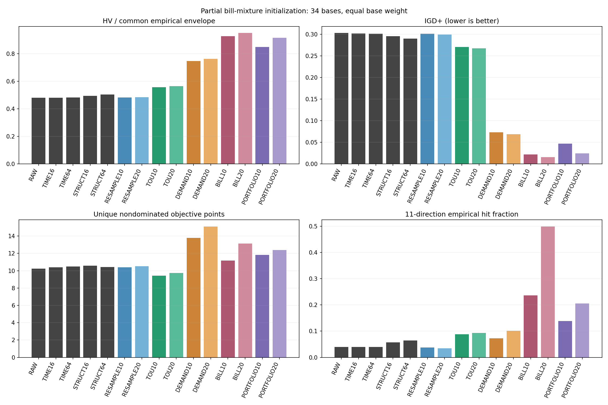
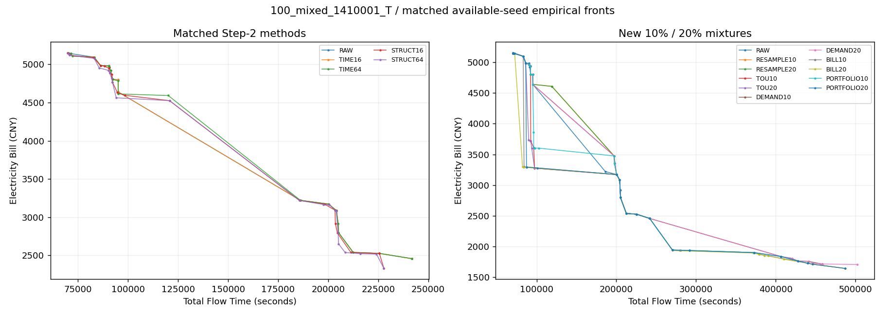

# 电费混合初始化：夜间部分结果分析

日期：2026-10-12。材料来源：academic-research-suite / experiment-agent；模式：validate；状态：ANALYZED（部分矩阵开发诊断）。运行源 a8a2afd，分析独立分支 research/initial-bill-results-20261012；不修改默认初始化。

## 结论与适用范围

**加入20%的总电费与Flow折中构造（BILL20），已经明显改善这批初始化的经验前沿，值得继续验证。** 单纯增加随机候选帮助很小；纯需量导向可以找到很低费的慢解，但对较快的解帮助有限。下一步应优先保留BILL方向，改善中间折中点和原有快解保留，再检查计入初始化成本后的整程收益。

这是初始化结果，尚未证明最终MOEA/D效果变好，也不能据此称方法具有文献创新性。原计划1440个种群实际完成1280个（128/144十组配对块），剩余160个未启动，全部属于50任务组。可用34个独立base中，30个具有完整H/T和两seed，4个只有seed11001的H/T，2个完全缺失。因此报告明确作为部分矩阵开发诊断；不把原36base确认实验标为完成。

## 实验比较的是什么

每个种群始终100成员。原10类来源各保留9个或8个，分别让出10%或20%给新构造；按原顺序截取，未根据质量挑选保留成员。

| 家族 | 新成员构造原则 | 要回答的问题 |
| --- | --- | --- |
| RESAMPLE | 原随机构造增加候选，4候选选1 | 是否只是额外候选产生的收益 |
| TOU | 已构造前缀的实际时间分时电费积分，加固定Flow权重0.1 | 分时电价偏好能否改善初始化 |
| DEMAND | 前缀固定900秒窗口需量费用，加固定Flow权重0.1 | 需量端是否缺少低费结构 |
| BILL | 前缀总电费与Flow折中，权重0、0.1、0.25、0.5 | 多种费用—时间偏好能否补齐前沿 |
| PORTFOLIO | 轮流取TOU、DEMAND、BILL库成员 | 混合家族是否比单家族更均衡 |

各家族做10%和20%两档。四个基础库每块各20个胜出者，每个位置4候选，总计320次新候选构造；10%取库前10个，20%取全部20个，PORTFOLIO也复用这些库。使用5%分数范围的RCL和随机化顺序。这里的前缀分数不等于完整未来任务的真实边际Bill；最终可行性和目标仍由完整SSGS/exact计算。

RESAMPLE还有顺序和随机流差异，四库共用唯一性集合，不能把比较解释成纯费用打分的单因素因果消融。共享库也使10%与20%没有独立的构造时间对照。

旧RAW、TIME16/64、STRUCT16/64使用第二步相同input、parent和种子，只匹配新组已完成的128块：640旧种群与1280新种群统一重算，总计1920个种群。

## 完整性、停止原因与验真

node1完成72块/720种群，01:28:10结束。node0完成56块/560种群，最后完成块01:49:01，后续受内存派发守卫限制；06:27:05以deadline_or_stop结束，保留16块未启动。守卫判断包含文件缓存，不能把资源等待直接归因于Lilanxin，或称算法崩溃。没有记录到算法failure、OOM或部分输出目录。检查时本批worker/supervisor均为0；未续跑、未改其他项目。

两端正式证据已全量回收到本地：4116文件、2,965,314,222字节；tar成员与本地解压文件全部逐size/SHA256通过。源、runner、输入、父个体、配置、原产物hash与同host配对通过。1280新种群均100成员、唯一genes及来源配额正确；1920新旧种群192000代表的数值、费用分解和来源完成检查。

原worker对40960新候选及128000新种群代表的独立exact复验由产物hash绑定。本轮另对96个预定位置的库胜出者fresh重跑SSGS/exact，全部一致；不是fresh重评全部候选。10240个胜出者的4候选择优数值审计通过。全部1920个HV和IGD+完成独立实现交叉检查。

一个BILL10种群存在严格浮点前沿与原Archive容差前沿差异，费用差约万亿分之一量级。原Archive规则重放一致；所有种群两种口径最大HV差1.11e-16，IGD+差0，不影响实质结论。

完整原始回收包和全部69张图在本地保留；本批完整raw尚未发布GitHub Release。Git交付包含分析脚本、聚合数据、缺失名单及少量按算例编号选取的示例图，不能称三端完整raw交付。

## 分析口径

每个native H/T算例把相同可用种子的15组种群构成共同经验非支配union，以其ideal/nadir归一化；HV参考点为(1.1,1.1)，IGD+/IGD参考同一union。它是本批方法共同形成的经验包络，**不是真实Pareto前沿**。扩展费用端也改变归一化范围，因此不能直接拼接第二步报告原HV数值。

先平均每个base可用H/T与seed，再令34个base等权；50/100/200任务分别10/12/12个base。30个完整base独立重做敏感性分析。保留两个16项Holm家族：四费用家族、两比例、HV/IGD+分别对RAW和相同比例RESAMPLE。使用20k规模分层bootstrap、100k配对signflip、seed2026101203。种群、方向或库槽位不是独立统计样本。

下表所有数值均为base等权均值。HV比例表示相对共同经验包络的HV覆盖，IGD+越小越好；ND为最终100成员的唯一非支配目标点数。“方向覆盖”为11个均匀线性权重、距经验最优分数0.001内的命中比例，不能代表全部非凸前沿覆盖。

| 方案 | 经验包络HV比例 | IGD+ | ND点数 | 11方向覆盖 |
| --- | ---: | ---: | ---: | ---: |
| RAW | 47.92% | 0.30290 | 10.22 | 4.01% |
| TIME16 | 48.09% | 0.30186 | 10.40 | 4.01% |
| TIME64 | 48.23% | 0.30124 | 10.49 | 4.01% |
| STRUCT16 | 49.31% | 0.29545 | 10.57 | 5.68% |
| STRUCT64 | 50.27% | 0.28980 | 10.43 | 6.48% |
| RESAMPLE10 | 48.17% | 0.30140 | 10.38 | 3.81% |
| RESAMPLE20 | 48.32% | 0.29932 | 10.50 | 3.41% |
| TOU10 | 55.56% | 0.27082 | 9.42 | 8.82% |
| TOU20 | 56.38% | 0.26723 | 9.74 | 9.36% |
| DEMAND10 | 74.66% | 0.07348 | 13.77 | 7.22% |
| DEMAND20 | 76.11% | 0.06867 | 15.11 | 10.09% |
| BILL10 | 92.68% | 0.02212 | 11.18 | 23.60% |
| BILL20 | **94.95%** | **0.01564** | 13.13 | **49.93%** |
| PORTFOLIO10 | 84.73% | 0.04707 | 11.83 | 13.84% |
| PORTFOLIO20 | 91.51% | 0.02458 | 12.39 | 20.59% |

BILL20描述性表现最好；BILL10已经有大部分质量收益。20%相比10%的HV再增加0.01816、IGD+再改善0.00648，方向覆盖增加较明显。两档之差属于探索性比较，不是单独预设的确认检验，更没有证明10%耗时更少。DEMAND20的ND点数更多却覆盖更差，说明不能只看非支配数量。

| 对RAW的比较 | 归一化HV增量 | IGD+改善 | 两指标Holm调整p |
| --- | ---: | ---: | ---: |
| TOU10 | 0.05487 | 0.03207 | 0.000160 |
| TOU20 | 0.06180 | 0.03567 | 0.000160 |
| DEMAND10 | 0.22652 | 0.22942 | 0.000160 |
| DEMAND20 | 0.23808 | 0.23423 | 0.000160 |
| BILL10 | 0.36840 | 0.28078 | 0.000160 |
| BILL20 | 0.38656 | 0.28726 | 0.000160 |
| PORTFOLIO10 | 0.29810 | 0.25582 | 0.000160 |
| PORTFOLIO20 | 0.35810 | 0.27831 | 0.000160 |

BILL20−RAW的HV增量95% bootstrap区间为[0.35429,0.41939]，IGD+改善为[0.26327,0.31298]，34/34个base均正向；对RESAMPLE20的HV增量0.38187、IGD+改善0.28368也通过对应家族。两个完整16项家族均正向通过；相同调整p来自100k Monte Carlo检验分辨率，不能说真实p完全一样。

30完整base敏感性下，BILL20−RAW的HV增量0.38586，区间[0.35064,0.42160]；IGD+改善0.28956，区间[0.26337,0.31828]。完整32项家族也通过。这降低了结果依赖4个半完成base的疑虑，但不会消除缺失和复用诊断算例带来的泛化限制。64统计及四个16项校正家族已独立重放一致。

## 电费改善是否只是牺牲速度

最低Bill点的配对平均费用变化：RESAMPLE20降低0.35%，TOU20降低2.15%，DEMAND20降低43.06%，BILL20降低43.28%，PORTFOLIO20降低43.06%。**43.28%不是同等Flow下节省**：BILL20最低费点的Flow相对RAW最低费点平均约3.30倍。

为检查快解附近是否也改善，进一步做探索性同Flow上限比较：对RAW和新组都限制为不超过RAW最快解的相同倍数，再分别取最低Bill；不用曲线插值生成不存在的可行解。下表为34base等权的配对费用改善，正数为节省。五档、全部十组均报告在flow_cap_summary.csv；这项是在主结果之后追加的探索，不进入预设Holm家族。

| 共同Flow上限 / RAW最快解 | BILL10 | BILL20 | TOU20 | DEMAND20 | PORTFOLIO20 |
| --- | ---: | ---: | ---: | ---: | ---: |
| 1.05倍 | 1.44% | 1.90% | 0.87% | -0.04% | 1.53% |
| 1.10倍 | 2.65% | **5.06%** | 1.25% | -0.02% | 2.59% |
| 1.25倍 | 9.02% | **12.25%** | 7.17% | -0.06% | 10.51% |
| 1.50倍 | 12.49% | **14.94%** | 8.98% | -0.21% | 12.27% |
| 2.00倍 | 15.17% | **16.65%** | 7.60% | -0.49% | 14.31% |

BILL20的收益不只来自极慢尾端；在1.1倍上限下128个配对种群有67个省费、8个更贵，其余相同；1.25倍下101个省费、3个更贵。DEMAND20在这些上限没有一个配对种群正向，主要补的是慢而低费的尾端。它更适合作为机制诊断或少量极端种子，不能取代折中构造。

原快解尚未得到逐算例保护。BILL20种群最快点平均改善0.44%，但11/34个base变差，最差base平均损失0.65%；20%截取旧类前8个会移除一些原快解。报告的平均质量提升不能掩盖这个问题。

## 为什么总费用折中比仅看分时电价更有用

低费端变化主要来自需量费。RAW最低费点的base等权平均总费5939.21，其中分时电费698.60、需量费5240.60；BILL20分别为3025.35、746.81、2278.54。这里是均值费用分解，不能用均值之比替代前面的配对43.28%。新低费端分时电费反而略高，说明只追最低分时电价抓不住主要缺口；需量下降与Flow代价需要共同平衡。

探索性分层中，BILL20在H/T的最低费点平均节省54.53%/32.03%，50/100/200任务分别45.73%/43.57%/40.94%；六场景均值也正向。H/T及规模不是额外独立样本，50组还有缺失，不能把分层差异包装为确认的交互。

BILL库槽位按权重分解如下，仅作为描述，不把2560槽位当作独立样本或纯权重因果实验：

| Flow权重 | Flow / RAW最快Flow | Bill / RAW最低Bill | 胜出者进入最终100成员ND的比例 |
| --- | ---: | ---: | ---: |
| 0 | 6.48 | 0.594 | 19.26% |
| 0.1 | 5.31 | 0.595 | 37.21% |
| 0.25 | 4.01 | 0.624 | 48.24% |
| 0.5 | 1.30 | 1.112 | 61.18% |

当前权重在较快的1.3倍Flow与较慢的4倍之间跳跃，中间折中方向可能仍偏稀疏。权重0.5的Bill高于RAW最低费点并不说明其无用，二者Flow不同；同Flow上限比较才更贴近这个判断。这里不同槽位还有随机顺序、候选池和已见集合影响，建议增加0.35/0.4附近权重只是待验证想法。

图按算例编号选择，完整68个native算例图均保留。两面板坐标范围可能不同；连线只是阅读辅助，不代表两点间每个插值都是可行解。所示为可用种子的经验前沿，而非独立重复种群或真实Pareto。

## 成本与下一步优先级

| 规模 | 四家族共享库生产均时 | 包含验真/导出等的块总均时 |
| --- | ---: | ---: |
| 50任务 | 26.79秒 | 32.19秒 |
| 100任务 | 135.43秒 | 158.96秒 |
| 200任务 | 905.77秒 | 1045.66秒 |

这些是每块四库共320候选的时间，**不是BILL20单独耗时**。不能除以4估计单家族，也不能声称BILL10快一半。200任务下原STRUCT16/64生产均时219.57/677.66秒，成本定义不同；当前结果不是等总时间算法比较。

建议依次验证以下三件事，当前均未启动，也未修改默认方法：

1. **简化为BILL折中种子并保护快端。** 优先保留20%费用方向作为研究候选；在原各类8个的固定配额内保留原最快点和必要方向点，仍总计100成员。以10%作为配额对照，实际单独构造BILL库并记录单家族耗时，而非继续为比较生产全部四库。
2. **补中间折中方向。** 少量保留0/0.1极低费种子，增加0.35/0.4附近权重，并与现有四权重在相同候选预算下比较。关注1.05–1.25倍Flow费用、快端损失和方向覆盖，避免只优化低费极端。
3. **全新留出算例、等总时间整程确认。** 比较RAW、STRUCT16、BILL10/20及改良BILL，初始化时间纳入总预算，再运行固定MOEA/D参考。报告最终/anytime HV、IGD+、同Flow上限费用与初始化成本；复用本批诊断base的初始化改善不够证明最终迭代收益。

原矩阵缺失16块可以在新的明确窗口下补齐，届时保留当前报告为部分版本；补齐旧诊断数据与全新留出整程测试的目的不同，不能相互替代。此次用户只要求先分析，未恢复这160种群或自动安排后续。

## 复现与解释检查

脚本、原始hash、缺失名单与统计流程见REPRODUCTION.md及ANALYSIS_PLAN.md；详细聚合结果在data/report.json，全部64统计独立复算在data/independent_statistics_audit.json，探索性上限与权重分析另列。分析代码本地521测试/full gates通过，overall85.09%、core96.92%；准确分析提交的远端CI以PR实读结果为准，不用运行源PR51的CI代替。

11项解释检查全部完成：独立单位使用base；配对输入与种子一致；依赖的HT/seed先聚合；缺失与完成选择显式说明；32项预设家族不删；探索性比较单列；p值不替代效应和区间；统计显著不当作整程收益；经验参考不称真实Pareto；费用极端不称同Flow节省；候选/CPU成本不等不称等时间因果效果。当前支持继续研究BILL初始化，不支持默认晋级、创新性宣称或Lilanxin干预。
