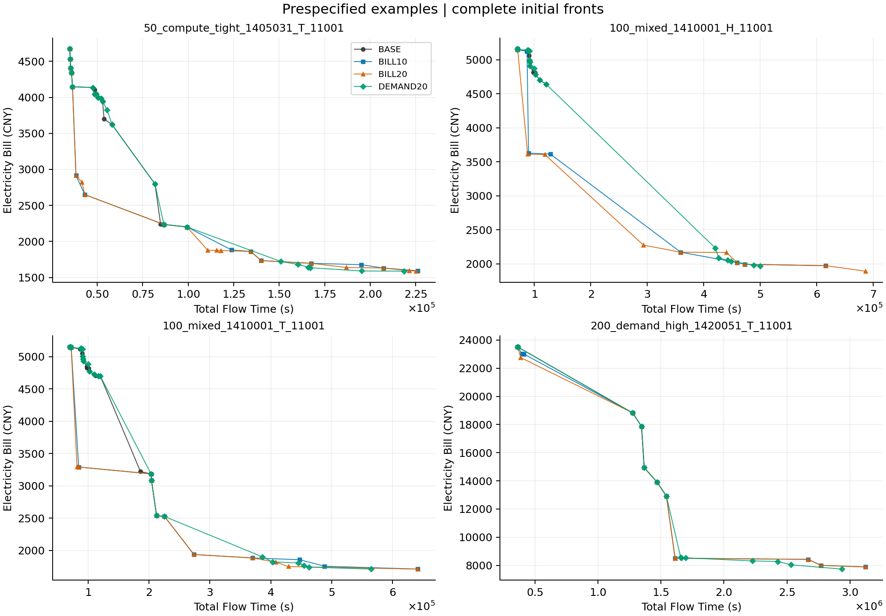
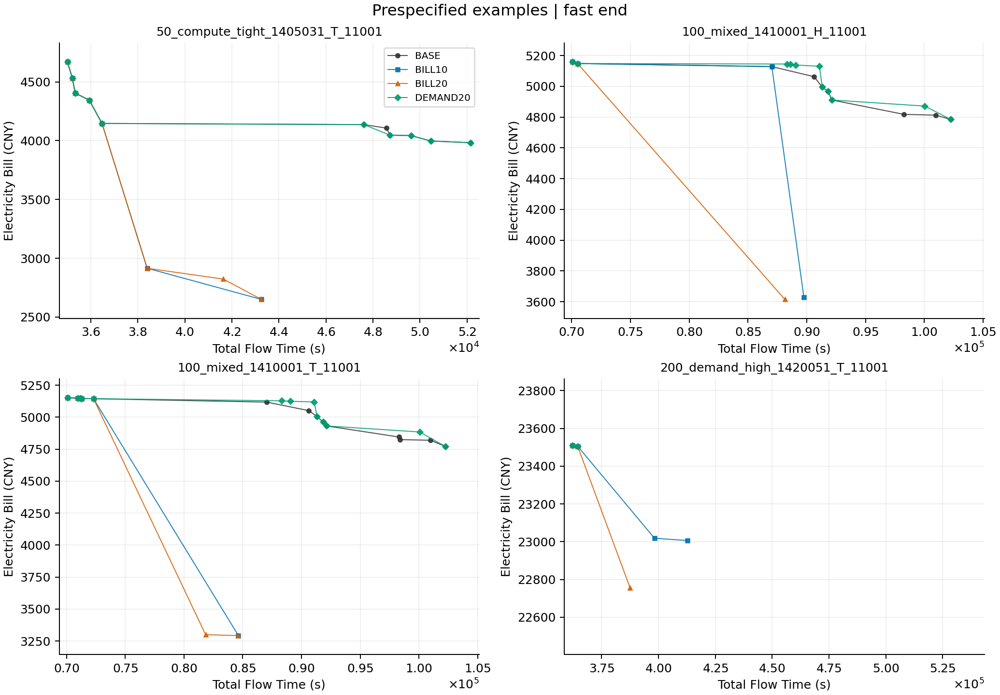

# 初始化四组独立质量与成本实验：完整结果分析

## Material Passport

Origin Skill: academic-research-suite / experiment-agent；Origin Mode: validate；日期：2026-10-12；Verification Status: ANALYZED；Version Label: benchmark-analysis-v1。完整原始文件、指标交叉实现与统计独立重放均已核验；本轮没有重新生成全部正式种群或 fresh 重评全部成员，不能把结果分析标为整实验再运行已复现。

## 结论先读

**这条初始化改进方向值得继续，但下一轮优先用 BILL10 做候选基线。** BILL10/BILL20 的初始前沿相对 BASE 有稳定的大幅改善，不再是前几轮算子改动中的弱信号；只是它们需要额外构造时间，能否在同样总预算下改善最终 MOEA/D 仍未验证。

BILL10 已取得 BILL20 相对 BASE 的 **93.24% HV 增量**，平均生产时间为 BILL20 的 **53.76%**。BILL20 的质量均值更高，但后 10 个费用种子的边际收益明显变小。这个排序是质量/成本的描述性比较，本协议没有预注册 BILL20−BILL10 的胜负检验。

DEMAND20 相对 BASE 也改善，但平均更慢、HV/IGD+ 均值较 BILL10/BILL20 差，快端固定 Flow 上限下未观察到明显平均省费。当前不宜把它作为下一轮主要初始化配方；保留作需量端机制对照即可。

## 1. 实验与数据完整性

正式 36 个诊断 base，50/100/200 任务 × 六场景 × 两个 base；native H/T、seed11001/11002，144 同 host 四组块、576 个独立 P100 种群。不是 576 个独立算例：独立统计单位是 36 个 base。输入复用前两步诊断矩阵，不是全新留出。没有 MOEA/D 迭代、RL、Polish 或候选链。

BASE 为原十类各 10 个。BILL10 为各旧类保留 9 个，加 10 个 Bill 导向新成员；BILL20/DEMAND20 为各旧类保留 8 个，加 20 个新成员。每个新成员独立四选一，每臂各自重新构造原100，不共享原种群或候选库生产成本。BILL10/BILL20 新成员前10个在全部144块严格一致；原始父基因hash在各臂一致。DEMAND 的构造评分只用需量，最终总费用仍由原 exact evaluator 给出。

运行源固定 `6d3d0e662a72c2ff0a3ded9ad7bf4d0ccf3c97c2`，canonical `29388ddf2e5b03593b4d51b0bcf02d81906218d3d8469e157100e89a3f41def7`，原 PR53 未合并。20005/20007 同 host 条件经正式索引验证，原34+72与补跑22+16按键归并，不重复计数；原node0安全stop历史保留。完成于北京时间18:30:56，无真实算法失败/OOM、所有正式worker退出。

完整正式与技术pilot共 **3,622 文件 / 1,164,983,249 字节**，两tar共108,625,673字节；全部tar成员及解压文件逐size/SHA通过。pilot12块/48种群单列，不参与统计。服务器与本地原件保留，本轮没有清理服务器磁盘。

576种群的57,600成员可行/数值/基因唯一性、576存储Archive回放、7,200四选一代表评分和28,800候选前缀费用与exact记录一致性检查通过；576 HV 与576 IGD+交叉实现通过。原worker对28,800新候选及57,600最终成员的独立exact证据由完整产物hash绑定，本轮仅回读验真，不假称全部fresh再评价。

## 2. 总体质量

以下先对每个base的H/T与两个seed取平均，再让36base等权。HV越大越好，IGD+/IGD越小越好。尺度为本native case四组×两seed的共同经验非支配union的ideal/nadir；退化维使用1作除数，HV参考点(1.1,1.1)。超出HV参考盒的点不贡献HV，距离指标不裁剪。

| 方案 | normalized HV | IGD+ | IGD | HV/共同经验包络 | unique ND数/P100 |
|---|---:|---:|---:|---:|---:|
| BASE | 0.446526 | 0.315586 | 0.412769 | 51.11% | 10.34 |
| BILL10 | 0.810973 | 0.019044 | 0.041879 | 94.01% | 11.55 |
| BILL20 | 0.837402 | 0.010548 | 0.029052 | 97.34% | 13.42 |
| DEMAND20 | 0.700446 | 0.055942 | 0.067480 | 80.55% | 15.59 |

“共同经验包络”仅包含本次8个种群已找到的点，BILL20达到其97.34% HV不表示已达到真实Pareto前沿97.34%。旧十组/第二步具有不同union，不能用本表比例跨批比较进步。

| 对 BASE | HV增量 [95% CI] | IGD+改善 [95% CI] | 主家族 Holm p（两指标） | 正向base |
|---|---|---|---:|---:|
| BILL10 | 0.364448 [0.332736, 0.395774] | 0.296542 [0.274464, 0.318437] | 0.000060 / 0.000060 | 36/36 |
| BILL20 | 0.390876 [0.360030, 0.422827] | 0.305038 [0.282978, 0.327906] | 0.000060 / 0.000060 | 36/36 |
| DEMAND20 | 0.253920 [0.218339, 0.290324] | 0.259644 [0.236606, 0.282809] | 0.000060 / 0.000060 | 36/36 |

三新臂对BASE的HV/IGD+共6主项联合Holm；IGD3项、生产wall3项分别各自Holm。36base分规模20,000配对cluster bootstrap，100,000配对sign flip，seed2026101204。12统计及6/3/3三家族独立重放通过。主p约0.000060，三个IGD次项p约0.000030；所有生产wall差均正且时间家族p约0.000030，说明改善伴随明确的额外生产成本。标准化配对效应量/每base完整效应见data/report.json，不仅报告p值。

## 3. 成本：200任务尤需注意

生产wall包括原初始化构造与首次exact、本臂候选构造与首次exact、代表选择和front提取。原初始化参考重放、候选重复exact与最终100成员独立SSGS/exact记为审计；JSON输出另列。生产wall不是端到端elapsed，审计不是后续真实算法必付的全部成本。

| 方案 | 平均生产wall秒 | 平均CPU秒 | 50任务生产秒 | 100任务生产秒 | 200任务生产秒 | 平均审计秒 | 平均导出秒 |
|---|---:|---:|---:|---:|---:|---:|---:|
| BASE | 3.94 | 3.94 | 0.45 | 1.66 | 9.72 | 3.94 | 0.022 |
| BILL10 | 72.46 | 72.37 | 5.20 | 26.78 | 185.39 | 5.57 | 0.023 |
| BILL20 | 134.77 | 134.58 | 9.86 | 49.70 | 344.76 | 6.95 | 0.022 |
| DEMAND20 | 153.79 | 153.60 | 10.81 | 57.53 | 393.02 | 8.16 | 0.023 |

全部正式臂生产CPU累计 **14.58小时**，四组逐一测量，不等于单次初始化延迟。四阶Williams四种顺序各36块，位置/前序均衡；各臂均同host连续执行。20005经历文件缓存门等待与补跑，已部分完成base的不同HT/seed可能分属不同时段，故wall时间是本轮共享硬件环境的观察，不能宣称独占延迟或跨机器普遍常数；CPU也一并报告。

从BILL10加到BILL20，平均HV只再增加 **0.026429**，平均生产时间再增加 **62.32秒**。以200任务为例，BILL10/BILL20分别约3.09/5.75分钟。若后续整程总预算只有10分钟，生产初始化已占约31%/57%；若30分钟则约10%/19%。这只是预算占比推算，不能据此推断最终胜负。

## 4. 改善来自哪里，快端有没有代价

| 方案 | 最低Bill相对BASE平均省费 | 最低Bill点Flow/BASE最快Flow | 快端平均Flow变化 | 最快Flow受损base | Flow≤1.1×BASE最快时省费 | ≤1.25×时省费 |
|---|---:|---:|---:|---:|---:|---:|
| BILL10 | 43.00% | 6.34× | -0.438% | 7/36 | 3.72% | 9.63% |
| BILL20 | 43.39% | 6.36× | -0.452% | 13/36 | 4.75% | 12.15% |
| DEMAND20 | 43.52% | 6.33× | +0.126% | 14/36 | -0.07% | -0.21% |

最低费用端约43%的省费不能解释成相同延迟下省43%：其点位允许更慢Flow。上表两个固定Flow上限诊断只取真实已构造点，没有插值；全部144配对观察均有可用点，因此没有因缺点筛掉病例。它们是事后探索性描述，不是额外预注册主检验。BILL20在仅允许25% Flow空间时平均仍省约12%，说明收益不限于极慢尾端；DEMAND20在快端平均略负，解释了它的总HV弱于Bill折中方向。

平均最快Flow略好不等于每个base都不损失。BILL10仍有7/36、BILL20有13/36个base的最快点损失。当前按旧来源配额截取9/8个可能删掉原快速代表；新费用种子不保证补回。下一步应在P100内显式保护少量Flow边界并重做方向/成员选择，而不是增加种群规模来掩盖快端缺口。这个“配额截取造成损失”是待隔离验证的机制解释，当前只验证损失存在。

非支配点数量也不足以单独判定质量：DEMAND20有15.59点，比BILL20的13.42多，但HV和IGD+更差；重要的是点在哪里，而非只增加ND数。200任务BILL20保留ND平均9.25，依然有稀疏折中区域，值得观察中间Flow权重和最终P100的方向保留。

## 5. 前沿图

所有图单独使用seed11001的一个P100，不把两个seed合并冒充一个种群。横轴Total Flow Time（秒），纵轴Electricity Bill（CNY），左下更好；线段仅引导视线，不证明线段上的调度可行。快端图统一只显示Flow不超过BASE最快值1.5倍的实际点，排除窗口外点的连线，防止未观察到的插值误导。

预定案例为50计算紧张T、100混合H、100混合T、200高需量T，各取首个base，未按收益挑图。完整72native算例的full/fast PNG+PDF共288文件与四概览位于完整分析ZIP；固定四案例概览随Git PR交付。图中费用导向常补上原BASE缺少的低费/中间点，但200高需量实例仍有很大点间空隙，不应把连续连线理解为已覆盖整个Pareto曲线。

## 6. 下一步建议（尚未实施）

1. **以BILL10作为下一轮较廉价参考，优先保护快端。** 在固定100成员内保留原最快/若干Flow端非支配代表，其余仍按来源与方向选取。必须与未保护BILL10对照，单独看快端损失、HV/IGD+与生产时间，不能直接写成当前采用。

2. **先补中间折中，再考虑把10提升到20。** 在同样10费用成员/40候选预算下比较当前权重与中间Flow权重/方向分散配方；同时考虑最终100成员的方向覆盖选择。构造权重与选择规则须分开消融，不能把两种改动的收益混在一起。

3. **计入初始化时间，做全新base的等总wall整程确认。** BASE、BILL10、保护快端BILL10，必要时以BILL20作高成本上界；测试至少两种总预算，初始化、迭代、Polish/Archive全部计入同一个deadline。否则本轮再大的初始化收益也不能证明最终MOEA/D更好。

成本优化也值得做，但要先profile候选前缀资源检查/贪心调度的具体热点，保留原路径、基因/目标/RNG等价与前后benchmark；不能未经测量就把收益归因某个积分函数。当前生成后四选一只用了40/80次new exact，但逐工序路径评分仍可能昂贵；生产时间的大头在新bank构造，表中已单列。

本轮没有启动上述新实验、设置定时、修改默认初始化/main/F6/A3或清理任何旧批次。

## 7. 统计误用检查与证据边界

| 检查（11/11） | 本轮处理 |
|---|---|
| Simpson反转 | 分50/100/200与H/T分别报告；三新方案总体及规模质量均正，不用规模差异替代机理。 |
| 生态谬误 | 独立单位36base，HT/seed先均值；不把576种群当576独立样本。 |
| Berkson/选择偏差 | 复用诊断base、非新留出；不能推向所有生产LLM负载。 |
| Collider条件选择 | 全144正式块，没有按成功、收益或耗时筛样；快端诊断全部有真实点。 |
| 忽略基率 | 非分类/诊断任务，不适用；全部base正负计数仍报告。 |
| 向均值回归 | 四臂同原父流且成对；但发现矩阵被复用，需全新留出确认。 |
| 幸存者偏差 | 正式144全部完成验真，原stop历史留存，pilot与重复尝试不计正式。 |
| 多处寻找效应 | 六主、三IGD、三wall分别Holm；候选间排名和快端上限描述明确探索性。 |
| 分析分叉 | 冻结seed/样本/归一化/统计家族；没有事后加样或挑收益子组；独立12统计重放。 |
| 因果越界 | 本实验支持具体构造对诊断初始前沿的影响，未检验整程收益或独立机理贡献。 |
| 反向因果 | 配方在评价前固定；经验参考由各臂共同决定，不能称真实最优或跨批尺度比较。 |

整体解读：诊断初始化质量证据强；泛化、成本可迁移性与整程收益保持CAUTION。没有用“未显著”当等价，也没有根据现有收益声称文献新颖性。

## 8. 交付与复现

完整raw、逐文件manifest/校验和、原运行source bundle：[GitHub Release](https://github.com/atlantic0423/geo-llm-scheduler/releases/tag/initial-bill-benchmark-analysis-20261012-6d3d0e6)。两tar分别独立解压到同一raw目录，formal_execution_index精确映射144键。运行源与分析源分开冻结；原PR53不合并，分析PR及准确head CI由最终交付验收记录给出。

完整分析ZIP包含全部指标、配对表、候选观察、共同参考、所有图和报告。`data/independent_statistics_audit.json`记录12统计/三Holm家族重放；`data/integrity_checks.json`记录全部指标与产物检查。Git提交保留适合版本管理的聚合表、复現脚本与固定概览，完整raw走Release。

本地完整结果根：`outputs/initial_bill_benchmark_complete_20261012`。原始数据已全量本地验真，GitHub raw已上传并逐size/SHA digest回读；最终下载抽样、报告PR/CI和全量分析交付的准确状态见 `DELIVERY_ACCEPTANCE.md`，不以本报告的计划文字提前声明验收。
