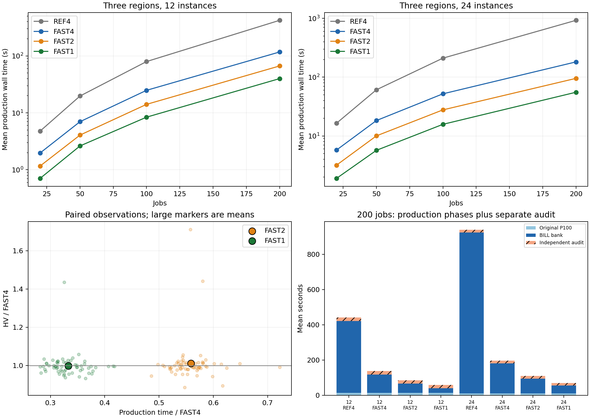
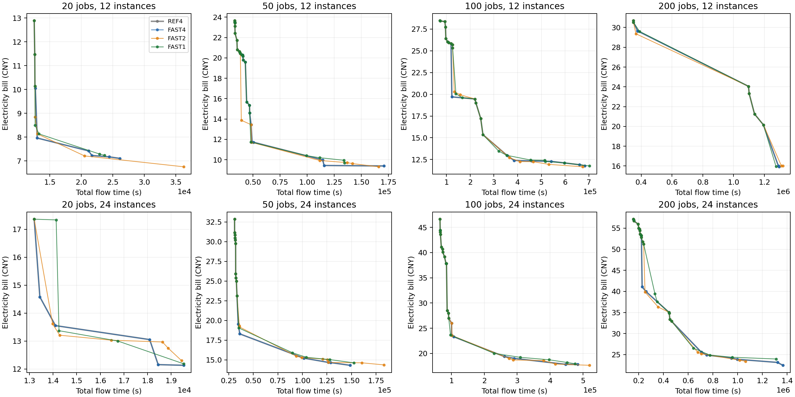

# BILL10 初始化加速与构造强度：结果分析

分析完成日期：2026-10-16。正式计算于2026-10-15北京时间22:23:39启动、22:52:30完成，约28分51秒。本批只研究初始化，没有运行MOEA/D后续迭代。

## 结论与推荐

**先用索引版四选一FAST4，保留90＋10和原构造强度。** 全部64个配对块的最终100成员种群、Archive、40次trial评分观察和随机流后态严格相同；相对原版REF4，生产wall配对几何均值为0.29923，95%区间[0.28682, 0.31229]，即约节省70.08%（区间68.77%–71.32%）。这是本批有直接等价证据的工程加速。

如果必须进一步压缩初始化预算，可选FAST2：相对FAST4的逐run配对生产时间平均减少44.12%，生产加独立审计平均减少39.65%。但是它不是无损替换：最低费用端在26/32个base上变差，配对相对费用平均增加1.09%；11/32个base的HV相对下降超过1%，其中2个超过5%。FAST1更便宜，但费用端平均增加2.39%、30/32个base变差，不建议优先作为质量比较的参考配置。

**下一步最有把握的降本方向是复用重复SSGS，并把资源日历推广到通用SSGS；先保留四选一。** 本批未实现这两项，也未将FAST4合并为项目默认。减少候选次数省下的时间能否转化为最终进化收益，仍需计入初始化的等总墙钟整程验证。

## Material Passport

- Origin Skill：academic-research-suite / experiment-agent；Origin Mode：validate；Origin Date：2026-10-16；Version Label：initial_speed_validation_v1。
- Overall Confidence：FAST4等价性及本批降本证据充分；FAST2/FAST1质量折中为CAUTION，未完成非劣检验。
- Task：初始化成本定位、四二一构造强度比较与可复现性验证；Mode：validate。
- Material：冻结256次正式初始化及配套pilot/golden/profiles；无外部论文、人工参与者或新算法实验。
- Verification Status：VERIFIED，指归档逐文件验真、冻结后处理重放和统计独立复算；不表示下载后fresh重评全部最终成员。
- 运行source：3653d52b164382491f07b6df7bd01e6a21c5f1b7；运行字节摘要：f89cf2773c741027690e273bdd0702da3732a405d6fd0c386353b1d6177e36ac。
- 分析代码在质量揭盲前冻结于de1ffa450e358ff0bbbff93eb9140fa143236f2b；本页为后续结果解释。
- [预注册协议](https://app.notion.com/p/3fa8878b801981029981edc2b5dab7c4)、[运行PR61](https://github.com/atlantic0423/geo-llm-scheduler/pull/61)、[分析PR62](https://github.com/atlantic0423/geo-llm-scheduler/pull/62)。两PR均未合并，原默认算法保持。

## 1. 实验回答什么问题

四组均为100成员：先从头构造原十来源P100，再每类保留9个，共90个，加10个BILL成员。没有复用先前计时外生成的父种群。BILL权重0/.1/.25/.5按3/3/2/2分配；每个BILL位置分别构造4、2或1个完整候选，合计40、20或10个候选。

| 组别 | 后端 | 每个BILL位置完整构造数 | 研究含义 |
|---|---|---:|---|
| REF4 | 原资源扫描与原积分 | 4 | 冻结原方法 |
| FAST4 | 资源日历、同P查询缓存、电价索引缓存 | 4 | 保留候选/评分/RNG的工程加速 |
| FAST2 | 同FAST4 | 2 | 构造强度改变 |
| FAST1 | 同FAST4 | 1 | 构造强度改变 |

正式32个全新独立base覆盖20/50/100/200工件、12/24个Serving Instance、3地区，以及mixed、burst、vram_tight、demand_high四种压力。各base两个seed、四组同host，64块/256run；块内顺序Williams均衡，最多24块并行，单块四组顺序运行。16次独立pilot、原200任务golden、8个单构造profile、1个整次初始化profile和4次微型恢复夹具全部排除在正式推断外。

FAST2/FAST1改变后续随机消耗、去重历史和候选集合，不是在FAST4的同一组候选里简单截前两项。比较反映完整构造策略，不能把所有差异只归因于“每次多挑两个”。

## 2. 已经降了多少时间

下表是未插桩正式run的平均生产wall秒数，每格8次运行（4个base×2seed）。生产包含原P100生成、BILL bank及选择；独立审计另列。

| 工件数 | 实例数 | REF4 | FAST4 | FAST2 | FAST1 |
|---:|---:|---:|---:|---:|---:|
| 20 | 12 | 4.78 | 1.97 | 1.16 | 0.71 |
| 20 | 24 | 16.45 | 5.76 | 3.19 | 1.90 |
| 50 | 12 | 19.76 | 7.00 | 4.07 | 2.62 |
| 50 | 24 | 60.96 | 18.28 | 10.03 | 5.70 |
| 100 | 12 | 79.70 | 24.89 | 14.10 | 8.40 |
| 100 | 24 | 210.30 | 52.05 | 27.75 | 15.77 |
| 200 | 12 | 422.46 | 117.35 | 66.68 | 39.97 |
| 200 | 24 | 923.87 | 181.51 | 95.26 | 55.33 |

FAST4相对REF4的32个base生产wall比值全部小于1；CPU的配对几何比0.29923、95%区间[0.28697, 0.31206]与wall接近，说明这里主要是计算开销下降。全矩阵生产算术均值217.28→51.10秒，均值之比为0.2352，与逐base对数比估计的0.2992权重不同，不能混称同一个速度估计。

200任务包含独立审计的实际成本如下。最后一列为两项相加，不冒充完整worker结束耗时；原runner未单独插入最终JSON导出计时。

| 实例数 | 组别 | 生产秒 | 审计秒 | 生产＋审计秒 |
|---:|---|---:|---:|---:|
| 12 | REF4 | 422.46 | 19.68 | 442.15 |
| 12 | FAST4 | 117.35 | 20.03 | 137.38 |
| 12 | FAST2 | 66.68 | 19.37 | 86.04 |
| 12 | FAST1 | 39.97 | 18.79 | 58.76 |
| 24 | REF4 | 923.87 | 15.75 | 939.62 |
| 24 | FAST4 | 181.51 | 15.90 | 197.42 |
| 24 | FAST2 | 95.26 | 15.07 | 110.33 |
| 24 | FAST1 | 55.33 | 14.81 | 70.14 |

200任务平均而言，FAST4生产149.43秒，FAST2 80.97秒，FAST1 47.65秒；包含审计为167.40、98.19、64.45秒。因此200任务已经从原版平均约11.2分钟生产降到约2.5分钟。12实例原版约7.0分钟、24实例约15.4分钟，不能拿旧批另一拓扑的185秒直接估本批所有200任务。

此前那个完全相同的200任务/R3/M12输入也单独重放过：420.383→116.963秒，种群及Archive严格一致。它只是一个golden，正式多场景均值以上表为准。

## 3. 减少次数损失多少初始前沿质量

同base的四组×两seed最终P100共同形成经验非支配参考，统一归一化；HV参考点(1.1,1.1)。该参考不是真实Pareto前沿，归一化HV也不是百分比覆盖率。先对同base两个seed求平均，再以32个base为独立单位。20k按规模分层bootstrap、100k配对signflip、seed2026101517；FAST2/FAST1相对FAST4的HV差和IGD+改善共四项联合Holm。表中两指标都是正值有利。

| 组别 | 指标 | 平均效应 | 95% bootstrap区间 | Holm p | 正/负base数 |
|---|---|---:|---|---:|---:|
| FAST2 | HV差 | -0.000311 | [-0.011673, +0.014589] | 1.000000 | 13/19 |
| FAST2 | IGD+改善 | +0.000926 | [-0.004539, +0.007865] | 1.000000 | 15/17 |
| FAST1 | HV差 | -0.006340 | [-0.012646, +0.000841] | 0.406036 | 11/21 |
| FAST1 | IGD+改善 | -0.002314 | [-0.006559, +0.002337] | 1.000000 | 9/23 |

四项均未确认总体差异，也没有预设等价/非劣界限，因此不能据此认定FAST2或FAST1无损。FAST1的HV均值方向较差、21/32个base为负；FAST2总体HV差近零，但base间差异很大。

| 组别 | 平均HV | 平均IGD+ | 种群unique ND数 | 11方向精确命中数 |
|---|---:|---:|---:|---:|
| FAST4 | 0.929438 | 0.026814 | 14.58 | 3.08 |
| FAST2 | 0.929127 | 0.025888 | 14.09 | 2.11 |
| FAST1 | 0.923098 | 0.029128 | 14.23 | 2.14 |

方向命中是11个加权和方向上达到共同经验union最优值（容差1e-9）的数量；它是较苛刻且偏向被比较union的描述性诊断，不是主检验，也不是整个连续前沿的覆盖证明。FAST2/1平均方向命中较少，说明“总HV相近”也可能伴随一些方向的代表解退化。ND数量本身不能代替质量。

### 不能被平均数掩盖的差异

FAST2的配对相对HV平均为+1.07%，中位数却为−0.17%，范围−8.06%至+57.66%。其中200任务/12实例/vram_tight这一个base相对增幅很大，拉高均值；它在两seed平均后的归一化HV增量为+0.191835。20/50/100任务分层HV平均差均为负（−.007004/−.001177/−.008225），200任务为+.015161。每层只有8个base且未作额外确认检验，这些只是异质性观察，不能据此制定“200任务固定二选一”的事后规则。

FAST2最差的20任务/24实例/demand_high为−8.06%，200任务/12实例/burst为−6.19%。完整64条base×策略诊断见descriptive_base_diagnostics.csv，主统计没有删除任何极端算例。图表固定展示mixed及seed15101的八个规模/机器数案例，不能以图中少数接近的前沿取代完整统计。

费用端是当前最实用的保留四选一理由：FAST2最低费用在26/32个base变差、相对均值+1.09%；FAST1为30/32、+2.39%。Flow最快端大多由共同保留的原90成员支撑，两种策略各只有1个base变差，但没有显式快端保护保证。这些端点结论均为描述性，不新增事后显著性家族。

图中REF4与FAST4完全重合。线段仅帮助观察离散解，连线上不保证存在可行调度。

## 4. 到底耗时在哪里

### 4.1 不是穷举工件排列，而是逐工件遍历机器路径

12实例=3地区×4实例，每个工件有$3\times4^2=48$条合法P/D路径；24实例=3×8，每个工件为$3\times8^2=192$条。200工件、40个完整引导候选相应为384000/1536000次前缀路径评分。机器数加倍会使这里的路径数变为四倍；资源拥挤、作业次序和权重还会进一步改变每次资源查询成本。

原版对每条路径重复查询P、D最早可行时刻，并重扫starts筛出某台机器的operation；电费试探又反复计算active区间、电价积分与固定900秒需量窗。加速版保持全部路径及原求和顺序，只减少重复扫描与重复查询。电价缓存采用相同积分公式与分项顺序，没有用不等价的原函数相减代替。

单个200任务/24实例/权重0的匹配profile中，原资源earliest累计43.391秒，其中intervals扫描32.963秒；原电价积分累计20.036秒。索引后，新日历earliest 5.120秒、积分0.299秒。它们是带插桩的单候选累计时间，父子项嵌套不能直接相加，也不能当完整初始化的正式加速倍数。8个匹配profile的候选/时刻/exact/RNG均严格一致，详细表见HOTSPOT_DIAGNOSTICS.md。

### 4.2 加速以后，重复SSGS值得先动

另做了一个与原200任务golden完全相同输入的整次FAST4 cProfile，不参与正式统计。总带插桩wall300.992秒，其中生产259.273秒、审计41.718秒，原最终P100/Archive仍严格一致。**这些数不是未插桩初始化用时**，只用来定位调用结构。

| 整次profile中的项目 | 调用数 | 累计秒 | 解释 |
|---|---:|---:|---|
| 全部SSGS.decode | 280 | 140.325 | 包含下列四类，不能再相加到父项 |
| 原P100构造中的decode | 100 | 21.224 | 保留的父构造成本 |
| guided_genotype末尾decode | 40 | 45.521 | 核对构造的前缀时刻 |
| seed_bank再次decode | 40 | 45.610 | 同一基因重新得到正式Schedule |
| 最终P100独立审计decode | 100 | 27.970 | 独立验证，保留 |
| 引导路径新日历earliest | 480000 | 81.513 | 与decode分属不同调用路径 |
| PrefixPower.trial | 384080 | 46.740 | 含active/需量/积分，含80次提交评分 |
| TariffIndex.integral | 3515366 | 3.136 | 是PrefixPower等项的子调用 |

全部decode约占该次profile总时间46.6%；其中seed_bank的40次重复decode占总profile约15.2%、生产约17.6%。这说明可复用SSGS结果的空间明确，但插桩会改变各函数成本比例，不能承诺正式运行也必定再省17.6%。

现在继续只优化TOU积分的上限很小：该次整体profile仅约1.0%落在积分接口。更优先的是通用SSGS内的全starts扫描，以及日历查询仍反复组装事件点和扫描活动集合。减少最终独立exact审计虽能让账面更快，却会削弱验收证据，不作为本轮降本建议。

## 5. 怎么设置更合理

| 使用条件 | 建议 | 理由与边界 |
|---|---|---|
| 正式质量比较、初始化预算尚可 | FAST4、P100、90＋10、四选一 | 本批严格保持原结果，生产已省约70%；200任务生产＋审计均值约167秒 |
| 初始化必须控制在约1–2分钟 | FAST2作为候选配置 | 200任务12/24实例平均86/110秒含审计；费用端约1.09%退化、局部HV损失仍需接受，非每例时限保证 |
| 极短测通/技术预跑 | FAST1可用 | 200任务含审计约64秒均值，费用端与方向覆盖代价更大，不优先用于最终质量结论 |

若总端到端预算为40分钟，则200任务平均生产＋审计FAST4约占7.0%、FAST2约4.1%；这是用本批均值作的预算举例，不是已跑过40分钟进化的效果结论。对20/50任务，FAST4本就只有几秒到十几秒，更没有必要为省这几秒统一砍构造强度。

后续工程优先级建议：

1. **复用guided_genotype第一次decode产生的完整Schedule。** 连同resource-wait等诊断字段传给seed_bank，保持首次时刻一致性检查，保留最终独立审计；逐候选、种群、评分、随机流及exact与REF4/FAST4对齐。
2. **将按operation编号保持求和顺序的资源日历用于通用SSGS。** 加速原P100、trial末尾decode和审计；保留reference路径、容量边界/并发反例/golden及前后benchmark。它比继续钻TOU缓存更值得优先尝试。
3. **再考虑构造强度的局部折中。** 例如费用权重0/.1保留四次、.25/.5降为两次，理论为32而非40次完整构造；这只是未测建议，未宣称等价或已知收益。需要新留出base验证，不能用本批平均差直接采用。

本轮不新派发上述实验，不改默认算法；宽泛的72小时多算法比较也尚未启动。

## 6. 完整性、复现与限制

正式256/256run、64/64严格配对块和32个独立base全部齐全，原validator/输入/spec/config/seed/host/source/产物SHA通过，原supervisor及本批worker全部退出、exit complete。包括技术诊断的完整raw为2097数据文件、429849958字节；归档29013567字节，SHA256为59865ffad18f81c8d12acb674703e1c4e7115b3438ae4c0630284bd53f0b7638。归档含manifest共2098成员，服务器tar、本地tar流和解压文件已逐项size/SHA检查；无删除。

原worker的7040个新trial独立exact与25600最终成员SSGS/exact复验由完整产物hash绑定；本轮本地未fresh重评所有最终成员。后处理对全部256个HV/IGD+进行了双实现核对，六个派生CSV/JSON逐SHA重放一致，四项质量、两项成本统计和Holm用另一实现从CSV复算一致。分析使用原exact的区域累加次序，没有自行换成不同的浮点求和。

本批24个不同物理核、单worker4GiB地址空间上限，合计96GiB低于200GB用户额度；未设置聚合200GB cgroup，实际短时RSS很低，不能外推为未来64路长预算内存压力验证。已完成run跳过和partial目录quarantine用独立微型夹具验证；flock只锁supervisor，异常恢复前必须另查孤儿worker，不能把run级续跑说成恢复内部搜索状态。

分析代码完整本地门禁583pass/1 Linux-only skip、overall85.44%/core96.92%；运行源本地579pass/1skip、Linux目标63专项及两PR当时准确head双Python CI通过。结果文档提交后的最终CI和Release验真见最终交付回执；可复现步骤见REPRODUCTION.md。

研究限制：32个受控合成base、每base两seed、固定3地区和12/24实例；不代表真实生产工作负载、其他拓扑或500任务。经验union参考偏向参与比较的构造策略；端点/方向与分层只作描述。较小trial非嵌套随机流，不识别每一份额外候选的纯边际贡献。初始化更好不保证固定总时间下MOEA/D最终更好；本批也没有证明任何算法创新。

### 统计解释检查

按ARS检查11/11类：聚合与规模分层异质性已展示，不能只报FAST2相对HV均值；独立单位为base，seed/run不冒充独立样本；32base全纳入、无幸存者筛选；四主检验预注册并联合Holm；无事后剔极端值或挑图；端点/方向/压力拆分标为描述；不从profile占比承诺未插桩收益；不把未显著当等价。生态推断、Berkson/碰撞变量控制、基准患病率、极端组前后回归、反向因果不适用或未用于推断。结论仅限同输入配对工程比较和本批构造策略，不跨到最终进化效果。
