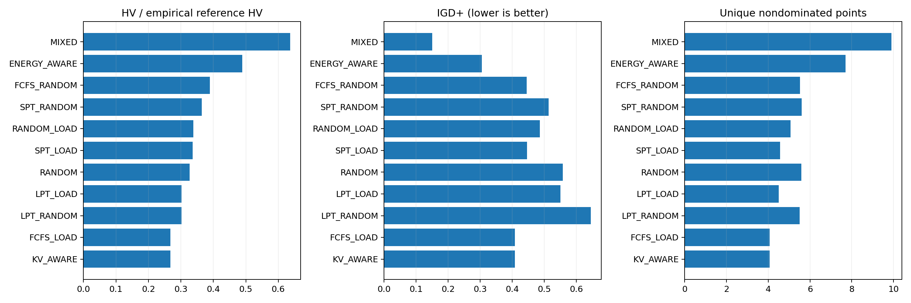
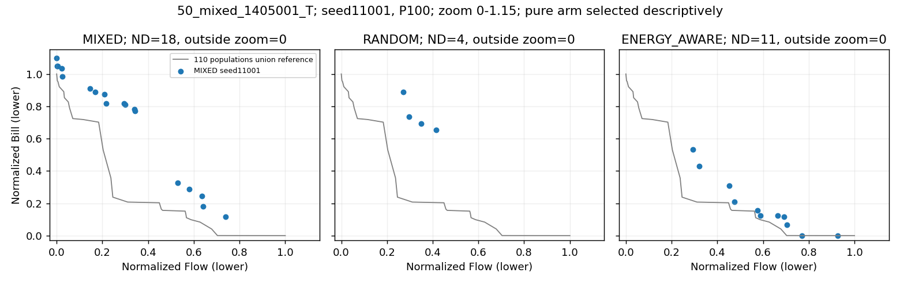
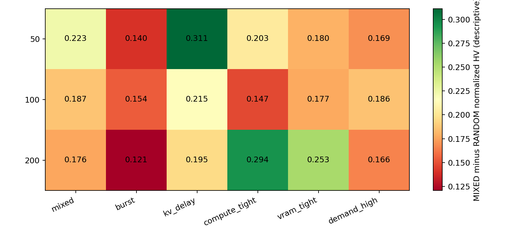

# 初始化第一步结果分析：原混合、纯随机与九个单启发式对照

当前混合初始化明显优于纯随机，并优于本轮各单独启发式的整体前沿质量；因此下一步应保留混合框架，针对费用端和方向覆盖改进。它已经能构造有效的初始折中前沿，但还没有形成稳定、充分覆盖的前沿。本轮只观察初始化，不证明最终迭代结果会随之改善。

## Material Passport

- Origin Skill: academic-research-suite / experiment-agent
- Origin Mode: validate
- Origin Date: 2026-10-11
- Verification Status: VERIFIED（指标与统计复算；不是重新运行全部候选 exact）
- Version Label: initialization_step1_v1

## 1. 执行、样本与统计方法

正式 36 个独立 base、72 个 native H/T 输入、50/100/200 任务、六压力场景，每个输入 10 个初始化 seed、11 种方法，共 7,920 个 P100 种群、720 个同主机方法块、792,000 个候选；全部种群均生成 100 个唯一基因，无失败/OOM。独立 pilot 的 396 个种群、39,600 个候选单列，未混入正式统计。两台最后于北京时间 2026-10-11 17:51:03 完成，墙钟约 18 分 59.8 秒。

原 worker 对每个候选进行 SSGS、exact 与独立 exact；MIXED 基因和 RNG 后态与原初始化器完整回放一致。原完整 validator/input/spec/config/source/seed/host/产物 SHA 检查通过。本轮结果处理引用这些哈希绑定证据，没有宣称 fresh 重评全部候选。运行源仍 e57d385b2a4dcc7546e2f54e920cccbe2b6eb7a1，canonical 06c3a645ff4bcd24431640eacca0a42fb58309c65ac41e9480b250e5927d9436；原默认算法不改。

每个 native 输入合并全部 11 方法 × 10 seeds 的 11,000 个正式候选，取唯一非支配集作共同经验包络；它不是已知真实 Pareto 前沿，也不是单次 P100 可直接达到的目标。按包络 ideal/nadir 归一化，退化轴 span=1；HV 参考点 (1.1,1.1)，其外点仅在 HV 中排除，IGD+ 不裁剪。H 为同地区电价模式，T 为地区电价差异模式；两者各用自己的输入构造。

统计单位为 36 个 base，先平均同 base 的 H/T × 10 seeds 配对差，再按 50/100/200 任务分层做 20,000 bootstrap 与 100,000 sign flip，统计 seed2026101101。主家族是 MIXED−RANDOM 的 HV/IGD+ 两项联合 Holm；九个其他 pure−MIXED 的 18 项是独立次家族。场景×规模每格只有两个 base，分层图和端点/来源/成本主要用于诊断，不冒充另外的确认检验。

## 2. 混合相对纯随机：优势已确认

| 指标，正向为混合更好 | 36-base 平均配对差与 95% CI | Holm p | 正/负 base |
|---|---:|---:|---:|
| 归一化 HV 差 | +0.194236 [+0.174881, +0.216397] | 1.99998e-05 | 36/0 |
| IGD+ 改善（随机减混合） | +0.408218 [+0.307168, +0.556118] | 1.99998e-05 | 36/0 |

混合 HV 平均 0.4334，随机 0.2392；IGD+ 分别 0.1503、0.5585。两指标的 36 个 base 平均配对差全部正向。描述性双向覆盖：混合弱支配随机前沿约 70.63%，随机弱支配混合约 6.11%。混合相对随机的最小 Flow 平均配对下降 24.12%，最小 Bill 下降 19.91%。端点指标没有另外做确认检验。

不能用“平均 HV 提升约 419%”概括本轮。随机有 75/720（10.42%）个种群 HV 为 0，另有很小分母；相对百分比仅对 645 个有定义的配对计算，容易被小分母放大，已在 CSV/JSON 标明。主检验使用全部配对的 HV 绝对差，75 个零值没有被剔除。混合也有 17/720（2.36%）个零 HV；这意味着点落在冻结参考矩形外，不等于不可行或完全没有非支配解。

## 3. 单独启发式是否比混合更好

| 方法 | 平均 HV / 经验包络 HV | IGD+ ↓ | 唯一 ND | Flow 端距包络 | Bill 端距包络 | 生产路径秒/种群 |
|---|---:|---:|---:|---:|---:|---:|
| MIXED | 63.70% | 0.1503 | 9.91 | 2.42% | 13.17% | 4.12 |
| FCFS_LOAD | 26.73% | 0.4081 | 4.07 | 4.86% | 69.17% | 3.32 |
| FCFS_RANDOM | 38.89% | 0.4453 | 5.53 | 26.19% | 54.87% | 3.68 |
| SPT_LOAD | 33.65% | 0.4466 | 4.56 | 12.12% | 61.30% | 3.57 |
| SPT_RANDOM | 36.47% | 0.5134 | 5.60 | 26.31% | 54.65% | 3.84 |
| LPT_LOAD | 30.22% | 0.5505 | 4.50 | 29.76% | 61.64% | 3.62 |
| LPT_RANDOM | 30.16% | 0.6459 | 5.50 | 43.02% | 55.18% | 3.89 |
| RANDOM_LOAD | 33.88% | 0.4865 | 5.06 | 24.47% | 60.66% | 3.96 |
| RANDOM | 32.73% | 0.5585 | 5.59 | 36.34% | 55.26% | 4.15 |
| KV_AWARE | 26.73% | 0.4081 | 4.07 | 4.86% | 69.17% | 3.33 |
| ENERGY_AWARE | 48.92% | 0.3047 | 7.70 | 87.07% | 10.23% | 7.84 |

这些是同等 P100 的原构造器对照，纯方法保留同样的 0.1 扰动。平均值不能替代配对检验；下表给出预先规定的直接 pure−MIXED 比较。

| pure−MIXED | HV 平均差 | HV 95% CI | IGD+ 改善 | 两项次家族 Holm p |
|---|---:|---:|---:|---:|
| FCFS_LOAD-MIXED | -0.2501 | [-0.2727, -0.2274] | -0.2578 | 0.000179998 / 0.000179998 |
| FCFS_RANDOM-MIXED | -0.1477 | [-0.1656, -0.1315] | -0.2951 | 0.000179998 / 0.000179998 |
| SPT_LOAD-MIXED | -0.1829 | [-0.2047, -0.1627] | -0.2963 | 0.000179998 / 0.000179998 |
| SPT_RANDOM-MIXED | -0.1698 | [-0.1988, -0.1432] | -0.3631 | 0.000179998 / 0.000179998 |
| LPT_LOAD-MIXED | -0.2080 | [-0.2276, -0.1898] | -0.4003 | 0.000179998 / 0.000179998 |
| LPT_RANDOM-MIXED | -0.2100 | [-0.2336, -0.1900] | -0.4957 | 0.000179998 / 0.000179998 |
| RANDOM_LOAD-MIXED | -0.1818 | [-0.2011, -0.1624] | -0.3363 | 0.000179998 / 0.000179998 |
| KV_AWARE-MIXED | -0.2501 | [-0.2727, -0.2274] | -0.2578 | 0.000179998 / 0.000179998 |
| ENERGY_AWARE-MIXED | -0.1112 | [-0.1273, -0.0951] | -0.1544 | 0.000179998 / 0.000179998 |

九个纯方法的整体 HV 和 IGD+ 都显著低于混合。ENERGY_AWARE 的平均前沿质量在纯方法中较好，但仍不能替代混合：它改善费用端的同时牺牲 Flow 端。没有预先检验纯方法相互之间的胜负，表中的排序只是描述。

## 4. 真正值得关注的缺口：T 费用端与折中覆盖

总体混合的最小 Flow 距共同经验包络约 2.42%，最小 Bill 高约 13.17%。必须分电价模式看：H 的 Flow/Bill 缺口约 2.34%/4.58%；T 约 2.50%/21.75%。混合相对随机在 H 的最小 Bill 平均配对反而高约 0.59%，在 T 则低约 40.40%；所以“混合所有目标在所有条件都更好”不成立。总体前沿质量更好是已确认结果，H 费用端胜负只是未做专门检验的描述。

在 T 中，纯 ENERGY_AWARE 的最小 Bill 距经验包络约 7.46%，明显小于混合的 21.75%；同块配对费用端平均下降约 11.34%，但最小 Flow 平均增加约 161.71%。这提示低费用构造确实能提供更靠近右下端的点，却容易牺牲完成时间。不能据此直接把种群全部换成 ENERGY_AWARE。

混合 P100 平均唯一 ND 仅 9.91，共同包络平均 25.32；HV 占包络约 63.70%。100 个均匀 Tchebycheff 方向中，相对经验包络标量值后悔差不超过 0.01 的比例约 18.86%。该阈值是诊断量，未做显著性判定；包络含 110 倍候选量，不能将其 36.30% HV 缺口理解为选择器一定可回收的收益，也不能把 ND 数差当作迭代最终收益。

固定第一 T 算例、固定 seed11001 的图如下。每个面板是一个 P100 的非支配子集；灰线是本输入全部方法/种子的共同经验包络。纯方法面板按本输入平均 HV 事后选作描述，不用于确认检验。显示缩放仅取 0–1.15；超出视窗的 ND 数在标题标明，全部点仍参与 IGD+。

## 5. 来源贡献及重复模式

MIXED 每类恰好接受 10 个初始个体；来源信用按唯一非支配目标点均摊，避免同目标重复点任意归因。以下仅为来源观察，不能解释为删去某方法后的反事实收益。

| 构造来源 | 平均 ND 信用 | 平均 ND 份额 | Flow 端信用 | Bill 端信用 |
|---|---:|---:|---:|---:|
| FCFS_LOAD | 1.076 | 12.08% | 29.17% | 2.08% |
| FCFS_RANDOM | 0.919 | 8.15% | 0.00% | 8.19% |
| SPT_LOAD | 1.231 | 12.29% | 24.86% | 0.14% |
| SPT_RANDOM | 0.710 | 7.01% | 0.00% | 10.14% |
| LPT_LOAD | 0.632 | 6.22% | 0.00% | 6.11% |
| LPT_RANDOM | 0.301 | 2.84% | 0.00% | 8.61% |
| RANDOM_LOAD | 0.771 | 7.48% | 0.00% | 2.92% |
| RANDOM | 0.328 | 2.95% | 0.00% | 6.67% |
| KV_AWARE | 1.096 | 12.60% | 35.56% | 2.36% |
| ENERGY_AWARE | 2.842 | 28.36% | 10.42% | 52.78% |

ENERGY_AWARE 仅占初始人数 10%，却贡献约 28.36% 的非支配来源份额和 52.78% 的 Bill 端信用；FCFS_LOAD、SPT_LOAD、KV_AWARE 承担较多 Flow 端信用。LPT_RANDOM 与 RANDOM 的非支配来源份额分别约 2.84%、2.95%，但这些随机结构是否有利于后续进化尚未检验，不能只据初始被支配率删除。

冗余核对发现：FCFS_LOAD 与 KV_AWARE 在 720 个同输入/seed 对照中有 718 个完整基因序列和集合完全一致；其全部 720 个目标前沿、HV/IGD+ 数值一致，另外两组基因不同但本轮目标表现相同。H 下 ENERGY_AWARE 与 FCFS_LOAD 的 360 个完整基因序列也一致。因 H 的各地区价格相同，Energy 的价格优先级失去地区区分；本算例的同质全阶段服务器使 MinLoad 经常已经选同机路径，KV 共址优先级难以形成额外策略区分。该原因由冻结生成器与本矩阵支持，不能推广为所有实例上三方法恒等。

混合中的两来源接受的是 RNG 流不同位置的样本，来源信用不同并不矛盾；重复规则也不等于完全重复的混合个体。值得测试更有区别的构造规则或配额，但本轮没有证明某个改配额方案可提升效果。

## 6. 成本与分层观察

生产路径定义为生成+SSGS+exact+Archive，不计技术独立复验和 MIXED 回放。混合约 4.12 秒/种群，随机 4.15 秒，ENERGY_AWARE 7.84 秒；ENERGY 的 SSGS 平均 6.62 秒，混合 3.16 秒。这里是同主机多进程负载下的测量，不是独占机器微基准；不能把技术复验/回放开销当作原初始化生产开销。

三任务规模的 MIXED−RANDOM HV 差分别约 +0.2045 / +0.1775 / +0.2007；六压力场景平均差全部正向。每个规模×压力仅两个 base，没有据此挑子组、追加样本或宣布某场景最适合新机制。

## 7. 下一步建议与停止条件

1. 保留原混合 P100 作为初始化研究对照，不换成纯随机或单一启发式，也不自动晋级默认算法。
2. 优先继续原第二步：在完全相同 genes/input 上观察有界 timing-only 费用预处理，用真实 Bill 分项、Flow、可行性及耗时区分“时序就能改善的费用缺口”和“必须改 assignment/order 的缺口”。初始目标改善不能预设会保留到迭代结束。
3. 结构构造侧先改低费用规则的折中能力：原 ENERGY_AWARE 只按 Prefill 地区全时域平均价排序，不直接评价 Decode 电价、Demand 峰值或实际调度时段。可测试 P/D 两阶段费用代理、低峰值负载与 Flow 限制，保留少量费用端样本，而非把全种群压向最便宜地区。此为候选，不是已验证方案。
4. 原第三步用同一 200/500 候选池比较方向选择和随机选 100，保护两端及中间方向。额外采样成本与选择规则收益必须分开，现有共同包络不能充当某个已可实现新初始化器。
5. 配额变更可以作为小规模候选：保留 Flow/费用/随机结构三类作用，减少表面不同但实际重复的规则；必须预先冻结配额，并在新留出 base 上等总 wall、计入初始化成本比较整程 HV/IGD+。来源份额不直接用作配额最优值。

本轮没有启动第二步、第三步或配额改动。若初始改善在整程预算下消失，或额外构造成本抵消最终收益，就缩减/停止该候选。A3 的 D8 最终优势属于另一批证据，本轮未运行 A3×初始化交互，不能把两项收益相加。

## 8. 复验与解释边界

全部 7,920 个 HV 已用独立水平条带算法复算，1,440 个 MIXED/RANDOM 的 IGD+ 与独立实现交叉验证；20 项 base 统计、20k CI、100k sign flip 及 2/18 两 Holm 家族均独立复现一致。六个指标/退化轴/参考点边界检查通过。源码/CI/完整 raw 回收及发布验收以附带 receipts 为准，不用测试通过代替研究效应。

统计谬误 11/11 核对：分层异质性已报告；独立单位固定 base；算例为合成诊断分布，外推有限；无事后筛选或调整控制变量；非分类实验无基率问题；不按极端结果选择新样本；正式没有失访/失败种群；两完整检验家族全部报告；统计计划质量前冻结，零分母仅在描述比率中标未定义；干预仅为初始化方法，不能推出最终搜索效果；构造先于评价，未反向归因。来源贡献是观察性记录，不能证明删去某模式的因果收益。

[原冻结计划](FROZEN_PLAN.md)；[复现说明](REPRODUCE.md)；[完整统计 JSON](data/report.json)；[逐种群指标 CSV](data/population_metrics.csv)；[直接配对差 CSV](data/paired_metrics.csv)。服务器与本地原件保留。

完整回收验真：43,998 个文件、14,421,978,453 字节，压缩包 1,426,295,175 字节；全部 tar 成员与本地文件逐大小/SHA256一致。正式与pilot、运维历史均保留，服务器原件未删除。完整 raw/compact 目前保存在本地；本轮 GitHub PR 交付报告、分析脚本和聚合表，不冒充完整 raw Release 已发布。
