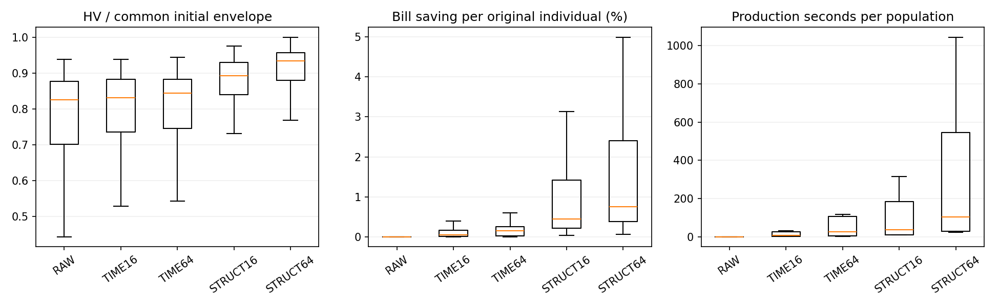
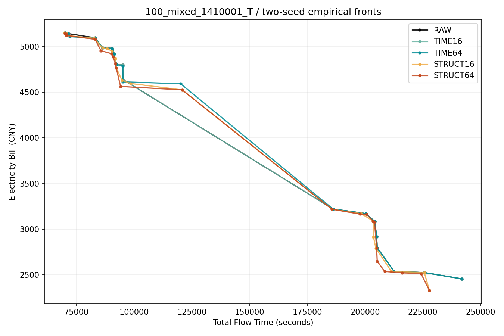

# 初始化第二步：时序与结构预处理结果分析

本轮已计算、完整回收并完成冻结统计分析。**结构预处理值得继续研究，16次档应作为下一步的成本参考；单纯Prefill右移有小幅收益，但当前枚举方式的收益有限。下一步重点是降低结构构造成本、保留不同权衡方向，并检验计入初始化成本后的整程效果。**这些是研究建议，默认初始化、F6与MOEA/D行为尚未更改，第三步尚未启动。

## 1. 执行与数据完整性

- 北京时间2026-10-11 20:02:49/50启动，两节点分别于20:42:11、20:42:51结束，总窗口约40分01秒。当前worker与supervisor均为0，exit complete，failure、stop、OOM均为0。
- 正式36个基础算例、72个native H/T输入，任务数50/100/200、六类场景、两seed、五组，共144个同host块、720个100成员种群。技术pilot的180种群单列，不进入正式统计。
- 正式共14,400个原始父个体，72,000个保留代表；原worker对2,068,058次追加候选评价及全部保留代表进行了独立exact复验。本次分析核查其完整产物哈希，**没有重新调用exact复验全部正式候选**。
- 正式与pilot全量回收6,444个文件、3,944,951,158字节，逐文件size/SHA256及全部tar成员验真通过。压缩包488,041,489字节，SHA256为`309c67b0f6c7ad5fdfe3dfda80436c8a530bf78a145f64e40ec04c07649fc2b7`。完整manifest SHA256为`478d6054e53723851e7e9b934ef11376b6dddb56fffc49f3cd04733915c4c482`。本地与服务器原件保留；本报告不宣称完整raw已上传GitHub Release。
- 原运行源冻结`5bb666874a86ae59e38aa2513a1c4f7ed1fa8fcb`，canonical `34dd838db2cf62124b967b45ba5049419f6ec96ddab82e6375104d106a1a7f02`，[启动PR49](https://github.com/atlantic0423/geo-llm-scheduler/pull/49)未合并。分析走独立分支，未修改运行源。

## 2. 这一步究竟测了什么

五组使用第一步原混合初始化产生的同一批100成员父种群。

| 组别 | 追加处理 | 每个原个体的追加exact上限 |
|---|---|---:|
| RAW | 保留原分配、顺序和SSGS时间表 | 0 |
| TIME16 | 原RightShiftPolish枚举前缀，至多一次Prefill右移 | 16 |
| TIME64 | 同样处理，允许更长枚举前缀 | 64 |
| STRUCT16 | A3电价代理区域迁移与A5 P/D联合前移候选交替、去重、取前缀 | 16 |
| STRUCT64 | 相同最大候选池，评价更长前缀 | 64 |

每个原个体仅保留一个可行、Flow不增加、Bill严格减少的代表，否则保留原解。TIME冻结MS/OS、全部Decode与其他操作，Flow完全不变；STRUCT重新SSGS。没有进化、RL、候选链或多步局部搜索。A3使用电价曝光代理，最终改进仍以exact Bill为准；本轮没有隔离A3和A5各自的因果收益。

STRUCT16和STRUCT64都构造最多64个候选的相同最大池，16档也支付完整池的生成开销。上限相同不等于实际评价数或耗时相同。平均每个种群追加exact次数依次为TIME16的1,459、TIME64的4,922、STRUCT16的1,600和STRUCT64的6,380。STRUCT16所有原个体均被16次前缀截断；STRUCT64已经遍历本轮的完整有限候选池。后者没有截断，不意味着整个结构邻域已穷尽。

## 3. 主结果：结构比时序更有潜力

主指标来自**最终保留的100成员种群**，不是搜索中所有候选的巨大Archive。HV越大越好，IGD+越小越好。每个native输入用五组、两seed的保留代表共同经验非支配集归一化，HV参考点为(1.1,1.1)。此参考不是已知真实Pareto前沿。

| 组别 | 平均归一化HV | HV相对RAW的差值 | 平均IGD+ | 相对RAW的IGD+改善 | 每个种群平均追加生产时间 |
|---|---:|---:|---:|---:|---:|
| RAW | 0.451911 | — | 0.354681 | — | — |
| TIME16 | 0.456443 | +0.004531 | 0.351798 | +0.002882 | 12.58秒 |
| TIME64 | 0.461228 | +0.009316 | 0.344298 | +0.010383 | 47.85秒 |
| STRUCT16 | 0.506694 | +0.054783 | 0.239837 | +0.114844 | 90.18秒 |
| STRUCT64 | 0.536046 | +0.084134 | 0.195140 | +0.159541 | 272.65秒 |

生产时间为原脚本测得的追加预处理耗时，扣除了审计用独立exact复验；不含原父种群生成，也不是未来整个算法的总时间。实际实验平均每个种群elapsed分别约26.85、104.20、102.77、318.72秒，另含独立复验和汇总工作；并行共享负载下的测量不等于单线程孤立benchmark。

按36个基础算例为独立单位，先平均其H/T与两seed，再按规模分层20,000次bootstrap、100,000次配对sign flip，随机种子2026101102。四个variant−RAW、各HV/IGD+共8项组成主Holm家族。

| 对比 | HV差的95%区间 | IGD+改善的95%区间 | HV严格改善基础算例 | 两项主Holm p |
|---|---|---|---:|---:|
| TIME16−RAW | [0.003523, 0.005589] | [0.001946, 0.004055] | 31/36 | 0.000080 |
| TIME64−RAW | [0.007384, 0.011319] | [0.005245, 0.017863] | 34/36 | 0.000080 |
| STRUCT16−RAW | [0.048521, 0.061469] | [0.047480, 0.198716] | 36/36 | 0.000080 |
| STRUCT64−RAW | [0.074662, 0.094666] | [0.071981, 0.258070] | 36/36 | 0.000080 |

p值已达到本次Monte Carlo检验分辨率附近，不能把0.000080写成解析精确概率。IGD+不截断归一化坐标，部分H/200任务输入的参考跨度较小，平均IGD+及其区间受这些输入影响，不能解读为费用或时间的百分比。

## 4. 增加到64次究竟值不值

次级8项Holm家族按冻结协议独立于主家族：同上限TIME−STRUCT，以及两条线64−16的HV/IGD+。

| 对比 | HV差 | IGD+改善 | 结论 |
|---|---:|---:|---|
| TIME16−STRUCT16 | −0.050251 | −0.111962 | 相同16次上限下，结构更好 |
| TIME64−STRUCT64 | −0.074818 | −0.149158 | 相同64次上限下，结构更好 |
| TIME64−TIME16 | +0.004785 | +0.007501 | 继续枚举有小幅收益 |
| STRUCT64−STRUCT16 | +0.029351 | +0.044697 | 更大结构池还有收益 |

以上每项次级Holm p均为0.000080。STRUCT64−STRUCT16的HV差95%区间为[0.022964,0.037270]，IGD+改善区间为[0.019377,0.077328]。

但STRUCT64平均生产时间约为16档的3.02倍。**16档已取得64档约65.1%的平均HV增量，只用约33.1%的追加生产时间。**这支持先以STRUCT16研究成本控制，不足以宣布16是所有规模、所有预算的最优档。

64档也没有支配16档的每一个点：其前沿对16档的弱覆盖平均为78.54%，反向为28.55%。原因之一是每个父个体只按最低Bill选择代表，64档可能选择Bill更低、但Flow比16档代表更高的候选，尽管仍不超过RAW的Flow。增加候选不会自动同时保留所有有价值的权衡。

## 5. 成本随规模增长，是下一步的实际障碍

| 任务数 | TIME16 | TIME64 | STRUCT16 | STRUCT64 |
|---|---:|---:|---:|---:|
| 50 | 2.17秒 | 4.89秒 | 10.17秒 | 27.53秒 |
| 100 | 7.81秒 | 28.57秒 | 40.81秒 | 112.77秒 |
| 200 | 27.75秒 | 110.09秒 | 219.57秒 | 677.66秒 |

均为每个100成员种群的追加生产时间。200任务STRUCT64约11.3分钟，不能只因初始化HV更高就无条件加入有总时间限制的MOEA/D。

STRUCT16平均约25.76秒用于候选构造、49.34秒用于SSGS、11.08秒用于exact；STRUCT64分别约25.76、197.48、44.25秒。优化优先级应包含**避免16档仍生成完整64池**、减少重复SSGS构建与保持exact一致性的快速评价。改变生成前缀或RNG消耗属于新实现，需要同源候选、数学语义回归及benchmark，不能直接用当前结果替代验收。

## 6. 改善来自哪里，前沿还有什么不足

STRUCT16/64分别替换94.21%/99.65%的父个体，原个体平均Bill降低0.824%/1.306%，Flow降低0.970%/1.015%。TIME16/64的Bill降低仅0.101%/0.185%，Flow按设计完全不变。

STRUCT64平均每个原个体的TOU费用减少9.47元、Demand费用减少87.01元，16档分别7.12、54.01元。**当前总体的Bill改善以Demand费用下降为主**，不能将收益全部归因于A3电价匹配。200任务则TOU减少13.40元、Demand减少7.83元，费用构成随规模变化；这些是描述性观察，没有建立A3/A5贡献或规模交互的因果结论。

配对费用端最低Bill平均改善为STRUCT16的1.187%、STRUCT64的2.088%；最快Flow端平均改善0.370%/0.426%。共同经验包络上的Bill端缺口由RAW的4.438%降为3.149%/2.173%，仍有剩余空间。该缺口只是本轮经验包络之差，不能称距全局最优解的误差。

| 组别 | 保留种群平均唯一非支配点 | 全部探索候选Archive平均非支配点 |
|---|---:|---:|
| RAW | 10.34 | 10.34 |
| TIME16 | 10.53 | 10.53 |
| TIME64 | 10.63 | 10.63 |
| STRUCT16 | 10.60 | 21.49 |
| STRUCT64 | 10.65 | 26.42 |

100个个体的基因仍全部唯一，但结构预处理后的主要前沿点数只略增。全探索Archive更宽，其中也含不满足同父Flow安全筛选的不同权衡解，不能直接把它当最终初始化种群或用其HV替换主指标。这个差异支持研究**如何在100个位置中保留互补方向**；它尚未证明把这些候选加入种群就会改善后续迭代。

RAW对照被variant弱覆盖的比例均为100%，这很大程度由“父解保留、只接受Flow不升且Bill下降”的规则保证。不能把这一覆盖值当作额外独立的效果证据。

## 7. 建议下一步如何安排

1. **先做廉价结构预处理。**以STRUCT16为参考，按需生成候选、避免无效重复构造；把原实现保留为语义与效果对照。200任务优先控制SSGS成本。暂不把STRUCT64普遍设为默认。
2. **再做方向保留。**比较当前每父最低Bill选择与固定100成员的方向覆盖选择，保留最快端、最低费用端及中间权衡。候选池与总计算预算保持可比，另设同候选池选择对照，区分生成收益和选择收益。
3. **最后做独立整程确认。**使用全新基础算例，比较原混合初始化、廉价结构预处理、方向选择及其组合；保持MOEA/D/F6与随机流匹配，将原初始化和全部预处理计入相同总时间，比较最终HV、IGD+和anytime。需要先技术校准再冻结预算与矩阵。

当前不建议继续大幅增加原RightShift枚举预算。较弱的TIME收益仅适用于当前确定性前缀；按需峰值、便宜电价窗口选择更有针对性的时序候选仍是可研究问题，不能宣称时序优化已无价值。

以上三项尚未启动。本轮回答只完成用户要求的结果分析。

## 8. 证据与解释边界

本轮复用了第一步36个诊断基础算例，不是新留出确认。720个种群、14,400个原个体不能作为720或14,400个独立样本；正式统计独立单位为36base。单个规模×场景仅2base，子组只作观察，不挑选“好场景”重做主结论。

“初始前沿更好”尚不等于“相同总时间下MOEA/D最终更好”。本轮没有进化轨迹，也没有检验NSGA-II或宣布创新。共同参考集在不同批次改变，不能把本轮RAW的72.71%经验HV比例与旧匹配观察的20.55%或第一步的比例直接相减。

分析独立复算全部720个HV和IGD+，核查72,000个代表的同父目标安全性、36base同host，独立重放16项base统计与8/8两个Holm家族，并通过7项指标边界核验。后处理最初误以为RAW有`seconds.exact`计时字段，已按其空计时表修正为零并完整重跑；失败日志保留，属于分析脚本问题，不是算法崩溃。

ARS材料状态：**ANALYZED**。原worker exact证据为已验真产物绑定；当前默认采用不变；结构预处理与方向选择均为待整程实验的候选。已检查11类统计解释风险：样本来源、群集独立性、子组与整体、完整矩阵、同父对照、冻结检验家族、经验参考边界、选择规则保证、预算/耗时区别、初始化与最终效果区别、未检验的等价/因果/创新声明。

完整统计见`data/report.json`、`data/paired_metrics.csv`、`data/subgroups.csv`及`data/independent_statistics_audit.json`。72个native输入的两seed经验前沿和概览均已生成；固定编号的示例用于展示，不用于挑选统计样本。

Notion冻结协议：[初始化第二步协议](https://app.notion.com/p/3f68878b8019818db211d3e7fd0c46c3)。
