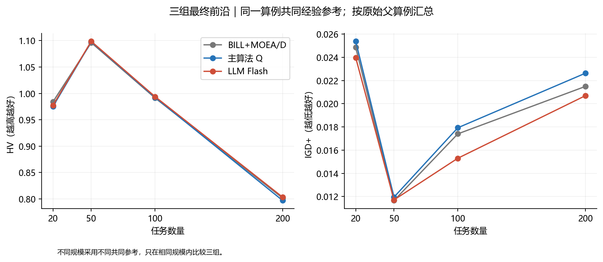
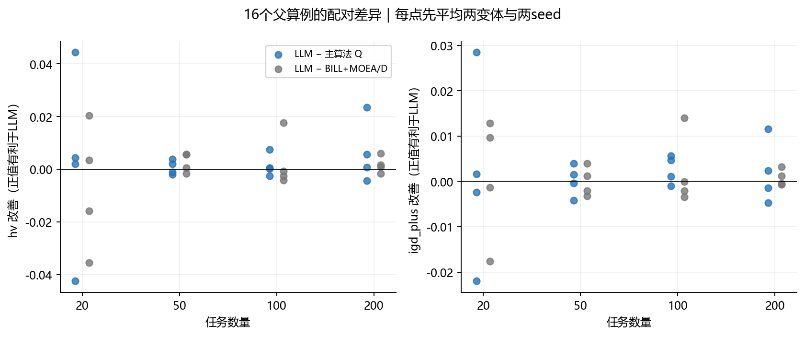
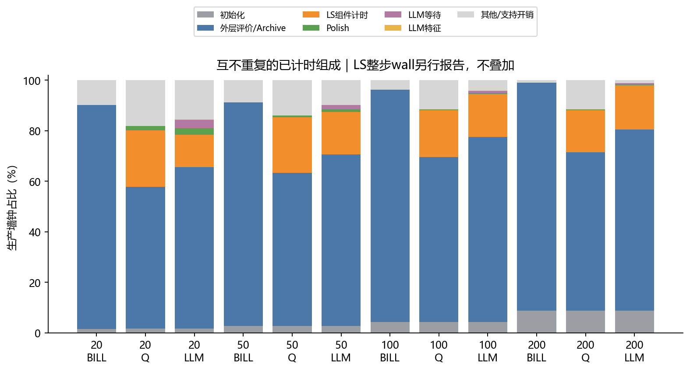
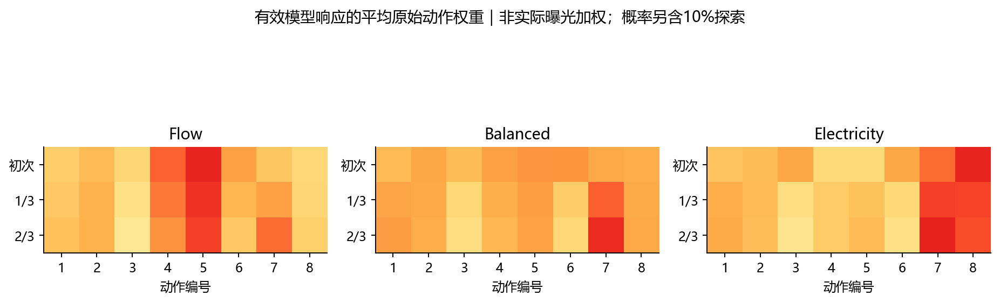
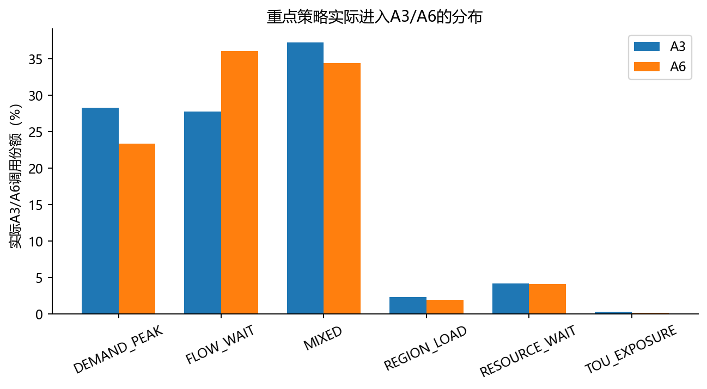
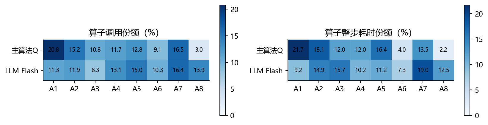
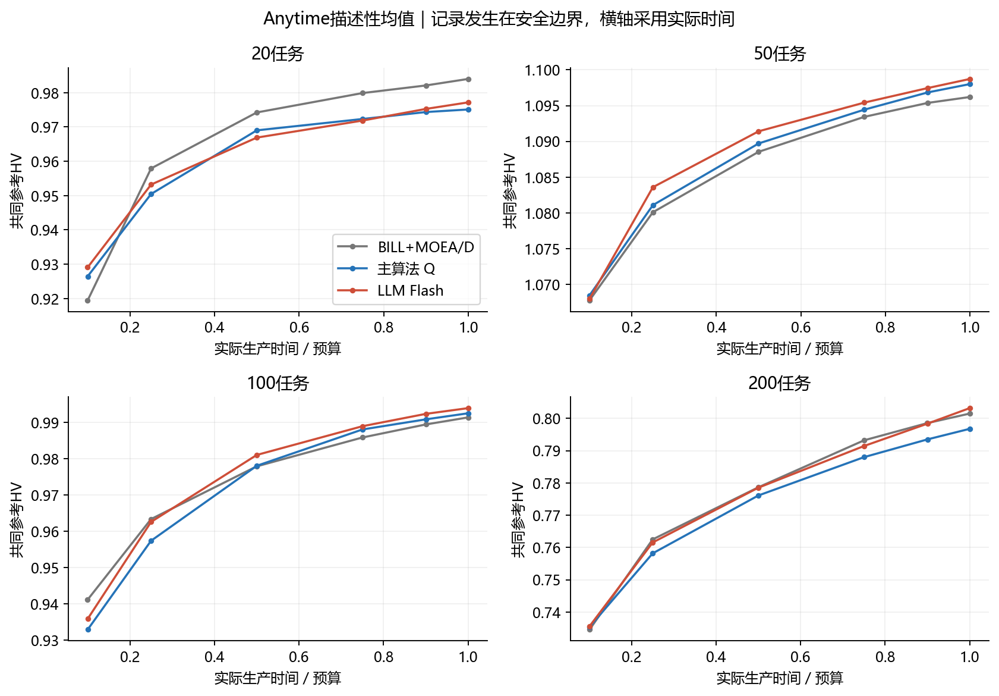

# DeepSeek Flash、主算法与BILL+MOEA/D三组结果分析

## Material Passport

日期：2026-10-24；类型：完整开发实验结果分析；模式：ARS validate。用户已授权完整回收并分析。对象为固定192run、64配对块、32输入、16原开发父，包含20/50/100/200任务四规模、两变体、seed16401/26401。运行源89f14655b27b6a5c4a49f6668705a5e090787089、canonical source1bcd40e2471ac685584038559e7f19ff17b059f72e293491a23d64ab3855071b。原始结果不改，默认算法不晋级。统计与指标复算状态以ANALYSIS_ACCEPTANCE、INDEPENDENT_AUDIT及最终复现回执为准。

## 核心结果

当前LLM版尚未表现出稳定优于两条基线的证据。相对主算法，平均归一化HV增加0.002646，配对相对HV描述性均值约0.397%；IGD+平均降低0.001554。四项主比较Holm校正后均为1.0，置信区间包含零。相对BILL+MOEA/D，HV平均差约−0.000017，基本持平；IGD+平均改善0.000933也未确认。未显著不代表等价，也不能断言LLM没有作用。

LLM版本完成了全部64次有效模型处理，接口能运行、策略确实改变搜索；但这不能替代最终质量证据。当前更清楚的现象是局部搜索时间结构改变：主算法LS整步墙钟平均占27.82%，LLM版约17.60%，轨迹均深从5降至3.66（约减少26.9%步骤）。模型等待约占1.59%，摘要特征约0.040%。这些是整包策略运行后的描述性变化，不能把节时单独归因于LLM推理更准确，或宣称早停质量无损。

## 四项冻结主比较

正值统一表示LLM改善：HV为LLM减基线，IGD+为基线减LLM。先对每父的两变体和两seed取均值，以16父为独立单位。每规模4父、分层20,000 bootstrap、100,000配对sign-flip；同时枚举65,536种符号作独立审计，四主检验同一Holm家族。

|比较|指标|平均改善|95% bootstrap CI|原始p|Holm p|正/负父数|
|---|---|---:|---|---:|---:|---:|
|LLM_FLASH-MAIN_Q|hv|+0.002646|[-0.005339, +0.010606]|0.526255|1.000000|11/5|
|LLM_FLASH-MAIN_Q|igd_plus|+0.001554|[-0.003023, +0.006364]|0.552774|1.000000|9/7|
|LLM_FLASH-BILL_MOEAD|hv|-0.000017|[-0.005607, +0.005601]|0.996150|1.000000|9/7|
|LLM_FLASH-BILL_MOEAD|igd_plus|+0.000933|[-0.002642, +0.004253]|0.626584|1.000000|7/9|

根seed为2026102401，每对比/指标由名称SHA256派生独立RNG。报告全部主比较，没有按结果更换比较或筛选seed。均值相对HV与绝对HV差是不同聚合量；不能把前者的正号替代后者或显著性。经验参考由同输入三组两seed最终Archive共同非支配union构造、各目标按共同ideal/range归一、HV参考(1.1,1.1)；它不是true Pareto，不可把本批归一化HV和其它批次直接拼接比较。

## 分规模表现

下表仅描述每规模4父。不同规模使用不同经验参考，不能跨规模比较HV绝对值高低来判断问题难度。

|任务数|BILL HV|主Q HV|LLM HV|BILL IGD+|主Q IGD+|LLM IGD+|
|---:|---:|---:|---:|---:|---:|---:|
|20|0.984012|0.975108|0.977179|0.024857|0.025382|0.023971|
|50|1.096207|1.098014|1.098729|0.011654|0.011948|0.011710|
|100|0.991344|0.992488|0.993898|0.017402|0.017928|0.015300|
|200|0.801508|0.796811|0.803197|0.021493|0.022633|0.020695|

20任务中LLM的HV低于普通底座，50/100/200任务的平均HV略高于两基线。100任务IGD+的均值变化较大，但只有4个独立父，不能事后把它升级为确认性胜利。总体11/16父的HV相对主Q为正，同时有5父变差；IGD+为9正7负，收益并不一致。完整32输入的两seed全前沿与共同快端窗口均已绘图，不只展示最好案例。

## 两端与快端附近的实际调度

端点取各run实际最小Flow或最小Bill，然后配对求相对改善，父内平均再对16父等权平均。两个端点通常是不同调度，不能把最小Flow与最小Bill拼成一个解。

|基线|端点|LLM相对改善（正为更低）|
|---|---|---:|
|MAIN_Q|min_flow|-0.043%|
|MAIN_Q|min_bill|-0.002%|
|BILL_MOEAD|min_flow|+0.123%|
|BILL_MOEAD|min_bill|-0.027%|

下表在每个输入三组两seed共同最快Flow的固定倍数内，取实际点中的最低Bill；无点时记缺失，不做线性插值。仅在双方均有点的配对上计算，并列出分母；可用父内平均后对可用父等权平均。这是事后描述，缺失与解集相关，不能作无偏的主检验。

|基线|Flow上界/共同最快|可用配对|可用父|LLM省费均值|
|---|---:|---:|---:|---:|
|MAIN_Q|1.10|64/64|16/16|-0.106%|
|MAIN_Q|1.25|64/64|16/16|-0.374%|
|MAIN_Q|1.50|64/64|16/16|-0.188%|
|BILL_MOEAD|1.10|64/64|16/16|+0.370%|
|BILL_MOEAD|1.25|64/64|16/16|-0.199%|
|BILL_MOEAD|1.50|64/64|16/16|-0.278%|

## 等墙钟时间与调用开销

生产预算300/600/1200/2400秒，含初始化、特征、API限流排队和等待、日志与搜索。最终独立exact审计与导出单列，完整表有实际overshoot。各run从头初始化，相同key的三组初始P100和Archive指纹一致。

LS整步wall来自逐动作外层实测；LS组件来自budget/构造/SSGS/exact/Archive的独立子计时。两者重叠，不能相加。剩余支持开销包括控制器/排序/上下文/日志等，未冒称全都属于某一模块。不同组/规模的步数与前沿状态不同，单次动作耗时差也不是同候选集性能基准。

|规模|组|LS整步占比|LS组件占比|轨迹均深|真正提前停止率|模型等待占比|特征占比|平均子代数|
|---|---|---:|---:|---:|---:|---:|---:|---:|
|总体|BILL_MOEAD|0.00%|0.00%|0.00|0.0%|0.00%|0.000%|46691|
|总体|MAIN_Q|27.82%|19.81%|5.00|0.0%|0.00%|0.000%|36125|
|总体|LLM_FLASH|17.60%|16.02%|3.66|60.3%|1.59%|0.040%|38578|
|20|BILL_MOEAD|0.00%|0.00%|0.00|0.0%|0.00%|0.000%|38925|
|20|MAIN_Q|29.28%|22.27%|5.00|0.0%|0.00%|0.000%|35009|
|20|LLM_FLASH|17.24%|12.78%|2.81|89.8%|3.29%|0.071%|34328|
|50|BILL_MOEAD|0.00%|0.00%|0.00|0.0%|0.00%|0.000%|67563|
|50|MAIN_Q|28.02%|21.91%|5.00|0.0%|0.00%|0.000%|46382|
|50|LLM_FLASH|17.83%|16.72%|3.49|69.4%|1.74%|0.041%|52539|
|100|BILL_MOEAD|0.00%|0.00%|0.00|0.0%|0.00%|0.000%|54315|
|100|MAIN_Q|26.56%|18.41%|5.00|0.0%|0.00%|0.000%|40534|
|100|LLM_FLASH|17.42%|16.97%|4.06|46.1%|0.90%|0.028%|43850|
|200|BILL_MOEAD|0.00%|0.00%|0.00|0.0%|0.00%|0.000%|25963|
|200|MAIN_Q|27.43%|16.64%|5.00|0.0%|0.00%|0.000%|22576|
|200|LLM_FLASH|17.92%|17.62%|4.27|35.9%|0.44%|0.020%|23596|

表中总体是先父内平均、再对16父等权平均的占比，因此四规模等权；若按全部LLM生产秒数加权，模型等待总和为666.49秒、总生产72005.37秒，对应0.926%。两种分母不同，不混用。

提前停止率只计no_gain_threshold且发生在第5步之前；第5步同时满足阈值与horizon不算提前，horizon_or_budget也不算。另有1个50任务LLM运行在预算末端命中trigger后、首LS步前到期，因此473次trigger对应472条实际轨迹；这项零步触发已单列，未通过改原始数据消除。

## LLM实际如何使用反馈

189/192请求有效（98.44%），64/64运行均至少一次有效策略。记录到的191个响应envelope合计输入3,366,369、输出94,237tokens，另1次无响应的服务计费未知，不虚构总费用。等待中位数3.29秒、95分位4.31秒、最大8.76秒。3次回退分别为：20任务请求无响应、约6秒硬截止；100任务返回snapshot_id与请求不一致；50任务Balanced权重多出未知字段A0x。后两条即使部分组可用，也按冻结整份校验拒绝，保留上一有效策略。未重试、重跑或更换模型。

每次都发送完整问题说明、三偏好组状态、八算子耗时与历史收益。它返回每组八权重、focus和停止阈值，程序混入10%均匀探索；A3只改变合法迁移候选的优先级，A6只改变合法destroy抽样并保留20%均匀成分，真实接受仍由exact/细权重执行。实际响应均返回deepseek-flash别名，不能冒称服务端不可变模型快照已锁定。

有效策略中停止阈值计数（按三组×有效响应）：{1: 3, 2: 236, 3: 321, 5: 7}。这是策略条目数，不是运行/子代曝光；实际效果以step日志的动作频次和stop为准。模型理由只作解释，不能用“模型说A7很好”当收益证据。

## 算子性价比与当前瓶颈

下表为LLM版实际全部LS调用的汇总。新目标事件是所有完整可行候选尝试Archive时产生的新目标事件，可一调用多事件；是有偏状态/曝光下的描述性观测，不是动作因果排名，也不等于最终保留点数。主Q旧日志的Archive insertion口径包含同目标phenotype，已另列字段，未将其零填充后与LLM新目标事件作高低比较。

|动作|调用份额|局部接受率|无候选率|新目标事件/动作秒|
|---|---:|---:|---:|---:|
|A1|11.27%|23.19%|0.00%|3.53|
|A2|11.90%|21.12%|0.00%|1.93|
|A3|8.29%|6.37%|0.00%|0.82|
|A4|13.07%|13.17%|3.37%|1.70|
|A5|14.96%|15.32%|3.23%|2.33|
|A6|10.28%|1.25%|0.00%|0.49|
|A7|16.36%|27.63%|3.37%|4.77|
|A8|13.87%|3.71%|57.40%|1.79|

A8实际调用份额从主Q的3.04%升到LLM的13.87%，但LLM A8有57.40%调用没有完整候选。模型经常因为需量费用占比较高而保留A8，即使近期反馈已经出现大量no-candidate；“这个目标重要”与“当前生成器有可用候选”仍混在一起。A8并非完全无收益，因此不能仅凭无候选率永久删除它。

A7贡献了较多在线新目标事件，A6局部接受较低，A3 focus也未在本三组整包比较中被单独识别。这些现象支持下一步先检查动作可执行性和实际候选机会，再评价收益；不能把本批不显著结论归咎于某一个动作或仅3次模型调用。LLM版省下的LS时间不一定都转成更好前沿，普通BILL底座还能用更多时间做外层搜索，说明“少花LS时间”和“打败普通MOEA/D”之间仍有缺口。

## 对下一步的判断

首版可以保留为可运行研究候选，现阶段不晋级默认，也没有必要立刻堆更多复杂模块。优先把本批已经暴露的实际问题落实：让模型区分A8目标重要性与候选可用性；用现有日志核对不同偏好组的机会/空调用与收益；检查短预算中模型等待的占比。若后续获得新授权，应保持同一时间口径，单独拆分动态动作权重、A3/A6 focus和停止规则，才能判断主要收益来自哪里。三组设计当前只识别整包差异，不支持宣称语言推理或任意单模块已贡献显著提升。本轮未实现这些后续建议、未增加算法臂或启动新实验。

## 可靠性和边界

- 完整192run/64块通过原validator/产物SHA，最终原worker187,133成员独立exact证据已绑定；本轮未重新fresh评估全部调度。完整3050文件/118,386,941字节已本地逐成员与解压SHA验真，服务器原件保留。
- 16父为复用开发面板，不是新留出；同机CPU绑定、Williams顺序和配对输入/seed不消除外部负载与SMT干扰，不能把全部wall差归因代码/模型。内存启动快照满足200GB保留要求；全程MemoryPeak未取得，不冒称已测峰值。
- 192次HV/IGD+有独立实现交叉核对，四个均值/精确sign-flip和Holm另行复算。数值重放、测试和交付的真实范围见复现与最终回执，不能用测试通过代替研究质量结论。
- 四主检验未确认优势；置信区间仍容许小幅正负效果，不能用未显著证明等价。分规模/快端/算子/策略均为描述性探索，未新增未校正的确认性比较。

## ARS统计误读检查（11/11）

|检查|本批处置|
|---|---|
|Simpson反转|分四规模列出方向，只有4父/规模，未把整体均值替代所有分层|
|生态谬误|推断单位为16父，不将192运行或个别调度点当独立样本|
|Berkson/选择偏差|明确面板复用且为开发筛选，不推断全部部署负载|
|Collider控制|未按运行后表现、动作成功或最终质量筛选主检验样本|
|基础率忽略|调用、无候选、响应、可用快端配对均给分母|
|均值回归|未只选表现差/最好seed重测，原矩阵全部保留|
|幸存者偏差|192/192完整，3次失败响应也计入调用率并保留回退|
|多处寻找显著|四主Holm完整报告；其余结果仅描述|
|分析分叉|冻结种子/参考/父级聚合/四主；未按结果改分组或删除异常|
|相关即因果|动作性价比是历史观测，三组只对整包比较，不归因单模块|
|反向因果|搜索状态同时影响动作选择与收益，未从相关性推断动作因果效果|
