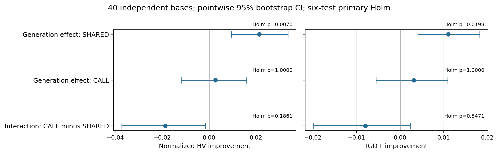
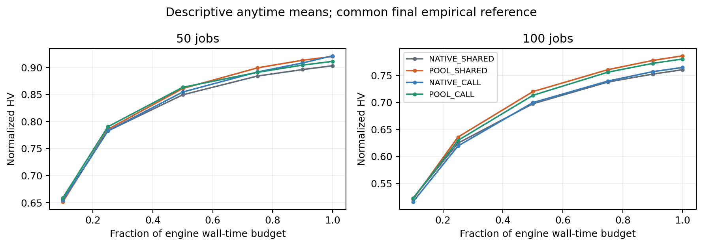
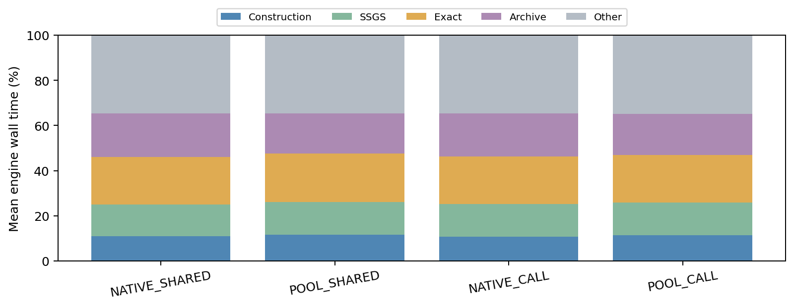
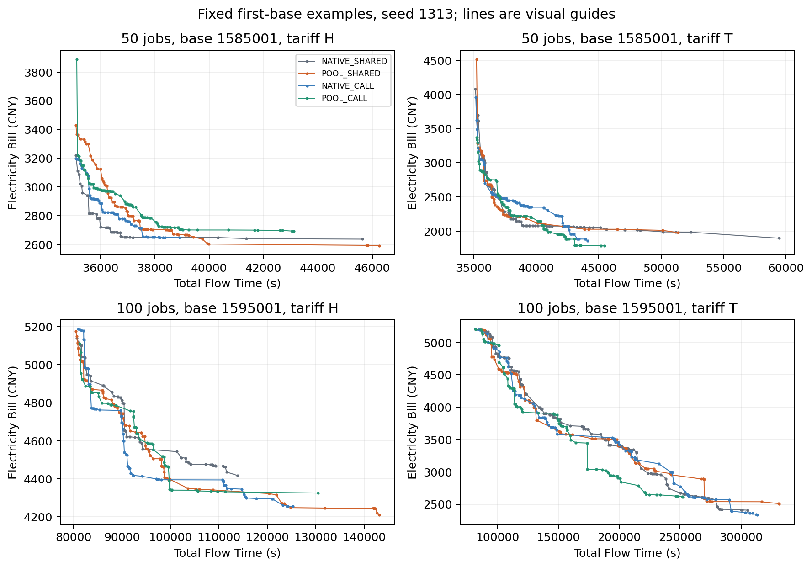

# MacroSearch生成规则×调用随机流四组结果分析

分析日期：2026-10-14，北京时间。运行源冻结 `6a6d1bbd808ba89b8cc835975127a77fc216ea1c`；默认main/F6/初始化未改变。本文区分计算验收、冻结质量分析和最终GitHub交付。质量统计已完成，PR/CI/Release的真实最终状态另见交付回执。

## 结论

共享随机流下，POOL规则再次改善等引擎时间前沿：配对相对HV均值 **+3.70%**，normalized HV增量 **+0.021429**，IGD+改善 **+0.011092**，主六项联合Holm p分别 **0.006960/0.019850**。

按调用隔离随机流后，POOL规则的收益尚未确认：HV **+0.002703**、IGD+改善 **+0.003124**，对应Holm p均 **1.000000**。这一结果不支持现在就宣称“扩大生成规则有独立、稳定的收益”。两种随机流下的生成效应差中差也未通过多重校正，不能断言此前收益完全由RNG消费造成。

建议保留POOL_SHARED作为有重复证据的研究候选，暂不将POOL或CALL晋级默认；下一步优先同源候选质量/多样性与真实成本诊断，候选库、代表抽样及评价数量分开。辅助非精英轨迹或距离反馈属于后续独立假设，本轮没有验证它们，也未启动新实验。

## Material Passport

- 问题：固定评价上限6时，生成10规则的收益在匹配各算子跨调用父随机消费后是否保留？
- 材料：40全新独立base、native H/T、seed1313/2313、四臂640run/160块；技术pilot和上一批数据不混入。
- Verification Status：ANALYZED；全部正式产物原validator与哈希验真，640HV交叉实现、32IGD+交叉实现、42统计及主6/次4Holm独立重放通过。
- 本轮未fresh重评全部正式最终解；原worker最终独立exact证据由完整产物SHA绑定。实验搜索没有重新运行。
- 当前限制：共同经验ND union非true Pareto；生成因子包含库/代表/抽样变化；CALL不是跨臂同候选或同轨迹；原238次与续跑402次执行阶段不同。

## 1. 计算完整性与原始结果

20005/b518ece5cd01的224run/56块于 **2026-10-14 02:58:47**完成，20007/878be0fed7b0的416run/104块于 **02:37:44**完成。故整批计算验收的最晚时刻为02:58:47；不是原15:20启动后的连续搜索耗时。昨晚23:14续跑至最晚结束约3小时44分，包含资源等待与导出。

本轮实际SSH核对两目标身份、真实worker/supervisor均0、exit/pipeline均complete、当前failure与stop均0、容器oom/oom_kill均0。旧导出MemoryError/stop/attempt/quarantine完整保留，不将它们算作正式run，也不把历史故障说成没有发生。原238个完整marker补跑前后SHA完全一致。

原运行source/canonical、884输入/spec、初始化、配置、seed、Q42与每个base全16run同host均验真。完整两个formal root **9,247文件/360,223,609字节**已只读流式全量回收，本地与服务器/tar逐size/SHA匹配。两tar为51,621,252/122,068,052字节，原server/local文件保留，未执行删除或全局cache操作。

原故障是搜索成功返回之后的Archive JSON导出达到256MiB进程地址空间上限；修复只在原run返回后串行导出并提高soft额度，搜索仍256MiB，原序列化、完整Archive及原validator不变。容器OOM0不能替代对该导出异常的记录。旧50/100规模存在执行阶段混合，见第6节。

## 2. 四组比较了什么

| 组 | 生成规则 | 完整候选exact上限 | 随机流 |
|---|---|---:|---|
| NATIVE_SHARED | 原生6规则 | 6 | 原具名共享流 |
| POOL_SHARED | 按10规则构造，取前6评价 | 6 | 原具名共享流 |
| NATIVE_CALL | 原生6规则 | 6 | 每调用隔离子流 |
| POOL_CALL | 按10规则构造，取前6评价 | 6 | 每调用隔离子流 |

CALL每次仅从对应算子父流取一个128位seed，内部消耗不推进下一次父流；匹配给定算子第几次调用的消费规则，并不保证不同臂轨迹、调用次数、候选集合或调用时点相同。生成规则对A1–A5的top-2B库、代表/抽样，以及其他动作的构造参数有联动，不是纯候选库大小干预。

所有候选仍来自同一步冻结incumbent，严格改善接受、Q42、原A8、五步轨迹、A3修正、Trigger、Polish、Archive和初始化固定。评价上限相同不代表每动作实际exact次数相同，A8尤其经常不足6。

## 3. 统计口径

每个native算例用四臂、两seed的共同经验ND union作归一化与IGD+参考；归一化HV参考点为(1.1,1.1)。所有run先按相同base的H/T、两seed四个观测求均值，**独立样本量是40，不是640**。按50/100任务分层配对20,000次bootstrap、100,000次signflip，显式seed2026101310。

HV处理减对照；IGD+改善为对照减处理，正数均表示有利。差中差为CALL下的生成收益减SHARED下的生成收益。主六项联合Holm；两个CALL简单效应的四项为独立次家族。其余指标和规模拆分为描述性，不拿未校正结果作新确认。

表中bootstrap CI为逐项、未作家族校正；判断预注册确认以Holm p为准。因此交互HV的CI未跨零但Holm p=0.186，并不构成家族内确认。不同重采样检验/区间也不能机械互换。

## 4. 主结果：共享下复现，隔离后未确认

| 对照 | 指标 | 配对增量 | 未校正95%CI | Holm p | 正/负base |
|---|---|---:|---|---:|---|
| POOL_SHARED-NATIVE_SHARED | HV | +0.021429 | [+0.009473, +0.033581] | 0.006960 | 27/13 |
| POOL_SHARED-NATIVE_SHARED | IGD+改善 | +0.011092 | [+0.004058, +0.018289] | 0.019850 | 26/14 |
| POOL_CALL-NATIVE_CALL | HV | +0.002703 | [-0.011861, +0.015974] | 1.000000 | 24/16 |
| POOL_CALL-NATIVE_CALL | IGD+改善 | +0.003124 | [-0.005536, +0.010960] | 1.000000 | 28/12 |
| GENERATION_X_CALL | HV | -0.018726 | [-0.037225, -0.001586] | 0.186078 | 14/26 |
| GENERATION_X_CALL | IGD+改善 | -0.007968 | [-0.019861, +0.002331] | 0.547105 | 18/22 |

POOL_SHARED在27/40base的HV、26/40base的IGD+上为正；收益不是所有算例都成立。配对相对HV+3.697%是先每配对单元求百分比再base聚合，与四臂整体HV均值比的+2.577%不是同一量。

POOL_CALL的HV在24/40base为正，IGD+在28/40base为正，但均值区间跨零、Holm未确认。不能因多数正或点估计正就称优于NATIVE_CALL，也不能把未显著改写成等价或无效。

**“共享显著、隔离不显著”不等于“二者差异显著”。** 差中差HV点估计−0.018726、IGD+−0.007968显示隔离下收益较小的描述性迹象，但主家族Holm .186/.547未确认随机流交互。不能写“POOL收益只是运气”“消除RNG后必然消失”或“二者没有交互”。

上一批不同base与归一化参考下也确认POOL6相对原生6，但不把+7.44%与本批+3.70%直接解释为收益衰减，更不合并两批追显著；它们共同支持原共享条件下的规则包是值得保留的研究候选。

## 5. CALL本身也未确认晋级

| 对照 | 指标 | 配对增量 | 未校正95%CI | Holm p | 正/负base |
|---|---|---:|---|---:|---|
| NATIVE_CALL-NATIVE_SHARED | HV | +0.011288 | [+0.001120, +0.021576] | 0.180038 | 27/13 |
| NATIVE_CALL-NATIVE_SHARED | IGD+改善 | +0.005312 | [-0.000480, +0.011155] | 0.274497 | 23/17 |
| POOL_CALL-POOL_SHARED | HV | -0.007439 | [-0.020896, +0.005307] | 0.562034 | 19/21 |
| POOL_CALL-POOL_SHARED | IGD+改善 | -0.002657 | [-0.011329, +0.005223] | 0.562034 | 18/22 |

NATIVE_CALL相对NATIVE_SHARED的HV点估计+.011288，但次家族Holm .180；POOL_CALL相对POOL_SHARED点估计−.007439、Holm .562。没有证据将CALL直接作为默认升级，也不能断言它一定损害性能。

## 6. 规模与执行阶段：仅描述

| 规模 | SHARED生成效应：HV/IGD+改善 | CALL生成效应：HV/IGD+改善 |
|---|---|---|
| 50任务，20base | +.017099 / +.008014 | −.010356 / −.005440 |
| 100任务，20base | +.025759 / +.014170 | +.015762 / +.011687 |

两规模SHARED方向均正；CALL在50任务负、100任务正。当前不能据此给规模设置不同生成规则：未预注册该确认，且所有50任务base均在续跑阶段完成，所有100任务base均混合原运行/续跑阶段，规模与执行阶段部分混杂。没有足够同阶段两规模的独立base能消除这一限制。保留全部冻结矩阵，不事后删不利base；后续如验证规模响应，应重新设计独立比较。

图为描述性均值，使用共同最终经验参考；检查点在原目标时刻之后的首次observer触发，延迟保留在anytime表。线段只作趋势指引。不能从某早期点优势确认长期稳定优越。

## 7. 成本与机制诊断

| 组 | 构造/SSGS/exact/Archive平均时间占比 | unique ND平均 |
|---|---|---:|
| NATIVE_SHARED | 10.87% / 14.14% / 21.06% / 19.26% | 85.24 |
| POOL_SHARED | 11.51% / 14.56% / 21.41% / 17.94% | 88.33 |
| NATIVE_CALL | 10.81% / 14.31% / 21.20% / 18.94% | 86.25 |
| POOL_CALL | 11.30% / 14.60% / 21.06% / 18.24% | 85.59 |

构造、SSGS、exact、Archive按原互斥计时相加；约34.6–34.8%剩余为其他引擎开销。Polish约24.1–24.8%，其中exact/Archive已进入上表，不能再次相加；约53% exact来自Polish。均不含离线生成初始化genes，搜索初始化解码/exact含在原引擎预算，最终复验/导出单列，平均约2.77–3.00秒。

POOL_SHARED相对NATIVE_SHARED配对后代吞吐描述性+5.39%、exact吞吐+2.12%；POOL_CALL相对NATIVE_CALL分别+3.95%/+1.50%。没有增加exact上限不能说获得同量有效工作：A8 pooled exact/调用约从2.07到2.66（SHARED）、2.10到2.70（CALL），构造ms/call约38.16→66.69、38.63→64.83；A3约96–97ms、A7约78–81ms。在线调用组成/状态不同，这些不是固定同incumbent的纯工程benchmark或A8因果收益证明。

POOL不是一项免费改动，质量与单位时间工作共同变化。大动作候选不足、目标/代表分布、候选重复和评分质量值得单独诊断；只换一个B无法说明机制。

## 8. 固定例子前沿

四案例取各规模首base、H/T、seed1313，不按结果挑最好案例；另一个seed仍参与全部统计。线段不是可行插值，不把单幅前沿图当统计证据。实际点为总Flow秒与电费人民币；末端最小值属于不同解，不能拼成同一可行解。

## 9. 下一步判断（建议，未执行）

1. **保留共享流POOL规则作为研究参考。** 两轮独立base在原共享条件下均有支持，但还不能称候选生成策略与随机流机制已完全分离，更不能作为已确认创新或默认算法。
2. **优先同源候选诊断。** 对相同incumbent、权重和明确调用seed，比较目标库覆盖、抽样代表、基因/时序重复、可行率、exact真实改善及Archive批次净贡献；先冻结采样口径，离线补查不反馈在线。将A1–A5筛选库与A7代表/A8候选不足分开，避免整个规则包同时改。
3. **成本优化先做等价路径。** 共享合法target/窗口/事件准备数据，候选与RNG后态一致才称纯工程优化；全池排序改为部分排序是另一个算法因素。构造、SSGS、exact、Archive均计入等总wall。
4. **动态预算和辅助探索作为后续独立方向。** ASW/MOW-P的距离反馈或可退步walk与当前严格接受/五步短轨迹不同；先测轨迹重复/停滞与少量特征预测价值，另设等成本随机对照，不能利用本批数据宣称它们有效。

本轮不原样追加样本到显著、不换DQN、不扩大Q表、不修改在跑/原运行源或自动启动实验。当前结果不是“MacroSearch完全无用”，而是“生成规则在原条件下有收益，但跨随机流的稳健机制尚未确认”。

## 10. 验证与11项统计解释检查

全部原validator/input/initial/config/source/hash/Q42/seed/同host及640矩阵通过；640HV两实现一致，32IGD+两实现一致，42统计/主6次4Holm独立重放一致，新增9项反例/边界测试通过。运行源未变；独立分析分支及全部工程质量门/CI真实状态见最终交付验收，不提前宣称通过。

| 检查 | 本批处理与边界 |
|---|---|
| Simpson/分组反转 | 报告CALL规模方向差异；分层仍仅描述，且执行阶段混杂 |
| 生态推断 | 独立单位40base，不据base均值推出每个调用或每个算例都改善 |
| 选择偏差/Berkson | 全冻结矩阵，无按效果删样；经验union仅测量参考 |
| Collider | 未按后处理成功率/收益分组作为主因果调整 |
| 基础率 | 不以多数正或后段成功率替代效果；正/负base及区间同报 |
| 回归均值 | 全新预定base，无挑最差者前后比较 |
| 幸存者 | 原导出故障/attempt保留，正式640补齐，不仅统计成功子集 |
| 多重检验 | 主6/次4分别Holm，其余明确描述性 |
| 分析路径 | 冻结seed/聚合/方向/家族，未加样或事后换指标 |
| 因果 | 干预是生成规则包；在线吞吐/算子成本不作唯一原因 |
| 反向因果 | 控制器/状态预测尚未实施，不将在线访问偏好解释为动作本征价值 |

原工作者最终exact由产物哈希绑定，不将验真或离线指标复算表述成fresh全量解重评。

### 本地工程验收

显式使用独立分析checkout的src后，完整lint/format/mypy/回归与覆盖率门通过：528项测试，387.51秒；overall84.87%、core96.94%。D03已发布材料验真、默认确定性replay、wheel与CLI smoke分别通过。此前第一次Windows全套526通过、两项旧mini campaign未在65秒观察窗口完成；原预算孤立复验两项通过，51.37秒。所有日志保留，没有修改测试预算，不将观察超时记成正式实验算法失败。

独立分析PR、准确head双Python CI、三份bundle fresh clone、完整分析SHA重放及Release下载验收的真实最终状态，由交付回执记录。Release标签指向冻结运行源6a6d1bb，分析版本另由PR及source_analysis.bundle绑定；不把报告分支当成默认算法采用。
