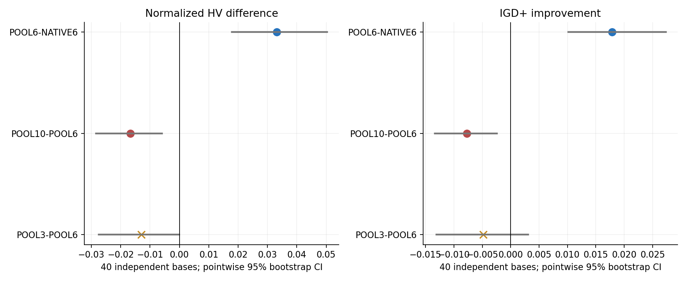
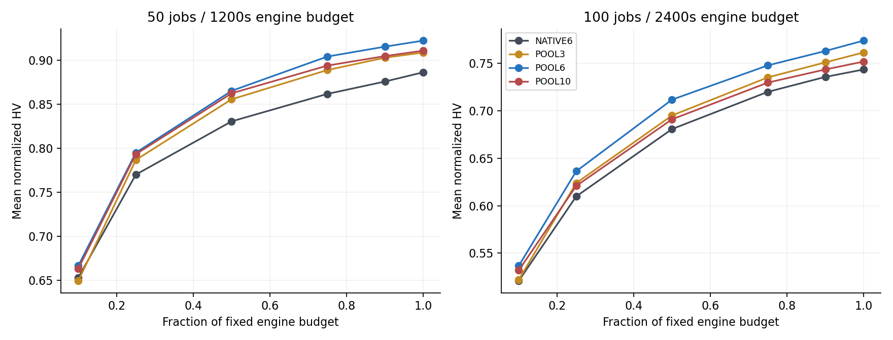
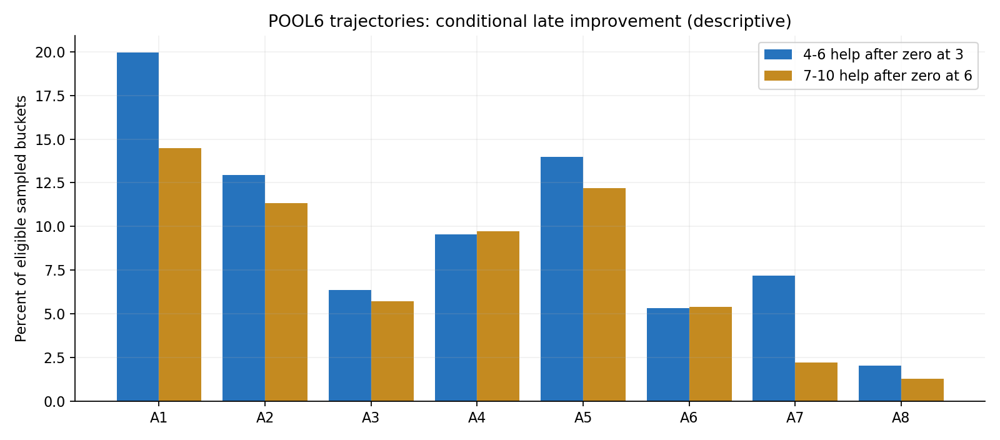
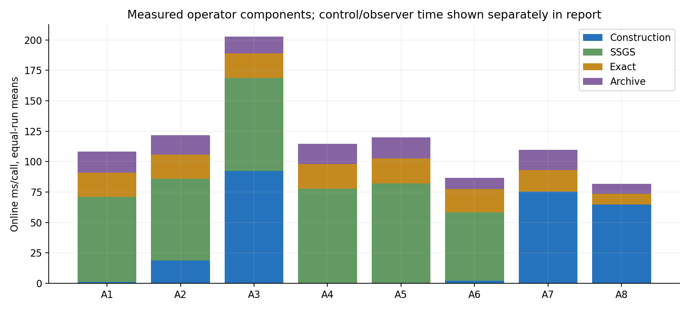
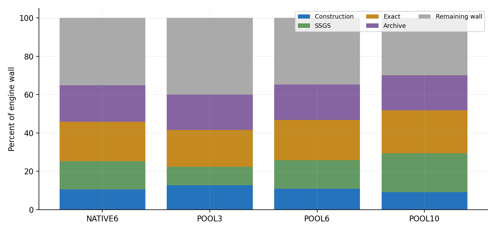
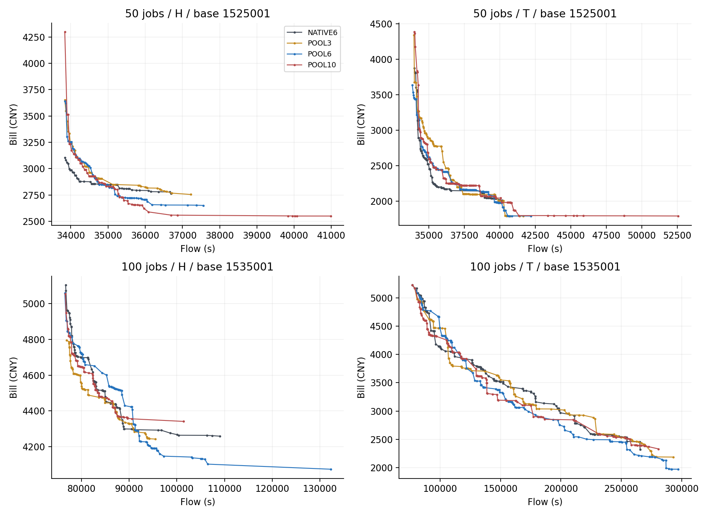

## Material Passport

| 字段 | 内容 |
| --- | --- |
| 资料范围 | 完整正式640run/160四组块/40新base；不含192技术pilot |
| 原运行版本 | 9b2ec3dd1fed371abf382192293338cac9ee4a24 |
| 包canonical SHA256 | 1d9a8f4c726312e95d49e553b587f9f08359a90e85b1cd0bdeac9ced6b1daea9 |
| 运维包装器版本 | 6982fd2546abf1222b69fce01db417694991fc0a；原运行源码不改 |
| Verification Status | ANALYZED；完整原始数据验真、指标交叉实现和统计重放通过 |
| fresh原实验重跑 | 未进行；原worker最终独立exact证据由完整产物SHA绑定 |
| 数据回收 | 10508文件/519236010字节；server/tar/local逐size-SHA一致，服务器原件保留 |
| 独立核查 | 640 HV、32 IGD+、33配对统计、六主联合Holm与3840原生/共同池前缀对照 |

# MacroSearch四组诊断：结果分析与下一步

本轮最值得继续的发现是**候选生成规则与评价数量需要分开**：保持更大的生成池，但评价6个，比原生6更好；同池评价10个反而在本轮等时间整程中更差。不能把这句话缩成‘预算越大越好’，也不能说已经证明动态预算控制器有效。

POOL6相对NATIVE6，归一化HV平均增加+0.033164，IGD+平均改善+0.017844，六项联合Holm分别为0.000500/0.000120；两个指标各30/40base方向为正。逐base配对相对HV平均+7.44%。默认main/F6并未晋级。

## 1. 本轮比较的到底是什么

| 组别 | 生成 | 线上exact评价上限 |
| --- | --- | --- |
| NATIVE6 | 原生B=6生成规则 | 6 |
| POOL3 | B=10生成规则、完整构造成本计入 | 3 |
| POOL6 | 同上 | 6 |
| POOL10 | 同上 | 10 |
四组都固定A3=tariff修正版、Q42、原A8、五步轨迹、Trigger、Polish、出生邻域替换；NATIVE6是本轮研究基线，不能直接当作未修正A3的旧main/F6。50/100任务各20base；原生H/T、算法seed1112/2212，同一base全部组和种子同host。每run1200/2400秒引擎预算，最终复验/导出另计。研究observer在四组同时开启且有实际wall成本，后续生产配置需独立确认。

## 2. 在线整程主结果

| 组别 | 平均HV↑ | 平均IGD+↓ | unique ND | offspring/s | exact/s |
| --- | --- | --- | --- | --- | --- |
| NATIVE6 | 0.814653 | 0.073243 | 90.06 | 5.712 | 79.25 |
| POOL3 | 0.834805 | 0.060206 | 82.28 | 6.381 | 69.82 |
| POOL6 | 0.847817 | 0.055399 | 86.46 | 5.723 | 80.25 |
| POOL10 | 0.831060 | 0.063114 | 88.46 | 5.084 | 89.70 |
每个原生实例使用全部四组/两seed最终Archive的共同经验非支配union作参照，ideal/nadir归一化；HV参照(1.1,1.1)。经验union不是true Pareto。归一化HV差与‘每base先求相对变化再平均’不同：0.814653到0.847817的总体均值比约+4.07%，逐base配对相对HV均值为+7.44%，不能混为同一个指标。

| 对照 | 指标（正=前者好） | base均值 | 未校正95% CI | 六主Holm p | 正向base | 判定 |
| --- | --- | --- | --- | --- | --- | --- |
| POOL3-POOL6 | HV差 | -0.013012 | [-0.027411, -0.000075] | 0.145979 | 18/40 | 未确认差异 |
| POOL3-POOL6 | IGD+改善 | -0.004807 | [-0.013113, +0.003088] | 0.273647 | 15/40 | 未确认差异 |
| POOL10-POOL6 | HV差 | -0.016757 | [-0.028452, -0.005952] | 0.026600 | 18/40 | 前者更差 |
| POOL10-POOL6 | IGD+改善 | -0.007715 | [-0.013383, -0.002430] | 0.030870 | 15/40 | 前者更差 |
| POOL6-NATIVE6 | HV差 | +0.033164 | [+0.017926, +0.050375] | 0.000500 | 30/40 | 前者更好 |
| POOL6-NATIVE6 | IGD+改善 | +0.017844 | [+0.010162, +0.027377] | 0.000120 | 30/40 | 前者更好 |
40base独立，先平均H/T与两seed，分规模20000次bootstrap与100000次signflip，seed2026101209；六主联合Holm。主判定按预先指定的signflip/Holm；例如POOL3的HV percentile CI刚好不跨0，而signflip及Holm仍未通过，两种方法不同，不能挑有利的一项宣称差异或等价。其他27项统计只作诊断，不冒充额外主确认。

POOL10−POOL6逐base相对HV均值−2.06%，offspring吞吐−9.60%，exact吞吐却+8.85%；更多评价没有转成更好的最终前沿。POOL3−POOL6的offspring吞吐+10.39%、exact吞吐−9.50%，但两项主质量没有证明更好，也没有确认等价。POOL6−NATIVE6的offspring吞吐+4.42%、exact吞吐+2.24%属于描述性，不能宣称速度提升已经确认或单独解释质量收益。

## 3. 同为评价6个，为什么生成规则仍会不同

原源码StructuralOperator对A1–A5截取前2B的候选库后随机抽B；A4/A5还受B影响的目标数量、位置采样及round-robin上限控制。原生6因此通常从最多12个候选里抽6，而POOL6先按10的规则生成（最多20库、抽10），再评价其中前6。A7代表池、A8尝试上限也依赖B；A6同源前缀可以一致，但较大的生成会继续消费算子RNG。此处是候选分布/生成与随机流联合因素，不是多评价了4个。

原生NATIVE6的3840个冻结调用已逐一与同源共同10池对照，480样本/动作；下表区分顺序差异与目标点集合差异，后者排除‘只调了顺序’的解释。目标集合相同仍不证明genotype、timing或RNG后态相同；也不能据此归因最终收益只来自某一个动作。

| 动作 | 样本 | 有序目标前缀不同 | 目标集合不同 |
| --- | --- | --- | --- |
| A1 | 480 | 100.00% | 100.00% |
| A2 | 480 | 100.00% | 99.79% |
| A3 | 480 | 100.00% | 98.33% |
| A4 | 480 | 98.12% | 92.29% |
| A5 | 480 | 98.96% | 96.46% |
| A6 | 480 | 0.00% | 0.00% |
| A7 | 480 | 73.12% | 72.92% |
| A8 | 480 | 35.21% | 35.21% |
**下一步应优先把‘生成库范围、抽样代表、返回数量、评价数量’拆成独立参数，并做匹配随机流对照。** 不要直接把B统一改10；也不要为省构造成本退回原生6，因候选分布可能一起退回。

## 4. 候选后段有机会，但不能每次都投入

主要诊断使用POOL6的3840个动作×阶段reservoir样本，每动作480桶覆盖40base。每桶内部均匀抽一个调用；样本比例不是全量调用成功率，访问次数加权估计另存在probe_actions.csv，并先在run内再HT/seed/base平均。偏好/condition没有单独等额抽样，不能把组间差异直接解释为状态的因果效应。

| 动作 | 前3零改善桶 | 其后4–6有收益 | 前6零改善桶 | 其后7–10有收益 | 访问加权候选不足10 |
| --- | --- | --- | --- | --- | --- |
| A1 | 336 | 19.94% | 269 | 14.50% | 0.00% |
| A2 | 355 | 12.96% | 309 | 11.33% | 0.00% |
| A3 | 392 | 6.38% | 367 | 5.72% | 0.00% |
| A4 | 387 | 9.56% | 350 | 9.71% | 0.75% |
| A5 | 372 | 13.98% | 320 | 12.19% | 0.38% |
| A6 | 449 | 5.35% | 425 | 5.41% | 0.00% |
| A7 | 292 | 7.19% | 271 | 2.21% | 23.46% |
| A8 | 395 | 2.03% | 387 | 1.29% | 85.07% |
所有动作合并的样本条件比例约9.40%/7.49%，但动作差异明显：A1达到19.94%/14.50%，A8只有2.03%/1.29%。原SEQ在16.20%样本桶中遗漏共同10池的正局部收益；各桶绝对增益加总中遗漏比例27.16%，只是共享上下文的诊断汇总，不是最终HV损失百分比，也不是访问加权或独立检验。不能用‘前三个没改善’直接证明后段无价值，亦不能把离线有更好候选当作在线追加一定划算。

A8访问加权约85.07%桶的共同池实际不足10；在线每call平均只评价2.65个，固定6本来已自动受实际可用候选限制。无候选不等于动作不存在其他全局邻居，也不能把未满预算再当作浪费了6次exact。全部3840主诊断桶均可还原可行候选位置；目标包络新增仅作当时诊断，不证明完整phenotype Archive的最终因果贡献。

## 5. 成本与工程改动的优先级

| 动作 | 构造ms/call | SSGS ms/call | exact ms/call | 完整step ms/call | 实际评价数/call | 构造占整程wall |
| --- | --- | --- | --- | --- | --- | --- |
| A1 | 1.01 | 70.11 | 19.94 | 206.56 | 6.00 | 0.08% |
| A2 | 18.89 | 66.98 | 19.77 | 216.41 | 6.00 | 1.06% |
| A3 | 92.36 | 76.34 | 20.11 | 306.92 | 6.00 | 3.45% |
| A4 | 0.31 | 77.49 | 20.23 | 218.89 | 5.98 | 0.02% |
| A5 | 0.49 | 81.64 | 20.50 | 229.35 | 5.99 | 0.03% |
| A6 | 2.20 | 56.26 | 18.95 | 171.06 | 6.00 | 0.08% |
| A7 | 75.50 | 0.00 | 17.54 | 207.66 | 5.32 | 5.03% |
| A8 | 64.78 | 0.00 | 8.82 | 177.59 | 2.65 | 1.20% |
以上是在线实际轨迹各run均值，调用组成、机器负载与incumbent不同；不是纯同源benchmark。A3枚举/TOU代理排序约92ms/call，A7与A8构造约75/65ms/call；A1/A4/A5构造很便宜，但结构候选还需SSGS。对结构算子省掉构造并不自动省掉后续SSGS。共享准备数据、候选枚举/排序及timing候选构造应先做正确性与benchmark，再谈提速。

POOL6整程平均构造10.95%、gateway SSGS14.87%、exact21.00%、Archive18.35%、剩余wall34.83%。Polish整体23.82%是重叠视角：包含其中exact/Archive，不能再相加；约53.39%的exact来自Polish。剩余wall包含状态/控制、诊断、去重等未分项开销，不能直接说全部是RL或observer。

## 6. 规模、电价与补跑敏感性

16次补跑仍在原host、同输入/初始化/算法seed/单run预算，但执行时间和并行负载变化，不能声称影响为0。排除涉及补跑的10个完整base，保留30base（50任务10、100任务20）后主方向不反转；再用两规模各50%权重时POOL6−NATIVE6 HV差仍+.029877、IGD+改善+.016416。该敏感性为描述性，不能替代原40base主分析或单独认证补跑无偏。

两规模与H/T的主方向都一致，收益在H更大；子组样本有限，下面只报告均值，不挑子组另立确认。

| 对照 | 指标 | 分组 | 独立base | 均值 |
| --- | --- | --- | --- | --- |
| POOL3-POOL6 | hv_diff | 50 | 20 | -0.013550 |
| POOL3-POOL6 | hv_diff | 100 | 20 | -0.012475 |
| POOL3-POOL6 | hv_diff | exclude_resumed_entire_bases | 30 | -0.015497 |
| POOL3-POOL6 | hv_diff | exclude_resumed_size_balanced | 30 | -0.017008 |
| POOL3-POOL6 | hv_diff | H | 40 | -0.020369 |
| POOL3-POOL6 | hv_diff | T | 40 | -0.005655 |
| POOL3-POOL6 | igd_plus_gain | 50 | 20 | -0.006817 |
| POOL3-POOL6 | igd_plus_gain | 100 | 20 | -0.002796 |
| POOL3-POOL6 | igd_plus_gain | exclude_resumed_entire_bases | 30 | -0.005128 |
| POOL3-POOL6 | igd_plus_gain | exclude_resumed_size_balanced | 30 | -0.006294 |
| POOL3-POOL6 | igd_plus_gain | H | 40 | -0.006455 |
| POOL3-POOL6 | igd_plus_gain | T | 40 | -0.003158 |
| POOL10-POOL6 | hv_diff | 50 | 20 | -0.011427 |
| POOL10-POOL6 | hv_diff | 100 | 20 | -0.022088 |
| POOL10-POOL6 | hv_diff | exclude_resumed_entire_bases | 30 | -0.020734 |
| POOL10-POOL6 | hv_diff | exclude_resumed_size_balanced | 30 | -0.020057 |
| POOL10-POOL6 | hv_diff | H | 40 | -0.028276 |
| POOL10-POOL6 | hv_diff | T | 40 | -0.005239 |
| POOL10-POOL6 | igd_plus_gain | 50 | 20 | -0.005548 |
| POOL10-POOL6 | igd_plus_gain | 100 | 20 | -0.009881 |
| POOL10-POOL6 | igd_plus_gain | exclude_resumed_entire_bases | 30 | -0.009409 |
| POOL10-POOL6 | igd_plus_gain | exclude_resumed_size_balanced | 30 | -0.009174 |
| POOL10-POOL6 | igd_plus_gain | H | 40 | -0.013497 |
| POOL10-POOL6 | igd_plus_gain | T | 40 | -0.001932 |
| POOL6-NATIVE6 | hv_diff | 50 | 20 | +0.035940 |
| POOL6-NATIVE6 | hv_diff | 100 | 20 | +0.030389 |
| POOL6-NATIVE6 | hv_diff | exclude_resumed_entire_bases | 30 | +0.030048 |
| POOL6-NATIVE6 | hv_diff | exclude_resumed_size_balanced | 30 | +0.029877 |
| POOL6-NATIVE6 | hv_diff | H | 40 | +0.054915 |
| POOL6-NATIVE6 | hv_diff | T | 40 | +0.011414 |
| POOL6-NATIVE6 | igd_plus_gain | 50 | 20 | +0.019005 |
| POOL6-NATIVE6 | igd_plus_gain | 100 | 20 | +0.016682 |
| POOL6-NATIVE6 | igd_plus_gain | exclude_resumed_entire_bases | 30 | +0.016505 |
| POOL6-NATIVE6 | igd_plus_gain | exclude_resumed_size_balanced | 30 | +0.016416 |
| POOL6-NATIVE6 | igd_plus_gain | H | 40 | +0.029059 |
| POOL6-NATIVE6 | igd_plus_gain | T | 40 | +0.006628 |
## 7. 前沿图与数据边界

固定图为每规模第一个base、H/T、seed1112，不按胜负挑例；补充目录包含80原生实例的同seed四组前沿PNG/PDF。第二个seed参与全部统计，其原始前沿在raw。连线仅帮助查看离散点，不表示连线之间存在可行调度。‘解数更多’与‘分布/质量更好’不同：NATIVE6平均unique ND 90.06多于POOL6的86.46，但两项主质量整体较差。

## 8. 建议下一步（本轮未启动）

1. **优先确认生成器改动**：固定评价6，比较原生6、共同池6、匹配随机流的原生对照，以及将较大筛选库/代表规则拆到各动作的版本。用全新base、关闭研究observer的生产配置、相同总wall；检验本轮收益是否延续，不改状态/奖励一起掺入。
2. **先做可等价的工程优化**：对A3代理排序/共享准备与A7/A8构造做同源候选身份、顺序、RNG后态、exact/Archive一致性和benchmark。若只省不可见的少量对象包装，收益可能很小；不得在缺benchmark时承诺整体加速。
3. **再测试有条件追加评价**：以动作、偏好、已见前缀增益/可用候选及真实增量成本为少量特征，按base隔离训练/留出；保留随机继续抽查，并与成本匹配随机分配比较。尤其不能按前三个零收益硬停。只有独立预测/等时间整程证据支持后才实现预算控制器。
4. **暂不增加大RL状态表或直接换复杂RL**：当前Q仍负责选动作，本轮没有验证状态扩维。候选池、算子选择和投入数量先各自归因；本轮也没有测试MacroSearch内部候选链或更深轨迹。

## 9. 统计解释与完整性检查

| 11/11检查项 | 处理与限制 |
| --- | --- |
| Simpson | 检查50/100、H/T、补跑敏感性；方向未反转，不据子组宣布普适 |
| 生态层级 | 40base为单位；不将15360调用或160块当独立n |
| 选择偏差 | 正式矩阵全部640保留；压力场景非现实总体的随机抽样 |
| collider | 完整矩阵为主；零改善条件样本只用于诊断，未作在线策略效应 |
| 基率 | 零3/零6分母明示；桶比例与访问加权估计分开 |
| 均值回归 | 全新40base，非按本轮极端胜负选例；不从旧批包络外推 |
| 存活偏差 | 没有丢run；16未运行者补齐，旧中断日志完整保留 |
| look-elsewhere | 六项预先主家族联合Holm；其余27项仅诊断 |
| 分析自由度 | 沿用冻结统计/seed；敏感性及prefix集合核查显式标为补充 |
| 因果/相关 | 线上对照支持本配置组合；动作收益、成本和中介来源不作单项因果认证 |
| 反向因果 | 线上预算先指定；但轨迹变化会改变后续状态/调用构成，不从末态反推最优投入 |
本轮原运行代码、数据与默认算法保持。完整统计已独立重放，原worker最终exact证据通过压缩原文与完整产物hash绑定，本轮未fresh重评所有最终解。代码/测试/CI、raw/报告交付的最终状态以复现回执和Notion版本记录为准；不把科学分析完成冒充已合并/创新认证。
