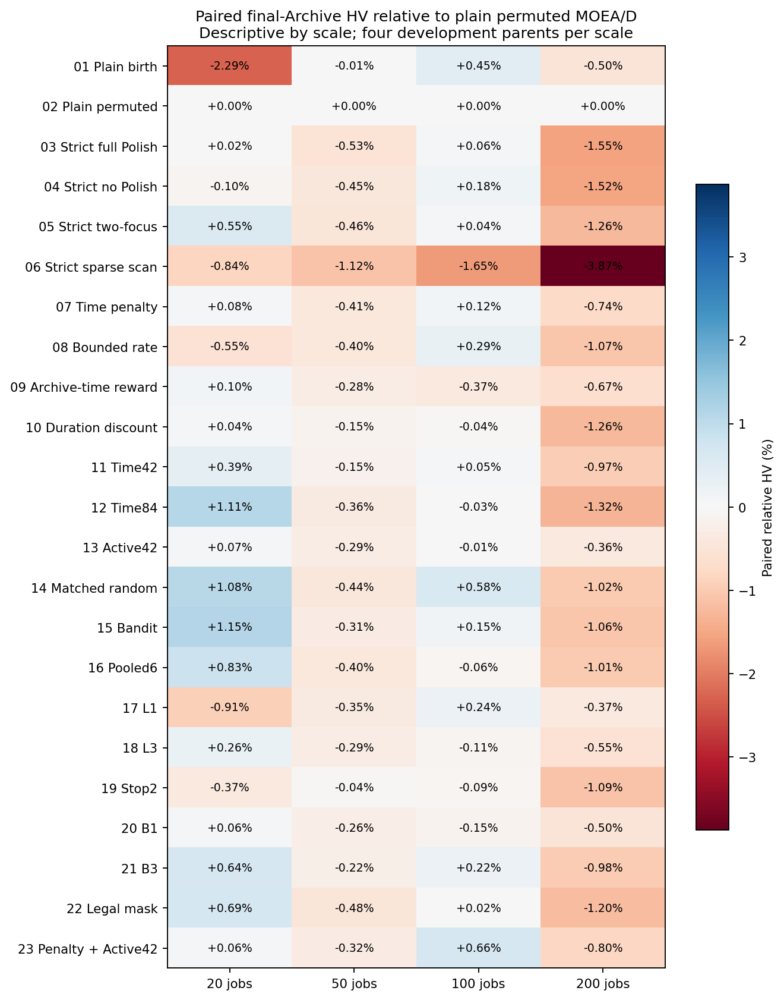
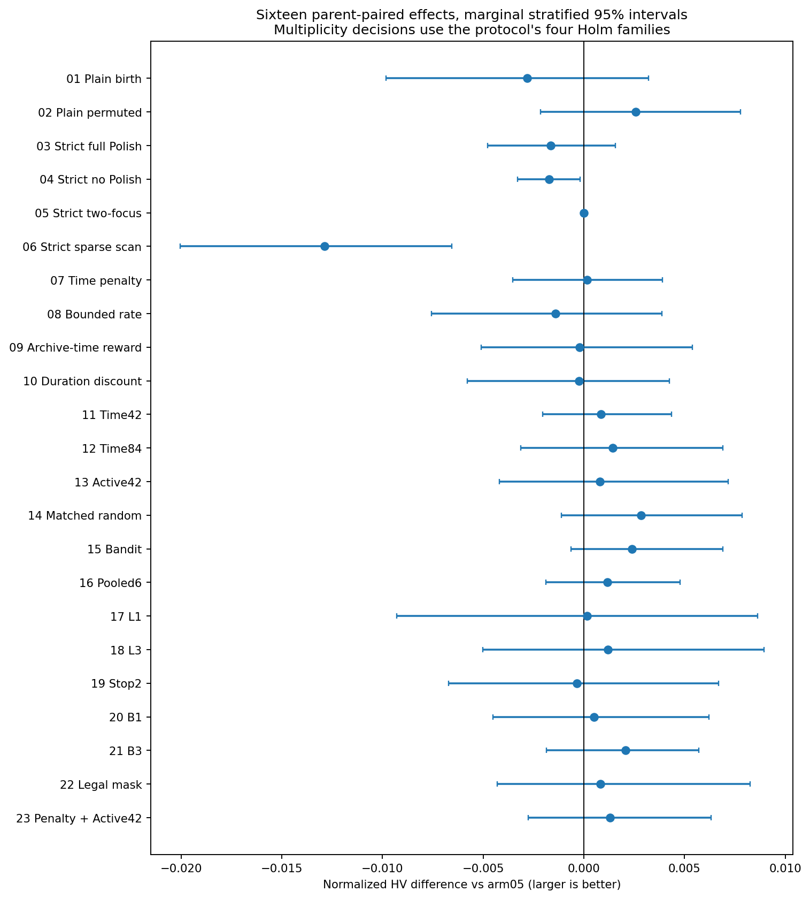
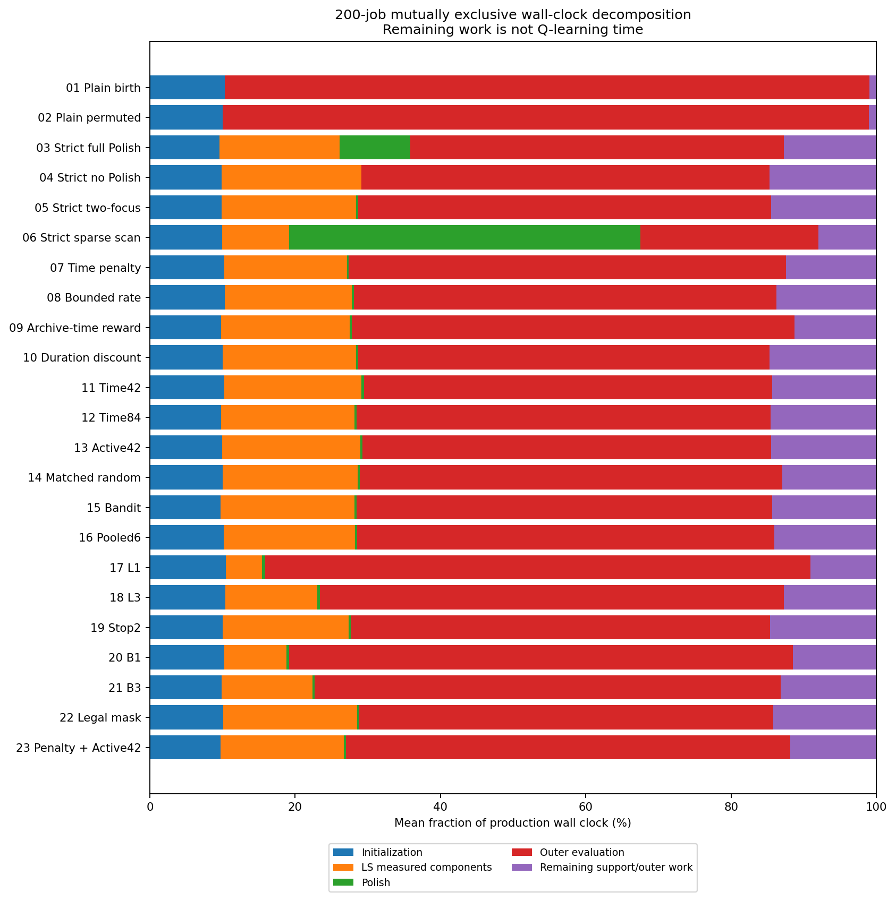
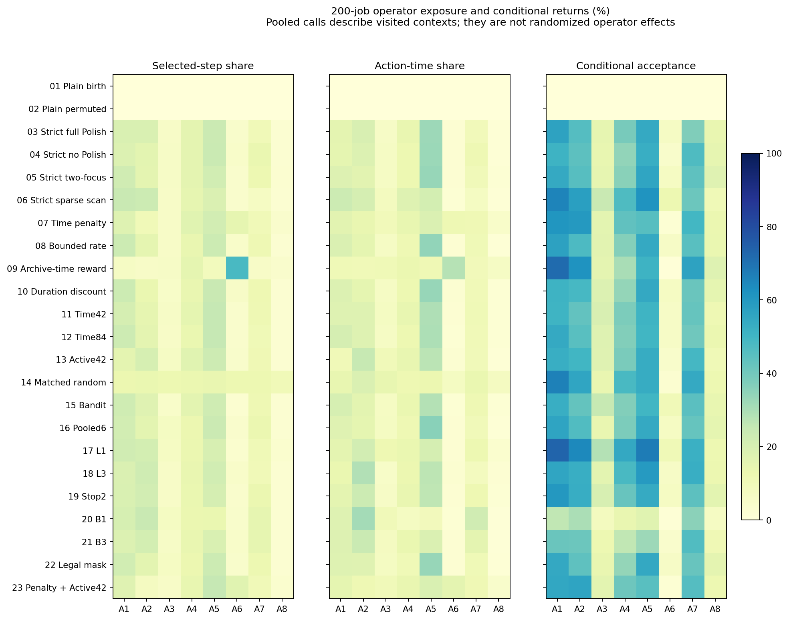

# RL23：全部23组实验逐项分析与下一步建议

本轮没有确认一个可以稳定取代当前两重点版本、并超过同初始化普通MOEA/D的新机制。最清楚的结果是：非LS子代也参与的低频全扫过贵；成本奖励改变了算子选择，但把学习推向便宜低收益动作；直接增加状态、缩短轨迹或减少候选都尚无稳定质量优势。下一步应研究何时值得做LS，而不继续同时扩大状态、奖励和算子组合。

## Material Passport

| 项 | 状态 |
|---|---|
| 来源/模式 | academic-research-suite / experiment-agent validate |
| 日期/版本 | 2026-10-21 / RL23结果v1 |
| 核验范围 | ANALYZED；完整回收、指标与56项统计已复核；未fresh重跑全部算法 |
| 数据 | 1472正式run、64块、23组；16开发父为独立单位 |
| 运行源 | 27198e88ae0f670f29c9f15caa2fe4af3bb196c6；默认未晋级 |
| 复现锁 | 原manifest/source/input/init/hash与本目录ANALYSIS_PLAN.json |

## 1. 完成与完整性

正式计算于北京时间 **2026-10-21 05:52:22** 完成，实际 **5.211小时（约5小时13分钟）**。全部1472/1472、64/64块通过原完成校验，真实worker0、systemd成功退出、无failure/stop。退出后的cgroup已消失，本次不能用空cgroup宣称重测运行全程OOM峰值；启动时OOM0和最终成功退出分别有证据。
全部 **19308文件/876512802字节**已全量回收，服务器原清单—tar成员—本地落盘文件逐size/SHA一致。完整tar 580882997字节，SHA `842951d1c35fc57d6745e92d48a485e1cbb2d956d6e8f62bf08438c769f27f33`。服务器和本地原件保留。原worker **1248896个最终种群/Archive成员的独立exact**证据与产物SHA绑定；本次没有fresh全量重评这些解。
92次技术pilot与正式分开。所有组从头构造相同90+10 BILL四选一/P100，初始化到搜索等总墙钟；最终exact审计/导出单列。20/50/100/200任务预算300/600/1200/2400秒，按规模轮转派发，96逻辑线程/48物理核。

## 2. 怎么比较，哪些结论不能说

每原输入用全部23组、两seed最终Archive的共同经验ND union作为归一化参照；HV参考(1.1,1.1)，IGD+越低越好。该参照不是true Pareto。所有百分比先按同run配对，再按父实例与规模等权汇总；它与先平均HV再求比值并不完全相同。32原input只有16开发父，两电价变体和两seed先在父内平均。四规模各4父，规模结果仅描述，不事后挑最好子组做主要结论。
预定四家族：7—22对5的HV/IGD+共32项；3—6六对Polish共12项；3—6对2共8项；23对7/13共4项。20000分层配对bootstrap、100000双侧signflip、分别Holm。保存边际CI而非同时置信区间；未显著不等价。56项均从run CSV独立重算，另枚举65536符号模式审计。1472个HV双实现一致，每个IGD+亦以16个参照点样本交叉核对；全文IGD+采用全部经验参照点。
主32项 **全部Holm p=1**，最小未校正p约 **0.2506**；所以没有赢家并非单纯由多重校正造成。第14组总体HV均值最高，但比普通底座只高约0.05%，IGD+几乎相同，不能把排序第一当稳健优势。

## 3. 23组总体结果

第2组为同随机替换的普通MOEA/D，第5组为两重点主基准。末三列为200任务，整步LS与Polish分别计时；普通组均无LS。

| 组 | 方案 | 总体HV | 总体IGD+ | HV对普通% | HV对两重点% | 200外层等效代 | 200整步LS% | 200Polish% |
|---|---|---:|---:|---:|---:|---:|---:|---:|
| 01 | BILL四选一＋普通MOEA/D，出生顺序替换 | 0.960064 | 0.029171 | -0.588 | -0.274 | 202.09 | 0.00 | 0.00 |
| 02 | BILL四选一＋普通MOEA/D，随机替换 | 0.965467 | 0.024658 | +0.000 | +0.335 | 196.02 | 0.00 | 0.00 |
| 03 | 严格触发＋原完整Polish | 0.961234 | 0.027999 | -0.502 | -0.204 | 116.55 | 28.54 | 9.73 |
| 04 | 严格触发＋无Polish | 0.961163 | 0.028260 | -0.474 | -0.184 | 141.90 | 33.14 | 0.00 |
| 05 | 严格触发＋两重点Polish（主基准） | 0.962889 | 0.026428 | -0.284 | +0.000 | 132.82 | 32.20 | 0.31 |
| 06 | 严格触发＋低频连续全扫 | 0.950008 | 0.036081 | -1.869 | -1.582 | 49.83 | 16.91 | 48.32 |
| 07 | 原质量奖励减时间惩罚 | 0.963057 | 0.026785 | -0.239 | +0.072 | 145.71 | 28.44 | 0.28 |
| 08 | 带下限的收益率奖励 | 0.961470 | 0.028075 | -0.433 | -0.126 | 136.86 | 30.45 | 0.29 |
| 09 | Archive面积增益减时间惩罚 | 0.962681 | 0.026569 | -0.305 | -0.007 | 152.91 | 28.16 | 0.32 |
| 10 | 持续时间折扣Q | 0.962661 | 0.026460 | -0.351 | -0.047 | 136.58 | 32.23 | 0.32 |
| 11 | TIME42：用时间阶段替换停滞位 | 0.963730 | 0.026763 | -0.170 | +0.139 | 136.50 | 32.48 | 0.32 |
| 12 | TIME84：保留42状态并增加时间位 | 0.964331 | 0.025604 | -0.149 | +0.149 | 147.63 | 32.13 | 0.29 |
| 13 | ACTIVE42：实际标量受限目标替换粗偏好 | 0.963687 | 0.026426 | -0.149 | +0.154 | 138.07 | 32.66 | 0.30 |
| 14 | 匹配随机算子选择 | 0.965734 | 0.024685 | +0.049 | +0.359 | 134.21 | 30.77 | 0.29 |
| 15 | Contextual Bandit：去掉未来价值 | 0.965285 | 0.024659 | -0.019 | +0.272 | 142.81 | 32.04 | 0.30 |
| 16 | POOLED6：合并偏好与进度 | 0.964046 | 0.026316 | -0.160 | +0.134 | 144.59 | 31.25 | 0.30 |
| 17 | L1：每段轨迹一步 | 0.963040 | 0.027937 | -0.348 | -0.021 | 181.36 | 13.01 | 0.41 |
| 18 | L3：每段轨迹三步 | 0.964082 | 0.026130 | -0.174 | +0.143 | 150.35 | 24.47 | 0.36 |
| 19 | STOP2：连续两步无收益提前停 | 0.962535 | 0.028258 | -0.396 | -0.088 | 149.49 | 31.10 | 0.29 |
| 20 | B1：一次MacroSearch只完整评价一个候选 | 0.963398 | 0.027090 | -0.212 | +0.099 | 167.82 | 19.09 | 0.37 |
| 21 | B3：一次MacroSearch最多评价三个候选 | 0.964950 | 0.026503 | -0.083 | +0.226 | 161.53 | 24.86 | 0.32 |
| 22 | 必要机会条件屏蔽A4/A5 | 0.963715 | 0.026863 | -0.243 | +0.057 | 139.27 | 31.83 | 0.31 |
| 23 | 时间惩罚＋ACTIVE42组合 | 0.964183 | 0.027516 | -0.103 | +0.204 | 148.96 | 27.97 | 0.30 |

## 4. 每一个小实验

### 01｜BILL四选一＋普通MOEA/D，出生顺序替换

**要解决的问题。** 保留纯分解进化作为底座，观察新初始化后不投入LS的能力，并与第2组分离替换顺序因素。

**总体观察。** HV对普通底座 -0.588%，对两重点 -0.274%；IGD+为 0.029171。以下各规模只有4个父，均为描述。

| 任务数 | HV对普通% | HV对两重点% | IGD+ | 外层等效代 | 整步LS% | Polish% |
|---|---:|---:|---:|---:|---:|---:|---:|
| 20 | -2.292 | -2.775 | 0.051274 | 408.17 | 0.00 | 0.00 |
| 50 | -0.011 | +0.457 | 0.015109 | 577.31 | 0.00 | 0.00 |
| 100 | +0.452 | +0.426 | 0.021732 | 451.82 | 0.00 | 0.00 |
| 200 | -0.503 | +0.796 | 0.028568 | 202.09 | 0.00 | 0.00 |

**推断边界。** 此组是底座/替换诊断，没有额外事后补一组显著性测试。

**分析与去留。** 第1/2组的差异提示替换顺序不能忽略，但这只是本开发面板上的诊断；不能将第2组稍高的均值都归给LS或学习。以后比较LS须以第2组为主要普通底座。

[固定四规模前沿图](figures/arm_01_fixed_fronts.png)。每规模固定最早父、variant0/seed16101，未按最好结果挑选。

### 02｜BILL四选一＋普通MOEA/D，随机替换

**要解决的问题。** 给模因版本提供替换顺序一致的普通MOEA/D对照；否则LS收益和随机替换收益会混在一起。

**总体观察。** HV对普通底座 +0.000%，对两重点 +0.335%；IGD+为 0.024658。以下各规模只有4个父，均为描述。

| 任务数 | HV对普通% | HV对两重点% | IGD+ | 外层等效代 | 整步LS% | Polish% |
|---|---:|---:|---:|---:|---:|---:|---:|
| 20 | +0.000 | -0.483 | 0.035503 | 357.34 | 0.00 | 0.00 |
| 50 | +0.000 | +0.476 | 0.015238 | 582.41 | 0.00 | 0.00 |
| 100 | +0.000 | -0.009 | 0.023563 | 420.22 | 0.00 | 0.00 |
| 200 | +0.000 | +1.354 | 0.024330 | 196.02 | 0.00 | 0.00 |

**推断边界。** 此组是底座/替换诊断，没有额外事后补一组显著性测试。

**分析与去留。** 这是最重要的工程底线：没有LS，仍取得很有竞争力的前沿。任何更复杂版本都应证明其额外成本值得，而不是仅报告局部接受或exact次数。它与第14组总体均值非常接近，不能只按排序宣布谁更强。

[固定四规模前沿图](figures/arm_02_fixed_fronts.png)。每规模固定最早父、variant0/seed16101，未按最好结果挑选。

### 03｜严格触发＋原完整Polish

**要解决的问题。** 检验严格LS门下，完整右移扫描是否仍能用新增降费覆盖它消耗的墙钟。

**总体观察。** HV对普通底座 -0.502%，对两重点 -0.204%；IGD+为 0.027999。以下各规模只有4个父，均为描述。

| 任务数 | HV对普通% | HV对两重点% | IGD+ | 外层等效代 | 整步LS% | Polish% |
|---|---:|---:|---:|---:|---:|---:|---:|
| 20 | +0.019 | -0.483 | 0.036173 | 335.08 | 29.59 | 3.12 |
| 50 | -0.530 | -0.066 | 0.019490 | 380.50 | 27.55 | 4.85 |
| 100 | +0.058 | +0.021 | 0.023597 | 275.04 | 27.73 | 6.35 |
| 200 | -1.554 | -0.287 | 0.032737 | 116.55 | 28.54 | 9.73 |

**预定普通底座比较。** hv有利方向差-0.004233、Holm p=0.390346；igd_plus有利方向差-0.003341、Holm p=0.368156。

**行为证据。** 200任务平均轨迹5.00步；实际访问5.75/42行状态，每活跃行约79.4次访问。跨规模父等权平均局部接受率22.65%，负奖励占比1.74%。这些是实际到访上下文下的行为，不是独立随机分配动作的因果收益。

**分析与去留。** 完整Polish相较两重点增加明显成本，均值没有相应增加；与无Polish、两重点的校正比较未确认优势。完整全扫不宜继续作为每次LS后的必做流程。

[固定四规模前沿图](figures/arm_03_fixed_fronts.png)。每规模固定最早父、variant0/seed16101，未按最好结果挑选。

### 04｜严格触发＋无Polish

**要解决的问题。** 关掉全部Polish，仅保留严格门、Q42、B6和L5，分离局部搜索本身的净收益。

**总体观察。** HV对普通底座 -0.474%，对两重点 -0.184%；IGD+为 0.028260。以下各规模只有4个父，均为描述。

| 任务数 | HV对普通% | HV对两重点% | IGD+ | 外层等效代 | 整步LS% | Polish% |
|---|---:|---:|---:|---:|---:|---:|---:|
| 20 | -0.104 | -0.623 | 0.038161 | 334.70 | 30.60 | 0.00 |
| 50 | -0.447 | +0.019 | 0.019361 | 406.12 | 29.88 | 0.00 |
| 100 | +0.181 | +0.140 | 0.022767 | 301.37 | 29.88 | 0.00 |
| 200 | -1.524 | -0.272 | 0.032753 | 141.90 | 33.14 | 0.00 |

**预定普通底座比较。** hv有利方向差-0.004304、Holm p=0.589494；igd_plus有利方向差-0.003602、Holm p=0.445516。

**行为证据。** 200任务平均轨迹5.00步；实际访问5.81/42行状态，每活跃行约99.6次访问。跨规模父等权平均局部接受率22.12%，负奖励占比1.78%。这些是实际到访上下文下的行为，不是独立随机分配动作的因果收益。

**分析与去留。** 去掉Polish并没有使质量稳定超过第5组，也没有确认超过第2组。说明在当前严格门下，问题不完全是右移拖慢：保留下来的B6×L5局部搜索仍承担很大机会成本。

[固定四规模前沿图](figures/arm_04_fixed_fronts.png)。每规模固定最早父、variant0/seed16101，未按最好结果挑选。

### 05｜严格触发＋两重点Polish（主基准）

**要解决的问题。** 每条LS轨迹后只处理两个重点Prefill，保持B6/L5/Q42，是奖励、状态与搜索投入方案的共同基准。

**总体观察。** HV对普通底座 -0.284%，对两重点 +0.000%；IGD+为 0.026428。以下各规模只有4个父，均为描述。

| 任务数 | HV对普通% | HV对两重点% | IGD+ | 外层等效代 | 整步LS% | Polish% |
|---|---:|---:|---:|---:|---:|---:|---:|
| 20 | +0.545 | +0.000 | 0.030700 | 310.65 | 29.75 | 2.14 |
| 50 | -0.462 | +0.000 | 0.018835 | 417.53 | 28.51 | 0.96 |
| 100 | +0.040 | +0.000 | 0.024611 | 284.97 | 29.22 | 0.40 |
| 200 | -1.259 | +0.000 | 0.031564 | 132.82 | 32.20 | 0.31 |

**预定普通底座比较。** hv有利方向差-0.002578、Holm p=0.826312；igd_plus有利方向差-0.001769、Holm p=0.826312。

**行为证据。** 200任务平均轨迹5.00步；实际访问5.69/42行状态，每活跃行约91.4次访问。跨规模父等权平均局部接受率22.48%，负奖励占比1.74%。这些是实际到访上下文下的行为，不是独立随机分配动作的因果收益。

**分析与去留。** 主基准的两重点Polish在200任务仅占约0.31%，现在真正的大头是整步LS约32.20%。继续主要优化两重点右移已很难回收大量时间，应把主要精力转向LS决策和投入。

[固定四规模前沿图](figures/arm_05_fixed_fronts.png)。每规模固定最早父、variant0/seed16101，未按最好结果挑选。

### 06｜严格触发＋低频连续全扫

**要解决的问题。** 将连续全扫改为LS后5%、非LS后10%抽样，尝试把贵精修稀疏化；严格门仍只控制LS。

**总体观察。** HV对普通底座 -1.869%，对两重点 -1.582%；IGD+为 0.036081。以下各规模只有4个父，均为描述。

| 任务数 | HV对普通% | HV对两重点% | IGD+ | 外层等效代 | 整步LS% | Polish% |
|---|---:|---:|---:|---:|---:|---:|---:|
| 20 | -0.838 | -1.322 | 0.040141 | 249.14 | 25.47 | 15.44 |
| 50 | -1.117 | -0.656 | 0.025947 | 246.25 | 18.27 | 36.37 |
| 100 | -1.651 | -1.653 | 0.033076 | 157.12 | 18.76 | 42.58 |
| 200 | -3.872 | -2.698 | 0.045158 | 49.83 | 16.91 | 48.32 |

**预定普通底座比较。** hv有利方向差-0.015459、Holm p=0.000720；igd_plus有利方向差-0.011422、Holm p=0.001750。

**行为证据。** 200任务平均轨迹5.00步；实际访问5.56/42行状态，每活跃行约42.7次访问。跨规模父等权平均局部接受率26.68%，负奖励占比1.78%。这些是实际到访上下文下的行为，不是独立随机分配动作的因果收益。

**分析与去留。** 低频并不等于总调用少。严格门约只让1%子代进LS，非LS者却仍按10%全扫，新增调用集中在数量庞大的未LS子代。200任务Polish占48.32%，外层等效代数从132.82降到49.83；相较两重点及普通底座，HV/IGD+均有校正后的劣势。这是最明确应撤回的版本。

[固定四规模前沿图](figures/arm_06_fixed_fronts.png)。每规模固定最早父、variant0/seed16101，未按最好结果挑选。

### 07｜原质量奖励减时间惩罚

**要解决的问题。** 以共同每规模参考时间归一化动作成本，从原质量奖励扣除0.25倍耗时，尝试减少昂贵低收益动作。

**总体观察。** HV对普通底座 -0.239%，对两重点 +0.072%；IGD+为 0.026785。以下各规模只有4个父，均为描述。

| 任务数 | HV对普通% | HV对两重点% | IGD+ | 外层等效代 | 整步LS% | Polish% |
|---|---:|---:|---:|---:|---:|---:|---:|
| 20 | +0.076 | -0.432 | 0.034444 | 333.03 | 26.57 | 2.13 |
| 50 | -0.412 | +0.053 | 0.018520 | 425.20 | 26.49 | 1.10 |
| 100 | +0.117 | +0.093 | 0.024455 | 324.08 | 27.19 | 0.47 |
| 200 | -0.735 | +0.574 | 0.029720 | 145.71 | 28.44 | 0.28 |

**预定主比较（相对5）。** hv有利方向差 +0.000168，95%边际CI [-0.003494, +0.003989]，Holm p=1.0000，正向父7/16；igd_plus有利方向差 -0.000357，95%边际CI [-0.002343, +0.001923]，Holm p=1.0000，正向父7/16。

**行为证据。** 200任务平均轨迹5.00步；实际访问5.75/42行状态，每活跃行约90.3次访问。跨规模父等权平均局部接受率18.49%，负奖励占比93.73%。这些是实际到访上下文下的行为，不是独立随机分配动作的因果收益。

**分析与去留。** 成本信号生效了，但优化目标发生偏移：大量零质量回报动作被扣成负值，学习更容易追逐便宜的低改进动作。200任务A6调用份额从基准约4.1%增加到约14.5%，而A6条件接受率仅约1.8%。省时间不等于获得净前沿收益；需要校准奖励尺度并给“不做LS”明确出口。

[固定四规模前沿图](figures/arm_07_fixed_fronts.png)。每规模固定最早父、variant0/seed16101，未按最好结果挑选。

### 08｜带下限的收益率奖励

**要解决的问题。** 奖励除以有下限的耗时比例，尝试强化单位时间局部改善，同时避免极短动作把奖励无限放大。

**总体观察。** HV对普通底座 -0.433%，对两重点 -0.126%；IGD+为 0.028075。以下各规模只有4个父，均为描述。

| 任务数 | HV对普通% | HV对两重点% | IGD+ | 外层等效代 | 整步LS% | Polish% |
|---|---:|---:|---:|---:|---:|---:|---:|
| 20 | -0.549 | -1.019 | 0.040324 | 320.86 | 29.29 | 1.96 |
| 50 | -0.401 | +0.063 | 0.017980 | 399.81 | 28.65 | 0.95 |
| 100 | +0.288 | +0.264 | 0.023231 | 317.76 | 29.28 | 0.43 |
| 200 | -1.071 | +0.188 | 0.030763 | 136.86 | 30.45 | 0.29 |

**预定主比较（相对5）。** hv有利方向差 -0.001419，95%边际CI [-0.007585, +0.003866]，Holm p=1.0000，正向父7/16；igd_plus有利方向差 -0.001647，95%边际CI [-0.006082, +0.001701]，Holm p=1.0000，正向父8/16。

**行为证据。** 200任务平均轨迹5.00步；实际访问5.75/42行状态，每活跃行约87.5次访问。跨规模父等权平均局部接受率22.57%，负奖励占比1.77%。这些是实际到访上下文下的行为，不是独立随机分配动作的因果收益。

**分析与去留。** 收益率没有得到稳定质量收益，也没有明显压低LS总时间。比值仍放大偶发局部改善，缺少“相对继续普通进化是否值得”的参照；不建议继续只围绕分母常数做大网格。

[固定四规模前沿图](figures/arm_08_fixed_fronts.png)。每规模固定最早父、variant0/seed16101，未按最好结果挑选。

### 09｜Archive面积增益减时间惩罚

**要解决的问题。** 以初始化冻结context中的在线HV增益替代局部标量改善，再扣时间成本，尝试对齐最终前沿。

**总体观察。** HV对普通底座 -0.305%，对两重点 -0.007%；IGD+为 0.026569。以下各规模只有4个父，均为描述。

| 任务数 | HV对普通% | HV对两重点% | IGD+ | 外层等效代 | 整步LS% | Polish% |
|---|---:|---:|---:|---:|---:|---:|---:|
| 20 | +0.096 | -0.430 | 0.034495 | 295.06 | 32.34 | 2.24 |
| 50 | -0.279 | +0.190 | 0.017193 | 412.35 | 27.70 | 1.00 |
| 100 | -0.372 | -0.401 | 0.025988 | 322.25 | 25.14 | 0.47 |
| 200 | -0.665 | +0.612 | 0.028600 | 152.91 | 28.16 | 0.32 |

**预定主比较（相对5）。** hv有利方向差 -0.000208，95%边际CI [-0.005123, +0.005424]，Holm p=1.0000，正向父9/16；igd_plus有利方向差 -0.000142，95%边际CI [-0.004401, +0.004543]，Holm p=1.0000，正向父9/16。

**行为证据。** 200任务平均轨迹5.00步；实际访问5.81/42行状态，每活跃行约104.1次访问。跨规模父等权平均局部接受率13.73%，负奖励占比99.97%。这些是实际到访上下文下的行为，不是独立随机分配动作的因果收益。

**分析与去留。** 这一版暴露出尺度问题：几乎所有动作奖励都为负，在线HV微小增量被成本扣项压住。200任务A6占约48.3%调用、27.8%动作时间，条件接受仅约0.7%。不能据此否定前沿信用思路，但当前公式不能直接沿用；先修尺度与放弃动作，再谈增加状态。

[固定四规模前沿图](figures/arm_09_fixed_fronts.png)。每规模固定最早父、variant0/seed16101，未按最好结果挑选。

### 10｜持续时间折扣Q

**要解决的问题。** 保留即时质量奖励，仅用动作持续时间调整非终止步的未来折扣，尝试区分不同长度动作。

**总体观察。** HV对普通底座 -0.351%，对两重点 -0.047%；IGD+为 0.026460。以下各规模只有4个父，均为描述。

| 任务数 | HV对普通% | HV对两重点% | IGD+ | 外层等效代 | 整步LS% | Polish% |
|---|---:|---:|---:|---:|---:|---:|---:|
| 20 | +0.044 | -0.436 | 0.034733 | 316.92 | 28.24 | 2.22 |
| 50 | -0.151 | +0.316 | 0.015787 | 419.34 | 28.45 | 0.86 |
| 100 | -0.042 | -0.079 | 0.023764 | 304.39 | 28.04 | 0.42 |
| 200 | -1.256 | +0.010 | 0.031557 | 136.58 | 32.23 | 0.32 |

**预定主比较（相对5）。** hv有利方向差 -0.000228，95%边际CI [-0.005690, +0.004195]，Holm p=1.0000，正向父10/16；igd_plus有利方向差 -0.000033，95%边际CI [-0.003126, +0.002214]，Holm p=1.0000，正向父11/16。

**行为证据。** 200任务平均轨迹5.00步；实际访问5.75/42行状态，每活跃行约88.8次访问。跨规模父等权平均局部接受率22.41%，负奖励占比1.82%。这些是实际到访上下文下的行为，不是独立随机分配动作的因果收益。

**分析与去留。** 只调整未来折扣没有形成稳定变化，说明当前五步Q的未来信用建模并非已找到的主瓶颈。该结果不代表SMDP理论无效，只说明这一具体折扣改法没有提供足够整程证据。

[固定四规模前沿图](figures/arm_10_fixed_fronts.png)。每规模固定最早父、variant0/seed16101，未按最好结果挑选。

### 11｜TIME42：用时间阶段替换停滞位

**要解决的问题。** 维持42行表，只将停滞位替换成实际总预算前/后半程，检验搜索阶段是否比停滞更有用。

**总体观察。** HV对普通底座 -0.170%，对两重点 +0.139%；IGD+为 0.026763。以下各规模只有4个父，均为描述。

| 任务数 | HV对普通% | HV对两重点% | IGD+ | 外层等效代 | 整步LS% | Polish% |
|---|---:|---:|---:|---:|---:|---:|---:|
| 20 | +0.386 | -0.106 | 0.035340 | 329.82 | 29.33 | 2.03 |
| 50 | -0.155 | +0.319 | 0.018376 | 421.62 | 28.93 | 0.92 |
| 100 | +0.054 | +0.021 | 0.023143 | 303.99 | 28.58 | 0.44 |
| 200 | -0.965 | +0.325 | 0.030193 | 136.50 | 32.48 | 0.32 |

**预定主比较（相对5）。** hv有利方向差 +0.000841，95%边际CI [-0.002000, +0.004236]，Holm p=1.0000，正向父8/16；igd_plus有利方向差 -0.000335，95%边际CI [-0.001916, +0.001350]，Holm p=1.0000，正向父9/16。

**行为证据。** 200任务平均轨迹5.00步；实际访问5.75/42行状态，每活跃行约92.9次访问。跨规模父等权平均局部接受率22.06%，负奖励占比1.93%。这些是实际到访上下文下的行为，不是独立随机分配动作的因果收益。

**分析与去留。** 时间阶段替换停滞后均值略有变化，各规模方向不统一，主比较没有确认。它没有明显减少LS投入；真实前/后半程信息可以保留作观察变量，但不因微小均值就采用为默认。

[固定四规模前沿图](figures/arm_11_fixed_fronts.png)。每规模固定最早父、variant0/seed16101，未按最好结果挑选。

### 12｜TIME84：保留42状态并增加时间位

**要解决的问题。** 保留原42状态，再增加一个真实时间阶段位，共84行；单独检验加状态是否提供新增决策信息。

**总体观察。** HV对普通底座 -0.149%，对两重点 +0.149%；IGD+为 0.025604。以下各规模只有4个父，均为描述。

| 任务数 | HV对普通% | HV对两重点% | IGD+ | 外层等效代 | 整步LS% | Polish% |
|---|---:|---:|---:|---:|---:|---:|---:|
| 20 | +1.112 | +0.612 | 0.029369 | 316.55 | 29.60 | 2.24 |
| 50 | -0.359 | +0.105 | 0.017523 | 420.51 | 28.20 | 0.92 |
| 100 | -0.028 | -0.069 | 0.024045 | 309.92 | 28.77 | 0.43 |
| 200 | -1.320 | -0.053 | 0.031479 | 147.63 | 32.13 | 0.29 |

**预定主比较（相对5）。** hv有利方向差 +0.001442，95%边际CI [-0.003152, +0.006920]，Holm p=1.0000，正向父8/16；igd_plus有利方向差 +0.000824，95%边际CI [-0.000676, +0.002557]，Holm p=1.0000，正向父8/16。

**行为证据。** 200任务平均轨迹5.00步；实际访问10.12/84行状态，每活跃行约54.2次访问。跨规模父等权平均局部接受率22.51%，负奖励占比1.94%。这些是实际到访上下文下的行为，不是独立随机分配动作的因果收益。

**分析与去留。** 增加状态确实增加了到访行数，也分薄了每行更新：200任务平均访问10.13/84行，每活跃行约54次；基准5.69/42行、约91次。没有稳定质量提升，不支持下一步继续盲目扩表。稀疏是可见现象，尚不能单凭它证明性能原因。

[固定四规模前沿图](figures/arm_12_fixed_fronts.png)。每规模固定最早父、variant0/seed16101，未按最好结果挑选。

### 13｜ACTIVE42：实际标量受限目标替换粗偏好

**要解决的问题。** 在状态中使用当前加权归一化Tchebycheff的实际受限项，尝试缓解粗偏好与真实改进方向不匹配。

**总体观察。** HV对普通底座 -0.149%，对两重点 +0.154%；IGD+为 0.026426。以下各规模只有4个父，均为描述。

| 任务数 | HV对普通% | HV对两重点% | IGD+ | 外层等效代 | 整步LS% | Polish% |
|---|---:|---:|---:|---:|---:|---:|---:|
| 20 | +0.075 | -0.419 | 0.035552 | 315.69 | 30.18 | 1.85 |
| 50 | -0.293 | +0.174 | 0.018235 | 408.19 | 29.39 | 0.93 |
| 100 | -0.014 | -0.044 | 0.023825 | 301.08 | 29.79 | 0.41 |
| 200 | -0.364 | +0.906 | 0.028093 | 138.07 | 32.66 | 0.30 |

**预定主比较（相对5）。** hv有利方向差 +0.000798，95%边际CI [-0.004145, +0.007161]，Holm p=1.0000，正向父8/16；igd_plus有利方向差 +0.000001，95%边际CI [-0.003212, +0.003853]，Holm p=1.0000，正向父8/16。

**行为证据。** 200任务平均轨迹5.00步；实际访问3.94/42行状态，每活跃行约136.9次访问。跨规模父等权平均局部接受率21.85%，负奖励占比1.74%。这些是实际到访上下文下的行为，不是独立随机分配动作的因果收益。

**分析与去留。** 200任务的均值相对普通底座差距较小，是可保留的方向诊断，但20任务没有带来相同改善，整体主比较未确认。状态中“实际受限目标”比凭直觉加维度更有解释性，仍需和动作机会信息一起小规模验证。

[固定四规模前沿图](figures/arm_13_fixed_fronts.png)。每规模固定最早父、variant0/seed16101，未按最好结果挑选。

### 14｜匹配随机算子选择

**要解决的问题。** 使用相同初始化、严格门、B6/L5、两重点与随机替换，只把Q选择换为匹配随机，检验学习净价值。

**总体观察。** HV对普通底座 +0.049%，对两重点 +0.359%；IGD+为 0.024685。以下各规模只有4个父，均为描述。

| 任务数 | HV对普通% | HV对两重点% | IGD+ | 外层等效代 | 整步LS% | Polish% |
|---|---:|---:|---:|---:|---:|---:|---:|
| 20 | +1.084 | +0.576 | 0.030373 | 323.21 | 28.16 | 2.26 |
| 50 | -0.445 | +0.022 | 0.018573 | 410.51 | 27.71 | 0.96 |
| 100 | +0.576 | +0.545 | 0.019833 | 298.11 | 28.84 | 0.43 |
| 200 | -1.019 | +0.291 | 0.029961 | 134.21 | 30.77 | 0.29 |

**预定主比较（相对5）。** hv有利方向差 +0.002844，95%边际CI [-0.001144, +0.007900]，Holm p=1.0000，正向父9/16；igd_plus有利方向差 +0.001743，95%边际CI [-0.001209, +0.004921]，Holm p=1.0000，正向父11/16。

**行为证据。** 200任务平均轨迹5.00步；实际访问5.69/42行状态，每活跃行约89.4次访问。跨规模父等权平均局部接受率20.05%，负奖励占比7.31%。这些是实际到访上下文下的行为，不是独立随机分配动作的因果收益。

**分析与去留。** 匹配随机在总体HV均值上最高，但相对普通底座只多约0.05%，IGD+几乎相同，且对第5组的预定主比较未确认。它至少说明本轮不能证明在线Q比匹配随机更有价值；不等于所有RL设计都无效。以后必须保留这个对照。

[固定四规模前沿图](figures/arm_14_fixed_fronts.png)。每规模固定最早父、variant0/seed16101，未按最好结果挑选。

### 15｜Contextual Bandit：去掉未来价值

**要解决的问题。** 保留状态与在线更新，把gamma设为0，只学习当前动作回报，检验多步未来信用是否必要。

**总体观察。** HV对普通底座 -0.019%，对两重点 +0.272%；IGD+为 0.024659。以下各规模只有4个父，均为描述。

| 任务数 | HV对普通% | HV对两重点% | IGD+ | 外层等效代 | 整步LS% | Polish% |
|---|---:|---:|---:|---:|---:|---:|---:|
| 20 | +1.148 | +0.627 | 0.027208 | 321.90 | 30.01 | 2.34 |
| 50 | -0.312 | +0.153 | 0.017512 | 402.52 | 28.75 | 0.92 |
| 100 | +0.150 | +0.112 | 0.023116 | 290.29 | 28.50 | 0.42 |
| 200 | -1.064 | +0.197 | 0.030797 | 142.81 | 32.04 | 0.30 |

**预定主比较（相对5）。** hv有利方向差 +0.002396，95%边际CI [-0.000621, +0.006856]，Holm p=1.0000，正向父11/16；igd_plus有利方向差 +0.001769，95%边际CI [-0.000473, +0.004781]，Holm p=1.0000，正向父10/16。

**行为证据。** 200任务平均轨迹5.00步；实际访问5.81/42行状态，每活跃行约97.1次访问。跨规模父等权平均局部接受率23.55%，负奖励占比1.75%。这些是实际到访上下文下的行为，不是独立随机分配动作的因果收益。

**分析与去留。** Bandit也处于较好的均值区间，说明去掉bootstrap没有明显破坏效果，但主比较仍未确认，不能宣称它优于Q。若后续研究学习器，可先用这个更简单的信用分配底座检验状态与奖励。

[固定四规模前沿图](figures/arm_15_fixed_fronts.png)。每规模固定最早父、variant0/seed16101，未按最好结果挑选。

### 16｜POOLED6：合并偏好与进度

**要解决的问题。** 把原状态合并到六类主导条件，减少状态分裂，检验共享样本能否比细表更有效。

**总体观察。** HV对普通底座 -0.160%，对两重点 +0.134%；IGD+为 0.026316。以下各规模只有4个父，均为描述。

| 任务数 | HV对普通% | HV对两重点% | IGD+ | 外层等效代 | 整步LS% | Polish% |
|---|---:|---:|---:|---:|---:|---:|---:|
| 20 | +0.830 | +0.314 | 0.031915 | 318.38 | 29.91 | 2.08 |
| 50 | -0.398 | +0.065 | 0.019125 | 407.64 | 28.11 | 0.91 |
| 100 | -0.064 | -0.108 | 0.024034 | 287.07 | 30.08 | 0.45 |
| 200 | -1.009 | +0.264 | 0.030188 | 144.59 | 31.25 | 0.30 |

**预定主比较（相对5）。** hv有利方向差 +0.001157，95%边际CI [-0.001931, +0.004756]，Holm p=1.0000，正向父7/16；igd_plus有利方向差 +0.000112，95%边际CI [-0.001239, +0.001678]，Holm p=1.0000，正向父7/16。

**行为证据。** 200任务平均轨迹5.00步；实际访问5.69/6行状态，每活跃行约93.0次访问。跨规模父等权平均局部接受率22.52%，负奖励占比1.73%。这些是实际到访上下文下的行为，不是独立随机分配动作的因果收益。

**分析与去留。** 六状态几乎都能访问，样本共享程度明显更高，但质量没有稳定增加。因此“42行太多”并非单独充分解释，粗条件本身是否预测动作收益仍应检验。

[固定四规模前沿图](figures/arm_16_fixed_fronts.png)。每规模固定最早父、variant0/seed16101，未按最好结果挑选。

### 17｜L1：每段轨迹一步

**要解决的问题。** 只保留每次进入LS后的第一步，把省下时间还给外层进化，直接检验五步深度的机会成本。

**总体观察。** HV对普通底座 -0.348%，对两重点 -0.021%；IGD+为 0.027937。以下各规模只有4个父，均为描述。

| 任务数 | HV对普通% | HV对两重点% | IGD+ | 外层等效代 | 整步LS% | Polish% |
|---|---:|---:|---:|---:|---:|---:|---:|
| 20 | -0.908 | -1.371 | 0.043848 | 329.54 | 10.11 | 3.17 |
| 50 | -0.351 | +0.116 | 0.018751 | 500.44 | 10.28 | 1.32 |
| 100 | +0.237 | +0.228 | 0.023204 | 376.46 | 11.19 | 0.58 |
| 200 | -0.370 | +0.943 | 0.025944 | 181.36 | 13.01 | 0.41 |

**预定主比较（相对5）。** hv有利方向差 +0.000151，95%边际CI [-0.009094, +0.008723]，Holm p=1.0000，正向父10/16；igd_plus有利方向差 -0.001509，95%边际CI [-0.009259, +0.005282]，Holm p=1.0000，正向父10/16。

**行为证据。** 200任务平均轨迹1.00步；实际访问5.69/42行状态，每活跃行约24.3次访问。跨规模父等权平均局部接受率31.54%，负奖励占比2.08%。这些是实际到访上下文下的行为，不是独立随机分配动作的因果收益。

**分析与去留。** 节约LS时间最明显，200任务整步LS从32.20%降到13.01%，外层等效代从132.82增到181.36，均值接近普通底座。但20任务出现较明显均值回退，整体主比较未确认。它是低投入诊断候选，不是已证明无损替代。

[固定四规模前沿图](figures/arm_17_fixed_fronts.png)。每规模固定最早父、variant0/seed16101，未按最好结果挑选。

### 18｜L3：每段轨迹三步

**要解决的问题。** 从五步降到三步，尝试保留一定连续修复，同时避免最后几步边际收益下降。

**总体观察。** HV对普通底座 -0.174%，对两重点 +0.143%；IGD+为 0.026130。以下各规模只有4个父，均为描述。

| 任务数 | HV对普通% | HV对两重点% | IGD+ | 外层等效代 | 整步LS% | Polish% |
|---|---:|---:|---:|---:|---:|---:|---:|
| 20 | +0.260 | -0.238 | 0.036536 | 358.38 | 21.95 | 2.21 |
| 50 | -0.293 | +0.173 | 0.016282 | 442.31 | 21.15 | 0.99 |
| 100 | -0.111 | -0.124 | 0.023852 | 337.30 | 21.27 | 0.49 |
| 200 | -0.553 | +0.762 | 0.027849 | 150.35 | 24.47 | 0.36 |

**预定主比较（相对5）。** hv有利方向差 +0.001193，95%边际CI [-0.005019, +0.008891]，Holm p=1.0000，正向父9/16；igd_plus有利方向差 +0.000298，95%边际CI [-0.003736, +0.005213]，Holm p=1.0000，正向父10/16。

**行为证据。** 200任务平均轨迹3.00步；实际访问5.81/42行状态，每活跃行约60.8次访问。跨规模父等权平均局部接受率25.87%，负奖励占比1.74%。这些是实际到访上下文下的行为，不是独立随机分配动作的因果收益。

**分析与去留。** 三步把200任务LS压到约24.47%，比五步省约24%的LS墙钟，质量均值有小幅变化但无稳定优势。它比一刀切L1更温和，可作后续净收益控制器的简单参考，不能据此直接采用。

[固定四规模前沿图](figures/arm_18_fixed_fronts.png)。每规模固定最早父、variant0/seed16101，未按最好结果挑选。

### 19｜STOP2：连续两步无收益提前停

**要解决的问题。** 最多五步，连续两步既无方向接受也无存活Archive新目标向量就终止，尝试自适应截短。

**总体观察。** HV对普通底座 -0.396%，对两重点 -0.088%；IGD+为 0.028258。以下各规模只有4个父，均为描述。

| 任务数 | HV对普通% | HV对两重点% | IGD+ | 外层等效代 | 整步LS% | Polish% |
|---|---:|---:|---:|---:|---:|---:|---:|
| 20 | -0.367 | -0.847 | 0.042714 | 326.79 | 18.66 | 2.73 |
| 50 | -0.039 | +0.431 | 0.017086 | 438.19 | 20.84 | 1.16 |
| 100 | -0.087 | -0.126 | 0.023672 | 311.89 | 24.28 | 0.47 |
| 200 | -1.090 | +0.190 | 0.029562 | 149.49 | 31.10 | 0.29 |

**预定主比较（相对5）。** hv有利方向差 -0.000354，95%边际CI [-0.006662, +0.006658]，Holm p=1.0000，正向父10/16；igd_plus有利方向差 -0.001831，95%边际CI [-0.006164, +0.002822]，Holm p=1.0000，正向父9/16。

**行为证据。** 200任务平均轨迹4.09步；实际访问5.75/42行状态，每活跃行约83.8次访问。跨规模父等权平均局部接受率25.56%，负奖励占比2.02%。这些是实际到访上下文下的行为，不是独立随机分配动作的因果收益。

**分析与去留。** 实际200任务平均仍走4.09步，节省有限。任意新目标向量留存都会重置失败计数，即使它的前沿面积价值很小，所以“两次完全没收获”可能过于宽容。这解释了早停触发弱的可能机制，不能把它当已验证的全部原因。

[固定四规模前沿图](figures/arm_19_fixed_fronts.png)。每规模固定最早父、variant0/seed16101，未按最好结果挑选。

### 20｜B1：一次MacroSearch只完整评价一个候选

**要解决的问题。** 把宽度6降到1，观察是否通过更多外层子代补回每个动作较弱的best-of-B质量。

**总体观察。** HV对普通底座 -0.212%，对两重点 +0.099%；IGD+为 0.027090。以下各规模只有4个父，均为描述。

| 任务数 | HV对普通% | HV对两重点% | IGD+ | 外层等效代 | 整步LS% | Polish% |
|---|---:|---:|---:|---:|---:|---:|---:|
| 20 | +0.062 | -0.429 | 0.037670 | 353.25 | 16.36 | 2.90 |
| 50 | -0.261 | +0.205 | 0.017211 | 468.45 | 17.52 | 1.15 |
| 100 | -0.150 | -0.169 | 0.025080 | 348.66 | 17.52 | 0.48 |
| 200 | -0.500 | +0.787 | 0.028400 | 167.82 | 19.09 | 0.37 |

**预定主比较（相对5）。** hv有利方向差 +0.000509，95%边际CI [-0.004456, +0.006106]，Holm p=1.0000，正向父9/16；igd_plus有利方向差 -0.000663，95%边际CI [-0.002829, +0.001667]，Holm p=1.0000，正向父9/16。

**行为证据。** 200任务平均轨迹5.00步；实际访问5.69/42行状态，每活跃行约112.7次访问。跨规模父等权平均局部接受率10.59%，负奖励占比2.19%。这些是实际到访上下文下的行为，不是独立随机分配动作的因果收益。

**分析与去留。** B1减少大量评价，但局部接受率明显下降，省出的时间没有形成稳定整程优势。同源第2—6个候选并非纯浪费，直接全砍会损失best-of-B选择质量。

[固定四规模前沿图](figures/arm_20_fixed_fronts.png)。每规模固定最早父、variant0/seed16101，未按最好结果挑选。

### 21｜B3：一次MacroSearch最多评价三个候选

**要解决的问题。** 把宽度6降到3，尝试在同源候选质量和评价成本之间折中。

**总体观察。** HV对普通底座 -0.083%，对两重点 +0.226%；IGD+为 0.026503。以下各规模只有4个父，均为描述。

| 任务数 | HV对普通% | HV对两重点% | IGD+ | 外层等效代 | 整步LS% | Polish% |
|---|---:|---:|---:|---:|---:|---:|---:|
| 20 | +0.643 | +0.144 | 0.035488 | 341.73 | 22.39 | 2.45 |
| 50 | -0.219 | +0.252 | 0.017899 | 449.06 | 22.83 | 1.15 |
| 100 | +0.223 | +0.186 | 0.023665 | 316.47 | 23.01 | 0.47 |
| 200 | -0.981 | +0.323 | 0.028959 | 161.53 | 24.86 | 0.32 |

**预定主比较（相对5）。** hv有利方向差 +0.002061，95%边际CI [-0.001898, +0.005719]，Holm p=1.0000，正向父10/16；igd_plus有利方向差 -0.000075，95%边际CI [-0.002055, +0.002040]，Holm p=1.0000，正向父6/16。

**行为证据。** 200任务平均轨迹5.00步；实际访问5.75/42行状态，每活跃行约101.1次访问。跨规模父等权平均局部接受率16.81%，负奖励占比1.80%。这些是实际到访上下文下的行为，不是独立随机分配动作的因果收益。

**分析与去留。** B3的总体均值较接近普通底座，200任务LS约24.86%，外层等效代161.53，构成一个简单降本候选。不过200任务仍低于普通底座，主比较不显著；它的价值是便宜、结构清晰，尚不是性能赢家。

[固定四规模前沿图](figures/arm_21_fixed_fronts.png)。每规模固定最早父、variant0/seed16101，未按最好结果挑选。

### 22｜必要机会条件屏蔽A4/A5

**要解决的问题。** 只在所有工序均无正Flow-wait时排除A4/A5，使用便宜必要条件避免明显缺少适用机会的动作。

**总体观察。** HV对普通底座 -0.243%，对两重点 +0.057%；IGD+为 0.026863。以下各规模只有4个父，均为描述。

| 任务数 | HV对普通% | HV对两重点% | IGD+ | 外层等效代 | 整步LS% | Polish% |
|---|---:|---:|---:|---:|---:|---:|---:|
| 20 | +0.688 | +0.197 | 0.033289 | 306.38 | 29.67 | 2.02 |
| 50 | -0.479 | -0.017 | 0.019039 | 413.36 | 28.29 | 0.97 |
| 100 | +0.017 | -0.019 | 0.024369 | 293.73 | 28.78 | 0.41 |
| 200 | -1.199 | +0.066 | 0.030757 | 139.27 | 31.83 | 0.31 |

**预定主比较（相对5）。** hv有利方向差 +0.000825，95%边际CI [-0.004295, +0.008170]，Holm p=1.0000，正向父8/16；igd_plus有利方向差 -0.000436，95%边际CI [-0.004428, +0.004356]，Holm p=1.0000，正向父7/16。

**行为证据。** 200任务平均轨迹5.00步；实际访问5.75/42行状态，每活跃行约94.3次访问。跨规模父等权平均局部接受率22.15%，负奖励占比1.55%。这些是实际到访上下文下的行为，不是独立随机分配动作的因果收益。

**分析与去留。** 必要条件屏蔽没有明显压低成本或提高质量。当前BILL初始化和严格门选出的解大多已经存在Flow-wait，这个必要条件在很多到访上下文可能太弱；报告只支持此版本无明确净收益，不支持随意扩大禁用算子集合。

[固定四规模前沿图](figures/arm_22_fixed_fronts.png)。每规模固定最早父、variant0/seed16101，未按最好结果挑选。

### 23｜时间惩罚＋ACTIVE42组合

**要解决的问题。** 将时间成本与实际受限方向同时加入，检验第7组与第13组是否能互相补充；组合另设比较家族。

**总体观察。** HV对普通底座 -0.103%，对两重点 +0.204%；IGD+为 0.027516。以下各规模只有4个父，均为描述。

| 任务数 | HV对普通% | HV对两重点% | IGD+ | 外层等效代 | 整步LS% | Polish% |
|---|---:|---:|---:|---:|---:|---:|---:|
| 20 | +0.055 | -0.452 | 0.039737 | 319.10 | 26.55 | 1.95 |
| 50 | -0.324 | +0.142 | 0.018291 | 435.43 | 25.32 | 1.02 |
| 100 | +0.658 | +0.634 | 0.021429 | 309.79 | 26.31 | 0.50 |
| 200 | -0.799 | +0.492 | 0.030608 | 148.96 | 27.97 | 0.30 |

**组合推断。** 相对7、13两个比较的HV和IGD+，组合家族四项Holm p均为1；与5/2的表格差值仅描述。

**行为证据。** 200任务平均轨迹5.00步；实际访问4.31/42行状态，每活跃行约127.9次访问。跨规模父等权平均局部接受率17.87%，负奖励占比93.70%。这些是实际到访上下文下的行为，不是独立随机分配动作的因果收益。

**分析与去留。** 组合相对时间惩罚或ACTIVE42的HV/IGD+均未通过组合家族校正，不能把两个单项均值相加来宣称协同。200任务仍呈高负奖励占比，组合并没有修复奖励尺度问题。先修单项定义，暂不继续堆组合。

[固定四规模前沿图](figures/arm_23_fixed_fronts.png)。每规模固定最早父、variant0/seed16101，未按最好结果挑选。

## 5. 时间到底花在哪里

200任务两重点基准的互斥分量：初始化9.85%、LS已测构造/预算/SSGS/exact/Archive分量18.54%、Polish0.31%、外层评价56.84%、其余14.46%。整步LS另有计时32.20%，它**包含**18.54%的已测分量；两者不能相加。二者差约13.66个百分点，属于severity/Archive identity/归一化/标量计算/循环等LS支持工作及计时口径余量，尚无更细互斥仪器，不应直接称为Q更新成本。
两重点右移已经很小。即使把它的0.31%全省掉，也不足以弥补约32%的LS投入。L1把LS降至13.01%，L3至24.47%，B1至19.09%，B3至24.86%；固定总墙钟下省出的时间转给外层，未缩短总实验预算。L1外层代数181.36，普通底座196.02；但代数增加本身仍不是质量提升。
初始200任务平均约10%预算，不是当前唯一大头；本轮没有证据要求增加初始化搜索量。最大初始化483.29秒、最大生产预算overshoot54.97秒、最大最终exact审计67.74秒。仅一个20任务run的初始化大于同块23组中位数3倍（31.17秒/约6.01倍），所有主统计保留该样本，不按结果删异常。资源和执行顺序会影响固定墙钟吞吐，不能把所有小差异纯归因算法。

## 6. 深度与宽度：省时间也会丢掉真实局部机会

两重点基准200任务共1723条轨迹，各深度调用相同。第1—5步接受率依次约57.46%、48.29%、42.19%、38.31%、31.92%，但相应整步耗时约3938/2255/2120/2107/1985秒。后面步骤更便宜，第5步仍有989个当步留存Archive身份，因此不能仅凭接受率下降就判定后四步都浪费。这里留存是**该步结束时**，不是最终Archive贡献。
同一次B6调用保存候选的前缀诊断：200任务在有足够候选的调用里，前1/2/3候选分别捕获约37.1%/56.0%/70.8%的完整局部标量改善；第4—6候选相对前三仍在约19.8%调用中产生额外best-of-B改善。各前缀的可用集合略不同，不是严格嵌套平均。它说明后面候选有价值，但不能据此直接断言B6的等wall整程更好；B3实际整程结果仍须看上面的配对比较。
STOP2平均4.09步，没有把资源投入压到L3级别。其“任意新目标向量就续命”与最终HV价值不完全一致，下一次早停应考虑收益量级和剩余成本，不能只看有无新向量。

## 7. 奖励与状态为什么没有解决问题

**时间奖励有用，但不能只奖励便宜。** 第7组负奖励占比约93.7%，第9组几乎100%；便宜且无改善的动作有机会成为“最不负”的选择。200任务基准A6约4.1%调用，时间惩罚约14.5%，Archive时间奖励约48.3%；三者A6接受率分别约6.8%/1.8%/0.7%。这是算法行为被改写的直接观察，说明成本项不是没生效，而是没有与有效前沿收益对齐。
**增加状态不是首选。** 原42表200任务平均仅5.69行到访，84表增至10.13行、每活跃行访问从约91降到54。POOLED6更密集，但也未稳定改善；所以需要检验状态能否预测动作的净收益，而不是先决定扩到多少维。STATE42/84的时间位必须按数值编码解释，不能用旧search_progress文字当停滞。
**学习器本身尚未挣回复杂度。** 随机和Bandit均在均值上接近最好，但对主基准未确认优势；本轮也没有证明在线Q优于匹配随机。不能据此宣称强化学习永远无效，能说的是当前状态/奖励/学习规则组合没有提供可靠额外价值。

## 8. Pareto覆盖、种群和初始化

200任务普通底座初始P100 HV0.66557、初始Archive0.73678、最终P1000.72198、最终Archive0.81915；两重点最终P1000.70489、Archive0.80923。种群与Archive分开后可见：两者最终Archive均超过初始化，但种群没有保存所有历史好解；这不是“初始化没用”或“多留Archive点就一定更好”。
两重点200任务当前P100平均约57.1种genotype、47.0个唯一ND目标点，Archive约95.8个唯一ND点；普通底座分别约62.5种genotype、49.9个P100 ND点、104.4个Archive ND点。更多储存成员可能是相同目标/不同phenotype，故报告优先看唯一ND与覆盖，不用raw Archive成员数冒充前沿质量。
200任务两重点对普通的覆盖约44.0%，普通对两重点约58.8%；L1对应约55.6%/48.5%。这些是每run覆盖比例的均值，和HV均值可以出现不同方向；不能由一个指标就宣布整个前沿严格支配。

## 9. 下一步优先级

1. **先撤掉低频全扫这个默认候选。** 保留两重点或无Polish作为轻量对照，不再对大量非LS子代做10%全扫。这里有校正后的明确劣势证据。
2. **主问题改成“值不值得进入/继续LS”。** 给控制器明确的Skip/继续普通MOEA/D选项；它与目前用便宜A6代替有效搜索不同。净收益参照要与省下时间可产生的普通进化机会对应，保留非零探索，不把全负回报简单推成永不搜索。此处为建议，尚未实现。
3. **修奖励尺度，再加状态。** 先打印质量收益、HV增益与时间扣项的分布，固定量纲与参考，避免0.25×cost长期压过有效增益。状态优先少量便宜的实际约束/方向差距/机会特征，检查能否预测各动作净收益；暂不再扩84以上。
4. **保留简单资源候选L1、L3、B3，先做小而清楚的验证。** L1最省LS但小规模有回退，L3温和，B3总体接近普通；没有证据确认它们无损。不要按本轮每规模4父手工挑一套赢家表，也不把未经测试的L3+B3组合当已有结果。
5. **一直保留普通permuted、匹配随机、Bandit三个对照。** 它们能分离LS投入、学习和bootstrap的价值。若新控制器不能稳定超过这些简单方法，应简化主算法，而不是继续增加模块。下一次确认需要真正新父实例；此开发面板继续用于诊断，不能反复挑参后仍当独立确认。

本轮仅完成回收、分析和交付，没有自动启动下一轮、修改默认、改运行源或清理服务器。

## 10. 全部预定统计结果

有利方向均统一：HV为左减右，IGD+为右减左。CI为边际95%；Holm分别在四个冻结家族内做。

| 家族 | 左−右 | 指标 | 有利方向均值差 | 95%边际CI | 原p | Holm p | 正向父/16 |
|---|---|---|---:|---|---:|---:|---:|
| primary | REWARD_TIME_PENALTY-STRICT_TWO_FOCUS | hv | +0.000168 | [-0.003494, +0.003989] | 0.935401 | 1.000000 | 7 |
| primary | REWARD_TIME_PENALTY-STRICT_TWO_FOCUS | igd_plus | -0.000357 | [-0.002343, +0.001923] | 0.791752 | 1.000000 | 7 |
| primary | REWARD_BOUNDED_RATE-STRICT_TWO_FOCUS | hv | -0.001419 | [-0.007585, +0.003866] | 0.789072 | 1.000000 | 7 |
| primary | REWARD_BOUNDED_RATE-STRICT_TWO_FOCUS | igd_plus | -0.001647 | [-0.006082, +0.001701] | 0.765772 | 1.000000 | 8 |
| primary | REWARD_ARCHIVE_TIME-STRICT_TWO_FOCUS | hv | -0.000208 | [-0.005123, +0.005424] | 0.935451 | 1.000000 | 9 |
| primary | REWARD_ARCHIVE_TIME-STRICT_TWO_FOCUS | igd_plus | -0.000142 | [-0.004401, +0.004543] | 0.945451 | 1.000000 | 9 |
| primary | TIME_DISCOUNT_Q-STRICT_TWO_FOCUS | hv | -0.000228 | [-0.005690, +0.004195] | 0.939731 | 1.000000 | 10 |
| primary | TIME_DISCOUNT_Q-STRICT_TWO_FOCUS | igd_plus | -0.000033 | [-0.003126, +0.002214] | 0.995050 | 1.000000 | 11 |
| primary | STATE_TIME42-STRICT_TWO_FOCUS | hv | +0.000841 | [-0.002000, +0.004236] | 0.650123 | 1.000000 | 8 |
| primary | STATE_TIME42-STRICT_TWO_FOCUS | igd_plus | -0.000335 | [-0.001916, +0.001350] | 0.759102 | 1.000000 | 9 |
| primary | STATE_TIME84-STRICT_TWO_FOCUS | hv | +0.001442 | [-0.003152, +0.006920] | 0.621744 | 1.000000 | 8 |
| primary | STATE_TIME84-STRICT_TWO_FOCUS | igd_plus | +0.000824 | [-0.000676, +0.002557] | 0.415876 | 1.000000 | 8 |
| primary | STATE_ACTIVE42-STRICT_TWO_FOCUS | hv | +0.000798 | [-0.004145, +0.007161] | 0.815292 | 1.000000 | 8 |
| primary | STATE_ACTIVE42-STRICT_TWO_FOCUS | igd_plus | +0.000001 | [-0.003212, +0.003853] | 0.999530 | 1.000000 | 8 |
| primary | MATCHED_RANDOM-STRICT_TWO_FOCUS | hv | +0.002844 | [-0.001144, +0.007900] | 0.304187 | 1.000000 | 9 |
| primary | MATCHED_RANDOM-STRICT_TWO_FOCUS | igd_plus | +0.001743 | [-0.001209, +0.004921] | 0.332177 | 1.000000 | 11 |
| primary | CONTEXTUAL_BANDIT-STRICT_TWO_FOCUS | hv | +0.002396 | [-0.000621, +0.006856] | 0.308267 | 1.000000 | 11 |
| primary | CONTEXTUAL_BANDIT-STRICT_TWO_FOCUS | igd_plus | +0.001769 | [-0.000473, +0.004781] | 0.250617 | 1.000000 | 10 |
| primary | POOLED6-STRICT_TWO_FOCUS | hv | +0.001157 | [-0.001931, +0.004756] | 0.610134 | 1.000000 | 7 |
| primary | POOLED6-STRICT_TWO_FOCUS | igd_plus | +0.000112 | [-0.001239, +0.001678] | 0.893261 | 1.000000 | 7 |
| primary | TRAJECTORY_L1-STRICT_TWO_FOCUS | hv | +0.000151 | [-0.009094, +0.008723] | 0.978270 | 1.000000 | 10 |
| primary | TRAJECTORY_L1-STRICT_TWO_FOCUS | igd_plus | -0.001509 | [-0.009259, +0.005282] | 0.843482 | 1.000000 | 10 |
| primary | TRAJECTORY_L3-STRICT_TWO_FOCUS | hv | +0.001193 | [-0.005019, +0.008891] | 0.784782 | 1.000000 | 9 |
| primary | TRAJECTORY_L3-STRICT_TWO_FOCUS | igd_plus | +0.000298 | [-0.003736, +0.005213] | 0.910441 | 1.000000 | 10 |
| primary | TRAJECTORY_STOP2-STRICT_TWO_FOCUS | hv | -0.000354 | [-0.006662, +0.006658] | 0.911451 | 1.000000 | 10 |
| primary | TRAJECTORY_STOP2-STRICT_TWO_FOCUS | igd_plus | -0.001831 | [-0.006164, +0.002822] | 0.574284 | 1.000000 | 9 |
| primary | MACRO_B1-STRICT_TWO_FOCUS | hv | +0.000509 | [-0.004456, +0.006106] | 0.859711 | 1.000000 | 9 |
| primary | MACRO_B1-STRICT_TWO_FOCUS | igd_plus | -0.000663 | [-0.002829, +0.001667] | 0.683333 | 1.000000 | 9 |
| primary | MACRO_B3-STRICT_TWO_FOCUS | hv | +0.002061 | [-0.001898, +0.005719] | 0.332847 | 1.000000 | 10 |
| primary | MACRO_B3-STRICT_TWO_FOCUS | igd_plus | -0.000075 | [-0.002055, +0.002040] | 0.956670 | 1.000000 | 6 |
| primary | LEGAL_OPPORTUNITY_MASK-STRICT_TWO_FOCUS | hv | +0.000825 | [-0.004295, +0.008170] | 0.890531 | 1.000000 | 8 |
| primary | LEGAL_OPPORTUNITY_MASK-STRICT_TWO_FOCUS | igd_plus | -0.000436 | [-0.004428, +0.004356] | 0.751832 | 1.000000 | 7 |
| polish | STRICT_REFERENCE-STRICT_NO_POLISH | hv | +0.000071 | [-0.003620, +0.003151] | 0.959160 | 1.000000 | 6 |
| polish | STRICT_REFERENCE-STRICT_NO_POLISH | igd_plus | +0.000261 | [-0.002374, +0.002710] | 0.794612 | 1.000000 | 7 |
| polish | STRICT_REFERENCE-STRICT_TWO_FOCUS | hv | -0.001655 | [-0.004792, +0.001605] | 0.383456 | 1.000000 | 6 |
| polish | STRICT_REFERENCE-STRICT_TWO_FOCUS | igd_plus | -0.001572 | [-0.003537, +0.000218] | 0.208908 | 0.871431 | 8 |
| polish | STRICT_REFERENCE-STRICT_SPARSE_SCAN | hv | +0.011226 | [+0.005930, +0.017572] | 0.000020 | 0.000240 | 16 |
| polish | STRICT_REFERENCE-STRICT_SPARSE_SCAN | igd_plus | +0.008081 | [+0.004973, +0.011750] | 0.000170 | 0.001700 | 14 |
| polish | STRICT_NO_POLISH-STRICT_TWO_FOCUS | hv | -0.001726 | [-0.003305, -0.000229] | 0.145239 | 0.871431 | 4 |
| polish | STRICT_NO_POLISH-STRICT_TWO_FOCUS | igd_plus | -0.001833 | [-0.003424, -0.000276] | 0.165838 | 0.871431 | 5 |
| polish | STRICT_NO_POLISH-STRICT_SPARSE_SCAN | hv | +0.011155 | [+0.004587, +0.018816] | 0.005740 | 0.045920 | 14 |
| polish | STRICT_NO_POLISH-STRICT_SPARSE_SCAN | igd_plus | +0.007820 | [+0.003341, +0.012811] | 0.011180 | 0.078259 | 14 |
| polish | STRICT_TWO_FOCUS-STRICT_SPARSE_SCAN | hv | +0.012881 | [+0.006601, +0.020034] | 0.000250 | 0.002250 | 15 |
| polish | STRICT_TWO_FOCUS-STRICT_SPARSE_SCAN | igd_plus | +0.009653 | [+0.005964, +0.013987] | 0.000090 | 0.000990 | 15 |
| plain | STRICT_REFERENCE-BILL_PERMUTED | hv | -0.004233 | [-0.008489, -0.000704] | 0.078069 | 0.390346 | 5 |
| plain | STRICT_REFERENCE-BILL_PERMUTED | igd_plus | -0.003341 | [-0.006331, -0.000600] | 0.061359 | 0.368156 | 4 |
| plain | STRICT_NO_POLISH-BILL_PERMUTED | hv | -0.004304 | [-0.009851, +0.001028] | 0.196498 | 0.589494 | 6 |
| plain | STRICT_NO_POLISH-BILL_PERMUTED | igd_plus | -0.003602 | [-0.007412, -0.000085] | 0.111379 | 0.445516 | 3 |
| plain | STRICT_TWO_FOCUS-BILL_PERMUTED | hv | -0.002578 | [-0.007787, +0.002085] | 0.433616 | 0.826312 | 7 |
| plain | STRICT_TWO_FOCUS-BILL_PERMUTED | igd_plus | -0.001769 | [-0.005045, +0.001167] | 0.413156 | 0.826312 | 5 |
| plain | STRICT_SPARSE_SCAN-BILL_PERMUTED | hv | -0.015459 | [-0.024666, -0.008364] | 0.000090 | 0.000720 | 1 |
| plain | STRICT_SPARSE_SCAN-BILL_PERMUTED | igd_plus | -0.011422 | [-0.016705, -0.006980] | 0.000250 | 0.001750 | 2 |
| combined | TIME_PENALTY_ACTIVE42-REWARD_TIME_PENALTY | hv | +0.001126 | [-0.001964, +0.004228] | 0.524635 | 1.000000 | 9 |
| combined | TIME_PENALTY_ACTIVE42-REWARD_TIME_PENALTY | igd_plus | -0.000732 | [-0.003105, +0.001592] | 0.627474 | 1.000000 | 10 |
| combined | TIME_PENALTY_ACTIVE42-STATE_ACTIVE42 | hv | +0.000496 | [-0.001940, +0.003228] | 0.792692 | 1.000000 | 8 |
| combined | TIME_PENALTY_ACTIVE42-STATE_ACTIVE42 | igd_plus | -0.001090 | [-0.003039, +0.000868] | 0.381696 | 1.000000 | 8 |

## 11. 统计误读检查与复现

已检查11/11类常见误读：总体与分规模方向（存在异质性，规模仅描述）；父与run层级（16父推断）；选择/碰撞偏差（不按接受者或赢家筛主样本，不按速度/质量删run）；基率（局部接受和最终收益分开）；回归均值（不挑最好seed作主要结论）；幸存者偏差（1472完整无缺样本）；多重寻找（四冻结Holm家族）；分叉路径（无事后新增主要家族、异常保留）；条件收益因果误读（动作选择非独立随机分配）；反向因果（到访状态和动作分布共同演化，不据相关断言原因）。这些检查不消除开发面板复用、每规模4父、共享CPU和探索性解释的限制。
指标表、全部56项推断、逐父差、动作/深度/候选前缀、anytime与固定前沿图见本目录附件；原始结果与source/analysis bundle、校验和及恢复说明见结果Release。[复现说明](REPRODUCTION.md)。
